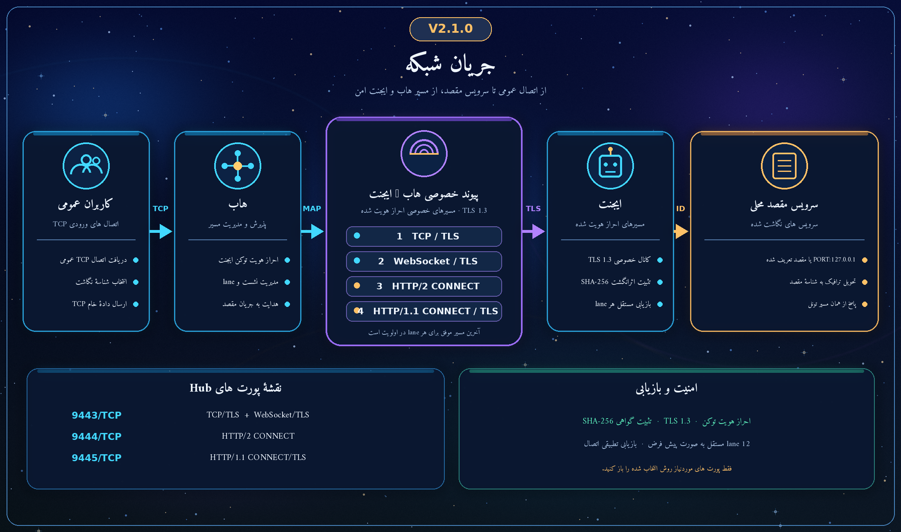

<p align="center">
  
</p>

<h1 align="center">SHAH TUNNEL | شاه تونل</h1>
<p align="center"><strong>V2.2.6 · تونل معکوس TCP · مسیرهای خارجی و بازیابی تطبیقی</strong></p>
<p align="center">شاه‌تونل اتصال‌های عمومی TCP را از طریق Hub و مسیرهای احراز هویت‌شدهٔ Agent به سرویس‌های مقصد نگاشت‌شده هدایت می‌کند. ارتباط خصوصی Hub↔Agent از TLS 1.3، تثبیت اثرانگشت SHA-256 و بازیابی تطبیقی میان چهار انتقال داخلی و مسیرهای خارجیِ ازپیش‌آماده‌شده روی Agent پشتیبانی می‌کند.</p>
<p align="center"><a href="README.md">🇬🇧 English</a> · <a href="README-fa.md">🇮🇷 فارسی</a></p>

## مسیر شبکه | Network Flow

<p align="center">
  
</p>

## قابلیت‌ها

- **چهار روش انتقال پیاده‌سازی‌شده:** TCP/TLS، ‏WebSocket/TLS، ‏HTTP/2 CONNECT و ‏HTTP/1.1 CONNECT/TLS.
- **بازیابی خودکار:** هر Lane مستقل با تأخیر افزایشی دوباره وصل می‌شود؛ گزینهٔ ۷ بین چهار انتقال قدیمی و گزینهٔ ۹ بین انتقال‌های قدیمی و مسیرهای خارجی جابه‌جا می‌شود. جریان TCP فعال از سوکت خراب بدون وقفه مهاجرت نمی‌کند و ممکن است دوباره برقرار شود.
- **امنیت:** TLS 1.3 در ارتباط خصوصی Hub↔Agent، احراز هویت توکن و تثبیت اثرانگشت SHA-256 گواهی.
- **هم‌زمانی:** دوازده lane مستقل به‌صورت پیش‌فرض، صف‌های محدود و انتخاب نشست با توجه به بار.
- **مدیریت:** منوی ترمینال، سرویس systemd، نمایش وضعیت و لاگ، نصب‌کننده و اسکریپت بررسی محلی.

## منوی انتقال

روی هر دو سمت Hub و Agent سیاست انتقال یکسان یا سازگار را انتخاب کنید. گزینه‌های ۱ تا ۷ معنی قدیمی خود را حفظ می‌کنند؛ گزینه‌های ۸ و ۹ مسیرهای خارجی را بدون جایگزین‌کردن انتقال‌های قبلی اضافه می‌کنند.

| گزینه | انتقال / راهبرد | عملکرد |
|---|---|---|
| `1` | TCP/TLS | جریان تونل روی اتصال TLS. |
| `2` | WebSocket/TLS | انتقال جریان در فریم‌های WebSocket داخل TLS. |
| `3` | HTTP/2 CONNECT | جریان CONNECT روی TLS و پورت TCP شمارهٔ کنترل + ۱. |
| `4` | HTTP/1.1 CONNECT/TLS | جریان CONNECT روی TLS و پورت TCP شمارهٔ کنترل + ۲. |
| `5` | HTTP CONNECT fallback | ابتدا HTTP/2 و در صورت شکست راه‌اندازی، HTTP/1.1 را امتحان می‌کند. |
| `6` | Automatic fallback | ابتدا TCP/TLS و سپس WebSocket/TLS. |
| `7` | FULL ADAPTIVE FAILOVER — قدیمی | همان چهار انتقال قدیمی را حفظ می‌کند و بین آن‌ها Failover انجام می‌دهد. |
| `8` | EXTERNAL TUNNEL | یک مسیر خارجی انتخاب‌شده روی Agent را با حامل احراز هویت‌شدهٔ TCP/TLS استفاده می‌کند. |
| `9` | FULL ADAPTIVE FAILOVER — همه | هر چهار انتقال قدیمی را روی مسیرهای خارجی پیکربندی‌شده و مسیر مستقیم امتحان می‌کند؛ ابتدا مسیر خارجی انتخاب‌شده و سپس مسیرهای جایگزین. |

### پورت‌های فایروال Hub

اگر پورت کنترل Hub برابر `9443` باشد:

- `9443/TCP`: ‏TCP/TLS و ‏WebSocket/TLS؛ همچنین برای گزینهٔ ۸ لازم است.
- `9444/TCP`: ‏HTTP/2 CONNECT در گزینه‌های ۳، ۵، ۷ و ۹.
- `9445/TCP`: ‏HTTP/1.1 CONNECT در گزینه‌های ۴، ۵، ۷ و ۹.

گزینهٔ ۸ فقط از حامل احراز هویت‌شدهٔ TCP/TLS استفاده می‌کند و به پورت کنترل نیاز دارد. گزینهٔ ۷ همان چهار انتقال داخلی قدیمی را نگه می‌دارد. گزینهٔ ۹ می‌تواند از هر چهار انتقال داخلی استفاده کند؛ بنابراین پورت کنترل، کنترل+۱ و کنترل+۲ باید در دسترس باشند. فقط پورت‌های لازم برای انتقال انتخاب‌شده را باز کنید.

### مسیرهای خارجی روی Agent

نصب‌کننده بستهٔ رسمی Cloudflare WARP را در سیستم‌های پشتیبانی‌شدهٔ Debian/Ubuntu دارای APT نصب می‌کند، اما هنگام نصب آن را ثبت‌نام یا متصل نمی‌کند. مسیرهای منوی Agent (انتخاب پیش‌فرض شمارهٔ ۲، Cloudflare WARP، است؛ نه Gateway آمادهٔ MASQUE):

- **MASQUE:** اتصال از طریق یک درگاه MASQUE محلی که به‌شکل SOCKS5 در دسترس است (پیش‌فرض `127.0.0.1:40001`). Wizard قبل از ذخیره، پاسخ واقعی SOCKS5 این درگاه را بررسی می‌کند. Shah Tunnel به‌تنهایی کلاینت مستقل MASQUE را اجرا نمی‌کند.
- **Cloudflare WARP:** کلاینت رسمی Cloudflare را در حالت دستگاهی `warp+doh` با پروتکل MASQUE فعال می‌کند. این حالت لازم است تا علاوه بر اتصال Agent↔Hub، خروجی IPv4/IPv6 سرویس مقصد محلی (از جمله خروجی کاربران VPN) نیز از WARP عبور کند. پیش از تغییر حالت، Shah Tunnel مسیر فیزیکی IPv4/IPv6 را ثبت و یک محافظ مسیریابی برای پاسخ‌های SSH نصب می‌کند؛ اتصال‌های مستقیمِ Failover نیز با `SO_MARK` از مسیر فیزیکی عبور می‌کنند.
- **WARP on WARP:** استفاده از یک نقطهٔ SOCKS5 دوم که جداگانه آماده شده است (پیش‌فرض `127.0.0.1:40002`). Shah Tunnel به‌تنهایی کلاینت دوم Cloudflare یا تونل دوم WARP ایجاد نمی‌کند.
- **Tor/Psiphon:** آدرس پراکسی SOCKS5 محلی را وارد کنید. پیش‌فرض Tor برابر `127.0.0.1:9050` و Psiphon برابر `127.0.0.1:1080` است؛ در صورت تفاوت، آدرس واقعی کلاینت را وارد کنید. نام مقصد توسط پراکسی Resolve می‌شود.

گزینهٔ ۷ همان حالت تطبیقی چهار انتقال قدیمی است. پیش از اجرای آن، اگر WARP دستگاهی قبلاً توسط Shah Tunnel فعال شده باشد، به حالت Local Proxy برگردانده می‌شود تا حامل‌های پروتکل‌های قدیمی ناخواسته از WARP عبور نکنند. گزینهٔ ۸ از مسیر خارجی انتخاب‌شده با حامل TCP/TLS استفاده می‌کند. اگر مسیر انتخابی WARP باشد، WARP دستگاهی فعال می‌شود تا خروجی اینترنت سرویس مقصد محلی و در نتیجه IP دیده‌شده توسط کاربران VPN نیز از WARP باشد. گزینهٔ ۹ چهار انتقال قدیمی را با مسیرهای خارجی ترکیب می‌کند؛ مسیر خارجی انتخاب‌شده اولویت دارد، مسیر مستقیم و دیگر مسیرها جایگزین هستند. سوکت‌های مسیر مستقیم/قدیمی در گزینهٔ ۹ به‌صورت جداگانه از مسیر فیزیکی VPS عبور می‌کنند و مسیر WARP از WARP استفاده می‌کند. هر Lane آخرین مسیر و انتقال موفق را به خاطر می‌سپارد. هنگام خرابی مسیر، اتصال بیرونی دوباره برقرار می‌شود؛ جریان TCP فعال بدون وقفه به سوکت دیگر منتقل نمی‌شود و ممکن است قطع و دوباره وصل شود. Hub و Agent باید با گزینهٔ متناظر تنظیم شوند.

**دامنهٔ اثر WARP:** در گزینهٔ ۸ با مسیر WARP یا گزینهٔ ۹ که مسیر WARP در فهرست آن وجود دارد، WARP دستگاهی روی Agent فعال است؛ بنابراین تمام ترافیکِ بدون علامتِ مسیریابی در آن VPS، از جمله خروجی سرویس مقصد، از WARP عبور می‌کند. پاسخ‌های SSH و سوکت‌های مستقیم Failover از مسیر فیزیکی VPS مستثنا می‌شوند. سرویس‌های دیگر VPS نیز ممکن است از WARP عبور کنند. به همین دلیل اجرای هم‌زمان Agent قدیمی/مستقیم و Agent مبتنی بر WARP روی یک VPS، درحالی‌که باید خروجی کاربرانشان متفاوت بماند، امن نیست. نسخهٔ ۲٫۲٫۶ این ناسازگاری را پیش از گرفتن توکن و دوباره پیش از ذخیره تشخیص می‌دهد؛ پروفایل جدید ذخیره نمی‌شود و تونل فعال قبلی متوقف یا تغییر داده نمی‌شود. برای داشتن هر دو خروجی جداگانه، از VPS مجزا یا دو نمونهٔ Xray با جداسازی شبکه‌ای مستقل استفاده کنید. محافظ را برای اجبار اجرای هم‌زمان حذف نکنید.

اگر پروفایل Agent قبلاً با MASQUE و پورت خالی `127.0.0.1:40001` ذخیره شده، پس از ارتقای باینری روی سرور خارج این فرمان را اجرا کنید:

```bash
ravanreverse repair-external
```

پروفایل `s` را انتخاب کنید و مسیر شمارهٔ ۲ (Cloudflare WARP) را تأیید کنید. این فرمان فقط مسیر خارجی انتخاب‌شده را جایگزین می‌کند، قبل از تغییر نسخهٔ پشتیبان خصوصی می‌سازد، توکن/اثر انگشت/Hub/Mappingها/تعداد Laneها را حفظ می‌کند و در صورت فعال بودن سرویس آن را راه‌اندازی مجدد می‌کند.

## مدیریت چند تانل و کارایی آپلود

- هر بار گزینهٔ «ساخت تانل» یک نام مستقل می‌گیرد و تنظیمات آن در فایل جداگانه ذخیره می‌شود؛ ساخت تانل جدید، تانل‌های قبلی را بازنویسی یا حذف نمی‌کند.
- هر پروفایل یک سرویس systemd مستقل دارد. گزینه‌های شروع، توقف، راه‌اندازی مجدد و وضعیت، ابتدا نام تانل را می‌پرسند.
- در منوی مدیریت تانل، گزینهٔ حذف یک پروفایل فقط همان تانل انتخاب‌شده را حذف می‌کند و حذف کامل برنامه همهٔ تانل‌ها را پاک می‌کند.
- پنجرهٔ ارسال هر جریان به ۶۴ فریم تا سقف ۶۴ کیلوبایت افزایش یافته است (حداکثر حدود ۴ مگابایت دادهٔ درحال‌پرواز برای هر جریان)، درحالی‌که صف خروجی هر اتصال محدودتر شده تا تأخیر صف و معطلی جریان‌های دیگر کمتر شود. روی کرنل‌های لینوکسِ دارای BBR، برنامه تلاش می‌کند الگوریتم BBR را فقط روی سوکت TCP تونل فعال کند؛ اگر کرنل پشتیبانی نکند، الگوریتم پیش‌فرض دست‌نخورده می‌ماند. این تغییرها می‌توانند محدودیت پنجره در مسیرهای با RTT بالا و تأخیر زیر بار را کاهش دهند؛ اما سرعت واقعی به پهنای‌باند، پکت‌لاس، ازدحام، qdisc کرنل و محدودیت اپراتور وابسته است. اشباع کامل لینک بالادست بدون تعیین سقف نرخ متناسب با ظرفیت واقعی شبکه، با تغییر نرم‌افزار به‌تنهایی قابل تضمین نیست.

## استفادهٔ مسئولانه و حریم خصوصی

ShahTunnel یک رلهٔ عمومی TCP است. آن را فقط برای سرورها و سرویس‌هایی پیکربندی کنید که مالک آن‌ها هستید یا مجوز صریح مدیریتشان را دارید. از آن برای دسترسی بدون مجوز به سامانه‌های اشخاص ثالث، انتقال ترافیک آزاردهنده یا مختل‌کردن سرویس‌ها استفاده نکنید. مسئولیت مقصدها و ترافیکی که عبور می‌دهید با مدیر سامانه است.

بخش نمایش اطلاعات سرور ممکن است برای تشخیص IPv4 عمومی و کشور سرور، درخواست HTTPS به سرویس‌های عمومی تشخیص IP و GeoIP از جمله ipify، icanhazip، checkip.amazonaws.com، ipinfo.io، ip.sb، ipapi.co و ipwho.is بفرستد. این سرویس‌ها می‌توانند IP عمومی سرور و فرادادهٔ درخواست را ببینند؛ درخواست‌های GeoIP شامل توکن تونل یا محتوای ترافیک تونل نیستند.

## نصب

ZIP را استخراج کنید و از داخل پوشهٔ آن، نصب‌کننده را با دسترسی root اجرا کنید:

```bash
sudo bash S1T-START.sh
```

پس از انتشار این نسخه در شاخهٔ `main` مخزن، نصب یک‌دستوره به این شکل است:

```bash
bash <(curl -fsSL https://raw.githubusercontent.com/ShahNetLab/ShahTunnel/main/S1T-START.sh)
```

در Debian/Ubuntu پشتیبانی‌شده با APT، نصب‌کننده بستهٔ رسمی Cloudflare WARP را نصب می‌کند؛ اما هنگام نصب آن را ثبت‌نام یا متصل نمی‌کند. فقط وقتی مسیر Cloudflare WARP در Agent انتخاب و تونل شروع شود، Shah Tunnel ابتدا محافظ SSH و مسیر فیزیکی را نصب و سپس WARP دستگاهیِ MASQUE را فعال می‌کند. هنگام اجرای گزینه‌های ۱ تا ۷، WARP به حالت Local Proxy برگردانده می‌شود تا انتقال‌های قدیمی از WARP عبور نکنند.

### نصب WARP در شبکه‌های محدود

نصب‌کننده برای دریافت کلید رسمی Cloudflare از timeout محدود استفاده می‌کند. اگر `pkg.cloudflareclient.com` از شبکه VPS در دسترس نباشد، نصب WARP با پیام مشخص رد می‌شود و نصب هسته Shah Tunnel ادامه می‌یابد؛ هیچ routeای هنگام نصب اولیه تغییر نمی‌کند. در این حالت مسیر WARP تا نصب موفق کلاینت رسمی قابل استفاده نیست. هنگام فعال‌سازی WARP برای تونل، اگر `nftables`، مسیر فیزیکی یا محافظ SSH قابل آماده‌سازی نباشد، Shah Tunnel از فعال‌کردن WARP دستگاهی خودداری می‌کند. اگر جدول مسیریابی عددی در نخستین اجرا هنوز ساخته نشده باشد، آن را به‌درستی جدول خالی در نظر می‌گیرد و هنگام افزودن مسیر فیزیکی ایجاد می‌کند؛ اما اگر route یا rule موجودی به شناسهٔ رزروشدهٔ جدول اشاره کند، از دست‌زدن به آن خودداری می‌کند.
