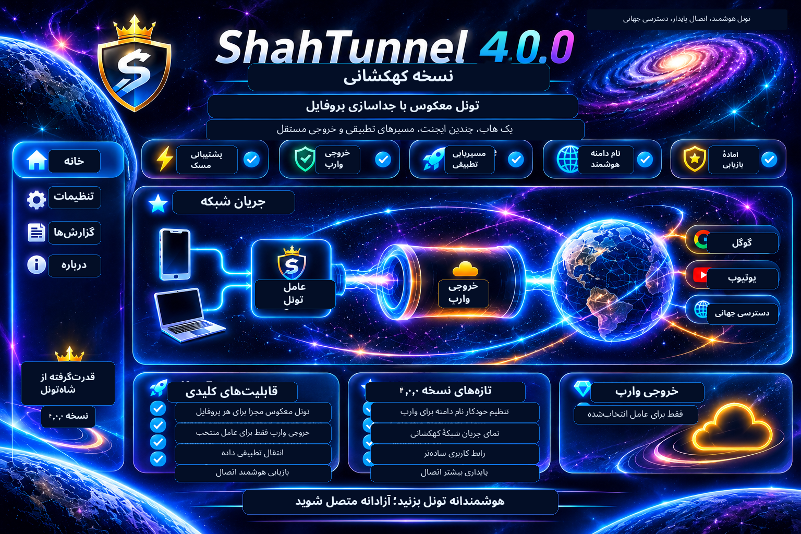

## تغییرات ایمنی و زمان‌بندی نسخهٔ 4.0.6

- منطقهٔ پیش‌فرض Psiphon آلمان است و فقط فهرست کشورهای غیرآمریکاییِ مجاز پذیرفته می‌شود: AE، TR، DE، RS، RO، BG، GR، GE، AM، AZ، NL، CH، AT، PL، CZ، SK، HU، FR، SE و FI. آمریکا و تنظیم منطقهٔ خالی/نامحدود رد می‌شوند.

### بهینه‌سازی Psiphon برای کاربران هم‌زمان

در نسخهٔ 4.0.6 مقدار `TunnelPoolSize` سایفون براساس RAM و تعداد CPU تنظیم می‌شود تا جریان‌های Port Forward در Xray به‌جای یک تونل، از چند تونل واقعی Psiphon استفاده کنند. روی VPS دارای حداقل ۴ گیگابایت RAM و ۲ هسته CPU، مقدار هدف ۸ تونل است. این عدد با ۱۲ Lane خود ShahTunnel متفاوت است؛ سرعت نهایی همچنان به ظرفیت VPS و شبکهٔ Psiphon بستگی دارد.

- پیش از فعال‌سازی خروجی Xray، IP عمومی واقعی خروجی از داخل SOCKS سایفون گرفته می‌شود. ابتدا سرویس‌های مکان‌یابی از مسیر خود Psiphon امتحان می‌شوند؛ اگر آن‌ها در خروجی سایفون مسدود یا محدود باشند، چند ارائه‌دهندهٔ مستقل از مسیر عادی Agent همان IP خروجی IPv4 یا IPv6 را مستقیماً استعلام می‌کنند. پاسخ‌ها با IP درخواست‌شده تطبیق داده می‌شوند. آمریکا، کشور متناقض، ناشناخته یا تأییدنشده همچنان مسدود می‌ماند.
- زمان‌بندی Cron اکنون برای یک پروفایل انتخاب‌شده مستقل است. فایل تنظیمات، وضعیت، قفل، اسکریپت و ورودی Cron هر پروفایل جداست؛ تنظیم یا حذف زمان‌بندی یک پروفایل روی پروفایل دیگر اثر نمی‌گذارد.
- Hotfix راه‌اندازی Psiphon: سرویس Agent و تونل واقعی Psiphon پیش از ساخت Sidecar Xray آماده می‌شوند؛ خطای `connection refused` ناشی از اجرای زودهنگام تنظیم Xray برطرف شده است. اجرای دوبارهٔ گزینهٔ ۲ برای پروفایل ذخیره‌شدهٔ ناقص، مرحلهٔ خروجی Xray را خودکار کامل می‌کند.
- محدودیت مهم: `EgressRegion` در Psiphon ترجیح منطقه است و تضمین نمی‌کند در آن کشور سرور موجود باشد. این نسخه مرز ایمنیِ عدم‌استفاده از آمریکا را اعمال می‌کند، اما هنوز کشورها را به‌صورت موازی آزمایش نمی‌کند و خودکار سریع‌ترین کشور را بر اساس بیشترین سرعت دانلود انتخاب نمی‌کند. تا وقتی جایگزین با اندازه‌گیری واقعی تأیید نشده، مسیر سالم آلمان را حفظ کنید.


<div align="center">


# شاه‌تونل ۴٫۰٫۶

[](https://github.com/ShahNetLab/ShahTunnel)

[](S1T-START.sh)

<p align="center">
<a href="https://t.me/MediaZet"></a>
&nbsp;
<a href="https://t.me/cloudflare0_bot"></a>
</p>

<div dir="rtl" align="center">برای حمایت از ShahTunnel و دریافت خبرها عضو کانال شوید؛ ربات برای عملیات Cloudflare است.</div>

[English](README.md) · **فارسی**

[⚡ قابلیت‌ها](#capabilities) · [🚀 نصب](#install)

</div>

---

<a id="network-flow"></a>
## Network Flow | جریان شبکه

<div dir="rtl">

مسیر انتقال Hub به Agent و خروجی اینترنت اختیاری هر پروفایل مستقل از یکدیگرند: تونل، Mappingهای TCP را به مقصد محلی Agent می‌رساند؛ مسیر اختیاری Xray فقط Inbound انتخاب‌شده را از خروجی SOCKS5 همان پروفایل (WARP، Psiphon یا Tor) عبور می‌دهد.

</div>

```text
کاربر → پورت عمومی Hub → Laneهای احرازشده Agent → مقصد محلی Agent
Inbound انتخاب‌شده Xray → Sidecar محدود به Loopback → SOCKS5 خروجی WARP / Psiphon / Tor → اینترنت
```

<p align="center"></p>

<a id="capabilities"></a>

## قابلیت‌ها

| | قابلیت | کارکرد |
|:--:|---|---|
|  | **رله معکوس Hub و Agent** | Hub پورت عمومی TCP را می‌پذیرد؛ Agent اتصال خروجی می‌سازد و هر Mapping را به مقصد محلی می‌رساند. |
|  | **پروفایل‌های مستقل** | هر تونل فایل تنظیمات و سرویس systemd جدا دارد؛ عملیات مدیریت روی پروفایل انتخاب‌شده انجام می‌شود. |
|  | **Laneهای انتقال تطبیقی** | چهار انتقال پیاده‌سازی‌شده به‌صورت جدا یا در حالت‌های Failover قابل استفاده‌اند. |
|  | **بازیابی مستقل Lane** | هر Lane جداگانه دوباره متصل می‌شود؛ خرابی یک Lane الزاماً Laneهای سالم را قطع نمی‌کند. پروفایل Agent جدید به‌صورت پیش‌فرض ۱۲ Lane مستقل دارد (حداکثر ۱۶). |
|  | **چند Mapping پورت** | شناسه هر Mapping، Listener عمومی Hub را به مقصد محلی Agent متصل می‌کند و باید در دو سمت یکسان باشد. |
|  | **خروجی مستقل Agent** | خروجی Laneهای Agent می‌تواند Direct، ‏WARP/MASQUE، Psiphon/SOCKS5 یا Tor/Snowflake/WebTunnel باشد. |
|  | **WARP اختصاصی Xray** | Inbound انتخاب‌شده به Sidecar محدود به Loopback کپی و از SOCKS5 محلی WARP عبور داده می‌شود. |
|  | **خروجی کاربر از Psiphon و Tor** | Inboundهای همان Agent در Sidecar مستقل Xray کپی می‌شوند؛ TCP و DNS از SOCKS5 انتخاب‌شده می‌روند و UDP برای جلوگیری از نشت مستقیم مسدود می‌شود. |


### خروجی خودکار کاربران از Psiphon

برای Agent جدیدی که هنگام ساخت، خروجی Psiphon را انتخاب می‌کند، Inboundهای Xray متناظر با Mappingها به‌صورت خودکار و پیش از شروع Agent در Sidecar مجزا و فقط روی `127.0.0.1` کپی می‌شوند. ترافیک TCP و DNS از SOCKS5 همان پروفایل عبور می‌کند. چون SOCKS5 محلی Psiphon یک پراکسی port-forward برای جریان TCP است و UDP را حمل نمی‌کند، UDP و هر نوع شبکهٔ ناشناخته در Sidecar به Blackhole می‌روند؛ بنابراین از خروج مستقیم UDP جلوگیری می‌شود، اما برنامه‌های UDP/QUIC و ICMP ping از این مسیر پشتیبانی نمی‌شوند. گزینهٔ جداگانه‌ای به منوی مدیریت اضافه نمی‌شود. پروفایل‌های قبلی دست‌نخورده باقی می‌مانند و این راه‌اندازی خودکار مخصوص Agentهای جدید است. این عملیات X-UI، کانفیگ اصلی Xray، سایر Inboundها، SSH و Routeهای میزبان را تغییر نمی‌دهد.

### خروجی خودکار کاربران Xray از Tor

برای Agent جدیدی که خروجی Tor را انتخاب می‌کند، شاه‌تونل Inboundهای Xray متناظر با Mappingها را در یک Sidecar مستقل کپی می‌کند. TCP و DNS کاربران از SOCKS5 اختصاصی Tor عبور می‌کنند؛ UDP و شبکه‌های ناشناخته به Blackhole می‌روند تا در صورت نبود پشتیبانی SOCKS5، اتصال ناخواسته از IP مستقیم سرور خارج نشود. این مسیر UDP/QUIC و ICMP ping را پشتیبانی نمی‌کند. Sidecar فقط روی `127.0.0.1` گوش می‌دهد و با توقف سرویس Agent متوقف می‌شود. فایل اصلی X-UI/Xray و Inboundهای دیگر تغییر نمی‌کنند. راه‌اندازی خودکار به Agentهای جدید Tor محدود است؛ پروفایل‌های قدیمی خودکار تغییر داده نمی‌شوند.

**بهینه‌سازی Psiphon در نسخه ۴٫۰٫۰:** اندازه‌گیری PING/PONG بین Hub و Agent هر ۵ ثانیه تازه می‌شود؛ میانگین‌گیری سریع‌تر (EWMA یک‌چهارم) است و فقط نمونه‌های تازه‌تر از ۱۵ ثانیه در انتخاب Lane نقش دارند. بار Streamهای فعال هم در امتیاز باقی می‌ماند و Cache DNS در Sidecar اختصاصی Xray فعال است. تنظیمات انتقال Psiphon متناسب با منابع میزبان است: زیر ۳ GiB RAM محدودیت محافظه‌کارانهٔ Meek/Relay و مقدار پیش‌فرض پنجرهٔ کانال SSH یعنی ۴ واحد (۱۲۸ KiB) حفظ می‌شود؛ از ۳ GiB به بالا محدودیت Meek/Relay برداشته و پنجرهٔ کانال SSH روی ۱۶ واحد (۵۱۲ KiB) تنظیم می‌شود تا توان TCP در مسیرهای دارای RTT زیاد بهتر شود. محدودیت Threadهای CPU فقط روی میزبان‌های حداقل دو هسته‌ای برداشته می‌شود و اندازهٔ پیش‌فرض Tunnel Pool سایفون حفظ می‌شود. این تغییرها برای انتخاب Lane بهتر و افزایش توان TCP هستند؛ زمان اتصال انتهابه‌انتهای برنامهٔ کاربر یا تأخیر فیزیکی مسیر Psiphon را تضمینی کاهش نمی‌دهند. SOCKS5 سایفون فقط TCP/DNS را حمل می‌کند؛ UDP/QUIC و ICMP ping پشتیبانی نمی‌شوند و به‌جای خروج مستقیم مسدود می‌شوند.
## انتقال‌های Hub↔Agent

در زمان ساخت تونل یک حالت را انتخاب کنید. تنظیمات Hub و Agent باید با هم سازگار باشند.

| گزینه ویزارد | حالت | عملکرد |
|:--:|---|---|
| `1` | TCP/TLS | جریان TLS بین Hub و Agent. |
| `2` | WebSocket/TLS | انتقال جریان تونل در فریم‌های باینری WebSocket روی TLS. |
| `3` | HTTP/2 CONNECT | انتقال CONNECT روی TLS و پورت کنترل + ۱. |
| `4` | HTTP/1.1 CONNECT/TLS | انتقال CONNECT روی TLS و پورت کنترل + ۲. |
| `5` | HTTP CONNECT fallback | ابتدا HTTP/2 و در صورت نیاز HTTP/1.1. |
| `6` | Automatic fallback | ابتدا TCP/TLS و سپس WebSocket/TLS. |
| `7` | Full Adaptive Failover | هر چهار انتقال؛ هر Lane آخرین انتقال موفق خود را ترجیح می‌دهد. |
| `8` | External egress | در Agent انتخاب Cloudflare MASQUE، Psiphon/SOCKS5 یا Tor/Snowflake/WebTunnel. |
| `9` | Auto-Quality Adaptive | کانال‌های Agent بین هر چهار روش انتقال و خروجی‌های در دسترس (MASQUE، سایفون پیکربندی‌شده و Direct) پخش می‌شوند؛ RTT و بار واقعی، مسیر بهتر را برای اتصال‌های جدید انتخاب می‌کند. |

در گزینهٔ `9`، ۱۲ Lane پیش‌فرض از ابتدا روی ترکیب‌های متفاوتِ چهار انتقال (TCP/TLS، WebSocket/TLS، HTTP/2 CONNECT و HTTP/1.1 CONNECT) و خروجی‌های واقعاً در دسترس (WARP/MASQUE فعال، Psiphon پیکربندی‌شده و Direct برای مسیر Agent→Hub) پخش می‌شوند. هر Lane هر ۵ ثانیه PING/PONG احراز‌شده می‌فرستد؛ Hub فقط نمونه‌های RTT تازه‌تر از ۱۵ ثانیه را همراه با تعداد Streamهای فعال امتیازدهی می‌کند و اتصال TCP جدید را به بهترین Lane سالم می‌فرستد. اگر یک مسیر قطع یا احراز/اتصال آن ناموفق شود، همان Lane ترکیب بعدی را امتحان می‌کند و پس از اتصال مجدد آخرین ترکیب موفق را در اولویت می‌گذارد. مسیر Direct در این ماتریس فقط fallback ارتباط Agent با Hub است؛ خروجی اینترنت کاربران Xray در Sidecar مستقل Psiphon باقی می‌ماند و در صورت در دسترس نبودن SOCKS5 به‌جای نشت مستقیم، fail-closed می‌شود. نشست TCP موجود وسط انتقال به Lane دیگری منتقل نمی‌شود و تا پایان روی Lane اولیه می‌ماند.

### روش‌های خروجی Agent

| روش | پیش‌نیاز / مسیر |
|---|---|
| `Direct` | اتصال Agent به Hub از مسیر عادی سرور. |
| `WARP / MASQUE` | WARP باید با MASQUE متصل باشد و Listener محلی WarpProxy / Local Proxy داشته باشد؛ حالت System Tunnel برای جداسازی خروجی یک پروفایل پذیرفته نمی‌شود. |
| `Psiphon / SOCKS5` | ShahTunnel در اولین استفاده ConsoleClient رسمی را می‌سازد و SOCKS5 اختصاصی را آماده می‌کند. |
| `Tor / Snowflake` | بستهٔ رسمی Tor و Lyrebird با SHA-256 ثابت‌شده نصب می‌شود؛ یک SOCKS5 فقط روی Loopback برای Laneهای TCP Agent→Hub و Sidecar خروجی Xray همان پروفایل اجرا می‌شود. |
| `Tor / WebTunnel` | همان مسیر Tor با Bridge اختصاصی که از Tor Bridges دریافت کرده‌اید؛ واردکردن Bridge لازم است. |
| `Adaptive` | از MASQUE فعال، Psiphon پیکربندی‌شده و مسیر جایگزین Direct استفاده می‌کند؛ پروتکل‌های پشتیبانی‌نشدهٔ WARP انتخاب نمی‌شوند. |

### خروجی انتقال Tor: Snowflake و WebTunnel

در بخش `EXTERNAL EGRESS` و روی Agent می‌توان Tor را انتخاب کرد. در زمان ساخت پروفایل، ShahTunnel بستهٔ رسمی Tor Expert Bundle نسخهٔ 16.0 را برای amd64 یا arm64 دریافت می‌کند و SHA-256 آن را با مقدار منتشرشده در فهرست امضاشدهٔ Tor Project تطبیق می‌دهد؛ سپس Tor و Lyrebird را برای Snowflake و WebTunnel آماده می‌کند. نصب فقط هنگام انتخاب Tor انجام می‌شود و برای ساخت پروفایل به اینترنت در دسترس نیاز دارد؛ بهتر است این پروفایل پیش از خاموشی یا محدودیت شدید آماده شود.

- `Snowflake`: از Bridge پیش‌فرض مستندشدهٔ Tor استفاده می‌کند.
- `WebTunnel`: باید یک خط Bridge معتبر از Tor Bridges دریافت و در ویزارد وارد شود.
- پراکسی SOCKS5 هر پروفایل فقط روی `127.0.0.1` و با DataDirectory اختصاصی اجرا می‌شود؛ Tor به‌صورت فرایند جانبی همان Agent مدیریت و در صورت خروج دوباره راه‌اندازی می‌شود.
- اتصال‌های TCP مربوط به Laneهای Agent→Hub و همچنین TCP/DNS کاربران Inboundهای Xray همان Agent از SOCKS5 محلی Tor عبور می‌کنند. برای مسیر کاربران، UDP و شبکه‌های ناشناخته در Sidecar به Blackhole فرستاده می‌شوند؛ UDP/QUIC و ICMP پشتیبانی نمی‌شوند و از مسیر مستقیم خارج نخواهند شد. Sidecar هر پروفایل جداگانه است، فقط روی Loopback گوش می‌دهد و با توقف Agent متوقف می‌شود. فایل اصلی X-UI/Xray، Inboundهای دیگر، TUN، مسیر پیش‌فرض، SSH و فایروال دست‌کاری نمی‌شوند.
- Tor مسیر شبکهٔ قطع‌شده را از هیچ ایجاد نمی‌کند. اگر از Agent تا Hub هیچ مسیر IP/DNS قابل استفاده‌ای باقی نمانده باشد، این روش نیز وصل نمی‌شود.

**DNSTT و Slipstream در این انتشار اضافه نشده‌اند.** این دو تونل DNS به دامنهٔ Delegated، کلید و سرور مکمل در سمت بیرونی نیاز دارند و با اضافه‌کردن یک SOCKS محلی در نقش Agent فعلی کار نمی‌کنند. برای ادغام واقعی باید جریان اتصال و نقش سمت داخل/خارج در معماری Hub/Agent توسعه یابد؛ اضافه‌کردن گزینهٔ منو بدون سرور هماهنگ، فقط یک انتخاب غیرعملی می‌ساخت. Psiphon از قبل در نسخه‌های قبلی وجود داشته و در این نسخه هم حفظ شده است.

### اتصال Psiphon از پورت عمومی ۴۴۳

اگر Psiphon به پورت کنترل Hub (برای نمونه `9448`) دسترسی نداشته باشد، Agent مسیر Psiphon را از نشانی Mapping عمومی Hub روی `443` عبور می‌دهد؛ مسیر Direct همچنان از پورت کنترل تنظیم‌شده استفاده می‌کند. مقدار پیش‌فرض Step 06 اکنون از پورت کنترل مستقل است و روی TCP/443 قرار می‌گیرد. Hub اتصال ShahTunnel را با ALPN اختصاصی `shah-tunnel-control/1` از ترافیک عادی TLS تشخیص می‌دهد و بایت‌های ClientHello کاربران عادی را بدون تغییر به Agent می‌فرستد. بنابراین نیازی به اشغال مجدد پورت ۴۴۳، تغییر X-UI، یا جابه‌جایی Mapping نیست.

برای استفاده از قابلیت‌های نسخهٔ جدید، هر دو سمت Hub و Agent باید نسخهٔ **4.0.6** را اجرا کنند. Mapping عمومی باید روی Hub فعال و از مسیر Psiphon قابل دسترسی باشد. در ویزارد Agent می‌توان نشانی جایگزین را تغییر داد؛ برای پروفایل‌های قدیمی که HubAddr آن‌ها روی `9443` است، مقدار `PsiphonHubAddr` هنگام بارگذاری به‌طور خودکار به همان IP روی `443` تبدیل می‌شود.

### راه‌اندازی خودکار Psiphon

با انتخاب `Psiphon / SOCKS5` یا مسیر خروجی تطبیقی در Agent، شاه‌تونل به‌صورت خودکار:

- ConsoleClient رسمی Psiphon را از نسخهٔ منبع ثابت‌شده، برای معماری `amd64` یا `arm64` می‌سازد.
- معماری و اجرای فایل باینری را پیش از نصب بررسی می‌کند.
- فایل JSON خصوصی هر Agent را با شناسه‌های عمومی کلاینت، آینه‌های فهرست سرور، کلید امضای فهرست، کلید امضای Server Entry و کلید Exchange می‌سازد.
- یک پورت SOCKS5 یکتا روی `127.0.0.1` و پوشهٔ دادهٔ مستقل اختصاص می‌دهد.
- دسترسی نوشتن systemd را فقط به پوشهٔ دادهٔ همان Agent محدود می‌کند.
- ConsoleClient را در حالت پراکسی محلی اجرا می‌کند. آماده‌شدن SOCKS5 محلی از اتصال واقعی Psiphon و از اتصال Lane به Hub جدا گزارش می‌شود. اگر SOCKS5 آماده شود اما مسیر هنوز کامل نشده باشد، سرویس فعال می‌ماند و وضعیت `PENDING` نشان داده می‌شود؛ اتصال موفق ادعا نمی‌شود. گزینهٔ `ListenInterface` ارسال نمی‌شود تا Psiphon از bind پیش‌فرض `127.0.0.1` استفاده کند و برای شناسایی اینترفیس به Netlink نیاز نداشته باشد. گزارش‌های تشخیصی فقط در Journal محلی ذخیره می‌شوند و می‌توانند اطلاعات حساس نشست/شبکه داشته باشند.

برای تعمیر پروفایلی که با تنظیمات قبلی Psiphon وصل نشده، از پوشهٔ پروژه اجرا کنید: `sudo bash repair-psiphon-profile.sh PROFILE`. این ابزار از JSON همان پروفایل نسخهٔ پشتیبان می‌گیرد و فقط سرویس `ravanreverse@PROFILE` را راه‌اندازی مجدد می‌کند. اگر SOCKS5 محلی آماده شود اما Psiphon یا Lane ارتباط با Hub هنوز متصل نشده باشد، وضعیت `PENDING` می‌دهد و سرویس را برای تلاش مجدد روشن می‌گذارد؛ فقط در صورت آماده‌نشدن SOCKS5، همان پروفایل را متوقف می‌کند.

نیازی به تهیهٔ دستی باینری یا JSON نیست. راه‌اندازی اولیه برای دریافت سورس رسمی و ابزار Go به دسترسی اینترنت نیاز دارد. هیچ TUN، مسیر پیش‌فرض سرور، SSH یا سرویس X-UI تغییر نمی‌کند. خروجی Psiphon در این پیاده‌سازی برای Laneهای TCP ارتباط Agent با Hub است و به معنی خروجی اینترنت کاربران Xray نیست.

> گزینه `9` فقط در ویزارد ساخت تونل وجود دارد و معنی آن **Auto-Quality Adaptive** است. در منوی اصلی مدیریت دیگر عملیات جداگانهٔ WARP وجود ندارد؛ خروجی WARP هنگام ساخت Agent و انتخاب آن در بخش External Egress به‌صورت خودکار اعمال می‌شود.

## اعمال خودکار خروجی WARP هنگام ساخت Agent

- هنگام ساخت Agent، گزینهٔ Cloudflare WARP over MASQUE را انتخاب کنید.
- ShahTunnel پیش از ذخیره و شروع سرویس بررسی می‌کند که WARP با پروتکل MASQUE متصل است و Listener محلی **WarpProxy / Local Proxy** در دسترس است.
- سپس Sidecar مستقل Xray و مسیر DNS مبتنی بر WARP را فقط برای Mappingهای همان پروفایل آماده می‌کند.
- سایر پروفایل‌ها، Inboundهای دیگر، تنظیمات X-UI، SSH و مسیرهای میزبان تغییر نمی‌کنند.
- برای Agentهای موجود، این رفتار در زمان ساخت اعمال می‌شود؛ برای افزودن آن به یک Agent قدیمی، پروفایل Agent را دوباره با خروجی WARP بسازید. عملیات جداگانه‌ای در منوی مدیریت وجود ندارد.

**نکته مهم:** قابلیت خروجی اختصاصی هر پروفایل به **WarpProxy / Local Proxy در حالت MASQUE** نیاز دارد. حالت **System Tunnel** به‌دلیل اعمال مسیر در سطح کل سرور برای جداسازی یک پروفایل پذیرفته نمی‌شود. اگر Local Proxy فعال یا قابل دسترسی نباشد، ویزارد با پیام خطا متوقف می‌شود؛ ShahTunnel مسیر را بی‌صدا به Direct تغییر نمی‌دهد و Route میزبان را هم دست‌کاری نمی‌کند.

## مدیریت روزمره

`sudo shah-tunnel menu` منوی مدیریت را باز می‌کند. عملیات روی پروفایل انتخاب‌شده انجام می‌شود:

| گزینه منو | عملکرد |
|:--:|---|
| `1` | ساخت پروفایل جدید Hub، Agent یا Relay. |
| `2` | شروع تونل انتخاب‌شده. |
| `3` | توقف تونل انتخاب‌شده. |
| `4` | راه‌اندازی مجدد تونل انتخاب‌شده. |
| `5` | نمایش وضعیت و لاگ‌های اخیر. |
| `6` | تنظیم Restart زمان‌بندی‌شده تونل‌های فعال. |
| `7` | حذف فقط یک پروفایل انتخاب‌شده. |
| `8` | حذف کامل ShahTunnel. |

<div dir="rtl">

دستورهای کاربردی:

</div>

```bash
sudo shah-tunnel version
sudo shah-tunnel menu
sudo systemctl status 'ravanreverse@PROFILE.service' --no-pager -l
sudo journalctl -u 'ravanreverse@PROFILE.service' -n 80 --no-pager
```

<div dir="rtl">

به‌جای `PROFILE` نام Instance سرویس همان پروفایل را قرار دهید. برای بررسی ساده‌تر، گزینه **Status & Logs** در منوی مدیریت، وضعیت و ۴۰ لاگ اخیر را نشان می‌دهد.

## امنیت

- توکن Hub و اثر انگشت گواهی را محرمانه نگه دارید. Agent باید دقیقاً از مقادیر تولیدشده در Hub استفاده کند.
- در فایروال Hub فقط پورت کنترل/CONNECT انتخاب‌شده و پورت‌های عمومی Mapping موردنیاز را باز کنید.
- توکن، کلید خصوصی، فایل کامل تنظیمات یا لاگ بدون حذف اطلاعات حساس را در Issue یا تصویر عمومی منتشر نکنید.
- Sidecar اختصاصی WARP برای Inbound کپی‌شده روی Loopback گوش می‌دهد و جایگزین سرویس اصلی Xray تحت مدیریت X-UI نمی‌شود.
- ShahTunnel را فقط روی سرورها و سرویس‌هایی استفاده کنید که مالک آن هستید یا مجوز مدیریتشان را دارید. [سیاست امنیتی](SECURITY.md).

<a id="install"></a>
## نصب

ShahTunnel از معماری **Hub / Agent** استفاده می‌کند. برنامه را روی سرور Hub و هر Agent نصب کنید. در صورت نیاز، یک سرور سوم نیز می‌تواند نقش Relay داشته باشد.

**پیش‌نیازها:** لینوکس `amd64` یا `arm64`، سرویس `systemd` و دسترسی root. نصب‌کننده ابزار Go نسخهٔ 1.26.1 را دریافت و با SHA-256 بررسی می‌کند، سپس باینری لینوکس را روی همان سرور می‌سازد.

**۱. نصب روی هر سرور**

```bash
bash <(curl -fsSL https://raw.githubusercontent.com/ShahNetLab/ShahTunnel/main/S1T-START.sh)
```

<div dir="rtl">

پس از نصب، منوی مدیریت باز می‌شود. برای ورود دوباره:

</div>

```bash
sudo shah-tunnel menu
```

<div dir="rtl">

**۲. ساخت Hub**

1. گزینه ساخت تونل جدید را انتخاب کنید و نقش **HUB** را بزنید.
2. پورت کنترل را تعیین کنید (پیش‌فرض `0.0.0.0:9443`) و انتقال مورد قبول Hub را انتخاب کنید.
3. نگاشت پورت‌های عمومی را بسازید. برای هر نگاشت یک شناسه مانند `main` یا `web` تعیین کنید.
4. **توکن Agent** و **اثر انگشت SHA-256 گواهی** را ذخیره کنید؛ Agent باید دقیقاً از همین دو مقدار استفاده کند.

**۳. ساخت Agent**

1. روی سرور مقصد، تونل جدید بسازید و نقش **AGENT** را انتخاب کنید.
2. آدرس Hub و پورت کنترل را وارد کنید و انتقال سازگار با Hub را برگزینید.
3. توکن و اثر انگشت گواهی Hub را وارد کنید.
4. همان شناسه‌های Mapping را بسازید و مقصد محلی هرکدام را وارد کنید؛ برای نمونه `127.0.0.1:443`.
5. پروفایل را ذخیره کنید. ShahTunnel سرویس مستقل آن را فعال می‌کند و Laneهای قطع‌شده را به‌صورت خودکار دوباره متصل می‌کند.

**۴. فایروال:** فقط پورت‌های لازم را باز کنید. Hub به پورت کنترل انتخاب‌شده، پورت CONNECT در صورت نیاز (`کنترل + ۱` برای HTTP/2 یا `کنترل + ۲` برای HTTP/1.1) و پورت‌های عمومی Mapping نیاز دارد. Agent اتصال خروجی را به Hub برقرار می‌کند و مقصدهای محلی در سمت Agent هستند.

</div>

## عیب‌یابی

</div>

| مشکل | اولین بررسی |
|---|---|
| Agent متصل نمی‌شود | آدرس Hub، توکن، اثر انگشت گواهی، سازگاری حالت انتقال و پورت‌های فایروال را بررسی کنید. |
| HTTP/2 یا HTTP/1.1 CONNECT کار نمی‌کند | پورت TCP اضافه Hub را بررسی کنید (`کنترل + ۱` یا `کنترل + ۲`). |
| Mapping ترافیک را عبور نمی‌دهد | شناسه Mapping در Hub و Agent و دسترسی به مقصد محلی Agent را بررسی کنید. |
| خروجی WARP فعال نمی‌شود | قبل از ساخت Agent بررسی کنید WARP با MASQUE متصل است و `warp-cli settings` یک Listener محلی `WarpProxy` قابل دسترسی نشان می‌دهد. حالت System Tunnel برای جداسازی هر پروفایل پذیرفته نیست. |
| DNS گوگل/یوتیوب روی WARP مستقل مشکل دارد | وضعیت سرویس `shah-tunnel-xray-warp-<profile>.service` و لاگ‌های همان Sidecar را ببینید؛ مسیرهای میزبان را تغییر ندهید. |

---

## رفتار و بهینه‌سازی Psiphon در نسخهٔ ۴٫۰٫۰

- آماده‌شدن Listener محلی SOCKS5 به‌تنهایی به معنی اتصال واقعی Psiphon نیست. سرویس Agent روشن می‌ماند تا ConsoleClient تلاش مجدد کند؛ ویزارد فقط پس از برقراری تونل واقعی و آماده‌شدن Laneها، اتصال را موفق اعلام می‌کند.
- ترافیک TCP و DNS ورودی‌های Xray همان پروفایل از SOCKS5 محلی Psiphon عبور می‌کند. UDP، QUIC و نوع‌های ناشناختهٔ شبکه در Sidecar مستقل مسدود می‌شوند و به مسیر مستقیم سرور برنمی‌گردند. این مسیر SOCKS5، ICMP ping را حمل نمی‌کند.
- Psiphon فقط در حالت Local SOCKS اجرا می‌شود. ShahTunnel دستگاه TUN نمی‌سازد، مسیر پیش‌فرض میزبان را تغییر نمی‌دهد، `CAP_NET_ADMIN` نمی‌دهد و سرویس Xray تحت مدیریت X-UI را تغییر نمی‌دهد.
- RTT داخلی Laneهای Hub↔Agent با PING/PONG احرازشده هر ۵ ثانیه اندازه‌گیری می‌شود. Hub انتخاب مسیر را بر اساس RTT تازه و بار جریان‌های فعال انجام می‌دهد؛ نمونه‌های قدیمی‌تر از ۱۵ ثانیه از رتبه‌بندی کنار می‌روند. این عدد با تأخیر سرتاسری‌ای که برنامهٔ کلاینت نمایش می‌دهد یکسان نیست.
- روی میزبان‌های دارای کمتر از ۳ GiB RAM، محدودیت بافرهای Psiphon حفظ می‌شود. از ۳ GiB به بالا، محدودیت بافر Meek و Relay برداشته و پنجرهٔ کانال SSH روی ۱۶ واحد (۵۱۲ KiB) تنظیم می‌شود؛ میزبان کم‌حافظه مقدار پیش‌فرض مستند ۴ واحد (۱۲۸ KiB) را نگه می‌دارد. محدودیت Thread روی میزبان تک‌هسته‌ای فعال می‌ماند و تعداد تونل‌های واقعی Psiphon با `TunnelPoolSize` متناسب با منابع میزبان افزایش می‌یابد؛ روی VPS دارای حداقل ۴ GiB RAM و ۲ CPU مقدار هدف ۸ تونل است.
- این تنظیمات برای افزایش توان TCP و واکنش سریع‌تر انتخاب Lane هستند؛ تأخیر فیزیکی مسیر کاربر تا Hub، رلهٔ Psiphon و مقصد را حذف نمی‌کنند. عددی مثل ۶۳۵ میلی‌ثانیه باید قبل و بعد از نصب از سمت کلاینت و در شرایط مشابه اندازه‌گیری شود؛ کاهش عدد مشخصی تضمین‌شدنی نیست.

برای مجموعهٔ کامل قابلیت‌ها، هر دو سرور Hub و Agent را روی نسخهٔ 4.0.6 نگه دارید. شماره‌های نسخهٔ تاریخی فقط در کد مهاجرت و تعمیر باقی می‌مانند تا نصب‌های قبلی شناسایی شوند؛ آن‌ها نسخهٔ اجرایی جداگانهٔ فعلی نیستند.
