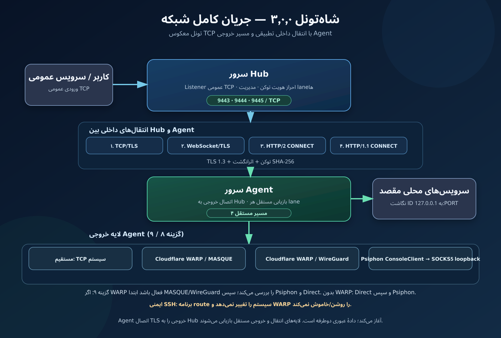

<p align="center">
  
</p>

<h1 align="center">SHAH TUNNEL | شاه تونل</h1>
<p align="center"><strong>V3.0.0 · تونل معکوس TCP · بازیابی تطبیقی چندلایه</strong></p>
<p align="center">شاه‌تونل اتصال‌های عمومی TCP را از طریق Hub و مسیرهای احراز هویت‌شدهٔ Agent به سرویس‌های مقصد نگاشت‌شده هدایت می‌کند. در نسخهٔ ۳، علاوه بر چهار انتقال داخلی قبلی، مسیر خروجی Agent می‌تواند از SOCKS5 رسمی Psiphon یا از WARP با پروتکل MASQUE / WireGuard عبور کند؛ حالت پراکسی محلی WARP با MASQUE نیز پشتیبانی می‌شود.</p>
<p align="center"><a href="README.md">🇬🇧 English</a> · 🇮🇷 فارسی</p>

## مسیر شبکه | Network Flow

<p align="center">
  
</p>

## قابلیت‌ها

- **چهار انتقال داخلی واقعی:** TCP/TLS، ‏WebSocket/TLS، ‏HTTP/2 CONNECT و ‏HTTP/1.1 CONNECT/TLS.
- **گزینهٔ ۸ ـ مسیر خروجی خارجی:** انتخاب Cloudflare WARP با پروتکل MASQUE، ‏WARP با WireGuard یا Psiphon ConsoleClient از طریق SOCKS5 محلی.
- **گزینهٔ ۹ ـ بازیابی تطبیقی چندلایه:** تلاش برای هر چهار انتقال داخلی؛ اگر WARP متصل باشد، مسیر فعال MASQUE یا WireGuard ابتدا راستی‌آزمایی می‌شود و در صورت شکست به Psiphon و سپس Direct می‌رود. اگر WARP فعال نباشد، آخرین مسیر موفق Direct/Psiphon در اولویت است؛ در شروع ترتیب Direct و سپس Psiphon خواهد بود.
- **امنیت:** TLS 1.3 بین Hub و Agent، احراز هویت توکن، تثبیت اثرانگشت SHA-256 و محدودکردن پراکسی Psiphon به loopback.
- **مدیریت:** پروفایل و سرویس systemd مجزا برای هر تانل؛ گزینه‌های اصلی منوی مدیریت و کارکردشان تغییر نکرده‌اند.

## منوی انتقال

گزینه‌های ۱ تا ۷ از نظر رفتار و شماره‌گذاری قبلی حفظ شده‌اند. گزینه‌های ۸ و ۹ فقط به انتخاب‌گر انتقال اضافه شده‌اند؛ گزینهٔ ۸ منوی اصلی مدیریت همچنان «حذف کامل نصب» است.

| گزینه | انتقال / راهبرد | عملکرد |
|---|---|---|
| `1` | TCP/TLS | جریان تونل روی TLS. |
| `2` | WebSocket/TLS | انتقال جریان در فریم‌های WebSocket داخل TLS. |
| `3` | HTTP/2 CONNECT | جریان CONNECT روی TLS و پورت TCP شمارهٔ کنترل + ۱. |
| `4` | HTTP/1.1 CONNECT/TLS | جریان CONNECT روی TLS و پورت TCP شمارهٔ کنترل + ۲. |
| `5` | HTTP CONNECT fallback | ابتدا HTTP/2 و در صورت شکست، HTTP/1.1. |
| `6` | Automatic fallback | ابتدا TCP/TLS و سپس WebSocket/TLS. |
| `7` | Full Adaptive Failover | هر چهار انتقال داخلی؛ آخرین انتقال موفق هر lane در اولویت قرار می‌گیرد. |
| `8` | External egress | در Agent یک زیرگزینه انتخاب می‌شود: MASQUE/WARP، WARP/WireGuard یا Psiphon/SOCKS5. Hub فقط سیاست انتقال داخلی را می‌پذیرد. |
| `9` | All-Protocol Adaptive | چهار انتقال داخلی روی WARP فعال (در صورت اتصال)، سپس Psiphon و Direct؛ با قطع WARP مسیر Psiphon جایگزین می‌شود و در نبود WARP آخرین مسیر موفق Direct/Psiphon اولویت دارد. |

### نکتهٔ مهم دربارهٔ WARP و SSH

شاه‌تونل دو حالت WARP را برای Agent پشتیبانی می‌کند. در حالت تونل سراسری، مسیر شبکهٔ میزبان باید از قبل از WARP عبور کند؛ برنامه وضعیت `warp-cli`، پروتکل فعال و خروجی واقعی `warp=on` را بررسی می‌کند. در حالت پراکسی محلی (`Mode: WarpProxy on port 40000`)، برنامه پورت پراکسی loopback را از `warp-cli settings` تشخیص می‌دهد، مسیر را با trace کلادفلر آزمایش می‌کند و اتصال HTTP CONNECT به Hub را از `127.0.0.1:<port>` عبور می‌دهد. این حالت با MASQUE پشتیبانی می‌شود؛ پراکسی محلی Cloudflare با WireGuard سازگار نیست. در این روش فقط کانال‌های خروجی Agent از WARP عبور می‌کنند و SSH، شنونده‌های ورودی و default route میزبان دست‌نخورده می‌مانند. برنامه **هیچ‌وقت** `warp-cli connect`، تغییر پروتکل، `disconnect` یا تغییر route سیستم را اجرا نمی‌کند. WARP باید پیش از اجرای سرویس Agent متصل باشد. این بررسی‌ها پیش از هر اتصال مجدد نیز تکرار می‌شوند و در گزینهٔ ۸، خرابی WARP باعث استفادهٔ پنهانی از مسیر مستقیم نمی‌شود.

اگر Local Proxy از قبل فعال است، حالت آن را تغییر ندهید؛ `WarpProxy` را روشن نگه دارید و از پورت نمایش‌داده‌شده در تنظیمات استفاده کنید (در بسیاری از نصب‌ها `40000` است). بررسی فقط‌خواندنی:

```bash
curl -fsS --proxy http://127.0.0.1:40000 https://api.cloudflare.com/cdn-cgi/trace | grep '^warp=on$'
```

فعال‌کردن حالت تونل سراسری WARP ممکن است default route سرور را تغییر دهد و نشست SSH را قطع کند. فرمان‌های زیر را فقط از کنسول ارائه‌دهنده یا با دسترسی جایگزین/خارج از باند اجرا کنید؛ از یک نشست SSH تنها برای تغییر مسیر پیش‌فرض استفاده نکنید:

```bash
warp-cli tunnel protocol set MASQUE
warp-cli connect
warp-cli status
warp-cli settings | grep -i protocol
curl -fsS https://api.cloudflare.com/cdn-cgi/trace | grep '^warp=on$'
```

برای WireGuard به جای MASQUE از `warp-cli tunnel protocol set WireGuard` استفاده کنید. راهنمای رسمی: [نصب WARP در Linux](https://developers.cloudflare.com/warp-client/get-started/linux/) و [حالت‌های WARP](https://developers.cloudflare.com/warp-client/warp-modes/).

### راه‌اندازی Psiphon

نسخهٔ رسمی Linux از `ConsoleClient` و فایل پیکربندی Client استفاده می‌کند. ShahTunnel باینری Psiphon را داخل ZIP کپی نمی‌کند؛ آن را فقط از [مخزن باینری رسمی Psiphon](https://github.com/Psiphon-Labs/psiphon-tunnel-core-binaries) دریافت کنید. در فایل JSON باید `LocalSocksProxyPort` با پورتی که در راه‌انداز Agent وارد می‌کنید برابر باشد؛ مقدار پیش‌فرض `1080` است. برنامه `ConsoleClient` را با دایرکتوری دادهٔ مختص همان پروفایل و bind روی رابط loopback اجرا می‌کند، سپس اتصال Hub را از SOCKS5 عبور می‌دهد. نصب‌کننده برای هر دو واحد systemd قدیمی و قالبی فقط اجازهٔ نوشتن در `/var/lib/shah-tunnel/psiphon` را با drop-in محدود اضافه می‌کند؛ `ProtectSystem=strict` همچنان فعال می‌ماند. به این ترتیب فقط اتصال خروجی Agent پراکسی می‌شود، نه SSH و نه کل سیستم.

### پورت‌های فایروال Hub

اگر پورت کنترل Hub برابر `9443` باشد:

- `9443/TCP`: ‏TCP/TLS و WebSocket/TLS.
- `9444/TCP`: ‏HTTP/2 CONNECT.
- `9445/TCP`: ‏HTTP/1.1 CONNECT/TLS.

برای گزینه‌های ۷، ۸ و ۹ هر سه پورت را روی Hub باز بگذارید، زیرا Agent ممکن است بین چهار انتقال داخلی جابه‌جا شود. WARP/MASQUE و Psiphon پورت ورودی جدیدی روی Hub اضافه نمی‌کنند.

## جزئیات Failover و محدودیت‌های لایه

- در گزینهٔ ۹، اگر WARP متصل باشد، مسیر فعال MASQUE یا WireGuard ابتدا با بررسی وضعیت، تنظیم پروتکل و خروجی زندهٔ `warp=on` راستی‌آزمایی می‌شود؛ سپس چهار انتقال داخلی روی آن امتحان می‌شود. در صورت شکست یا قطع WARP، مسیر Psiphon SOCKS5 و بعد Direct امتحان می‌شود. اگر WARP فعال نباشد، آخرین مسیر موفق Direct/Psiphon اولویت دارد و در شروع ترتیب Direct و سپس Psiphon است.
- در حالت تونل سراسری، مسیر سیستم WARP به‌عنوان یک مسیر مجزا راستی‌آزمایی می‌شود؛ مطمئن شوید IP هاب در فهرست استثناهای Split Tunnel قرار نگرفته باشد. در حالت Local Proxy، هر کانال از پراکسی HTTP CONNECT روی loopback عبور می‌کند. Local Proxy فقط با MASQUE قابل استفاده است. اگر مسیر WARP در گزینهٔ ۹ خراب شود، مسیر بعدی طبق Failover انتخاب می‌شود.
- Psiphon در این پیاده‌سازی با SOCKS5 برای جریان TCP استفاده می‌شود؛ این لایه، انتقال UDP مستقل فراهم نمی‌کند.
- قطع هر lane مستقل بازیابی می‌شود؛ laneهای سالم و سرویس SSH دست‌کاری یا restart نمی‌شوند.

## مدیریت چند تانل و کارایی

- هر تانل با نام یکتا و فایل تنظیمات جداگانه ذخیره می‌شود؛ ساخت تانل جدید، تانل‌های قبلی را بازنویسی نمی‌کند.
- هر پروفایل سرویس systemd مستقل دارد. شروع، توقف، راه‌اندازی مجدد، وضعیت و حذف یک تانل فقط روی همان پروفایل عمل می‌کند.
- پنجرهٔ ارسال هر جریان تا ۶۴ فریم ۶۴ کیلوبایتی افزایش یافته است. بهبود سرعت واقعی همچنان به پهنای‌باند، RTT، اتلاف بسته، ازدحام، qdisc و محدودیت میزبان وابسته است و تضمین سرعت مشخص ممکن نیست.

## نصب و ارتقا

نصب/ارتقای آنلاین با یک دستور (روی Linux amd64 یا arm64 دارای systemd و با کاربر root):

```bash
bash <(curl -fsSL https://raw.githubusercontent.com/ShahNetLab/ShahTunnel/main/S1T-START.sh)
```

این دستور فقط اسکریپت نصب را از `raw.githubusercontent.com` می‌گیرد. سپس خود نصب‌کننده سورس پروژه را مستقیماً از مخزن رسمی GitHub در `codeload.github.com/ShahNetLab/ShahTunnel` (شاخهٔ `main`) دریافت می‌کند، ابزار Go نسخهٔ مشخص‌شده را از آدرس‌های رسمی توزیع Go می‌گیرد و SHA-256 آن را اعتبارسنجی می‌کند، سپس باینری مخصوص همان VPS را **روی خود سرور build** می‌کند و در `/usr/local/bin/ravanreverse` نصب می‌کند.

**هیچ فایل باینری ShahTunnel نباید در GitHub، GitHub Releases یا ZIP سورس قرار بگیرد.** در مخزن فقط سورس، تست‌ها، مستندات و نصب‌کننده نگهداری می‌شوند؛ نصب‌کننده هیچ باینری آماده‌ای را دانلود نمی‌کند.

برای نصب یا ارتقا از سورسی که قبلاً روی سرور استخراج یا clone کرده‌اید:

```bash
sudo bash S1T-START.sh
```

در حالت اجرای محلی، نصب‌کننده از سورس همان پوشه build می‌کند. قبل از جایگزینی، از باینری قبلی نسخهٔ پشتیبان می‌گیرد و سرویس فعال ShahTunnel را هنگام ارتقا خودکار restart نمی‌کند تا نشست‌های فعلی قطع نشوند. نام سرویس قدیمی `ravanreverse.service` و مسیر `/etc/ravanreverse` برای سازگاری حفظ شده‌اند.

پردازه‌ای که همین الان اجراست تا زمان restart همچنان باینری قبلی را در حافظه نگه می‌دارد. برای فعال‌شدن نسخهٔ جدید، فقط سرویس ShahTunnel انتخاب‌شده را در زمان مناسب restart کنید؛ این کار نشست‌های عبوری همان تانل را قطع و دوباره وصل می‌کند، اما `sshd` را restart یا تغییر نمی‌دهد:

```bash
sudo systemctl restart ravanreverse.service
# یا برای پروفایل نام‌دار:
sudo systemctl restart 'ravanreverse@PROFILE.service'
```

## تست

```bash
./VERIFY-ALL-TRANSPORTS.sh
```

این اسکریپت تست انتقال‌های داخلی، آزمون پراکسی SOCKS5 و WARP Local Proxy با HTTP CONNECT، بررسی static و ساخت باینری‌های amd64/arm64 را انجام می‌دهد. تست WARP واقعی به کلاینت متصل و اینترنت فعال نیاز دارد؛ در محیط build آفلاین به‌عنوان تست زنده اجرا نمی‌شود.
