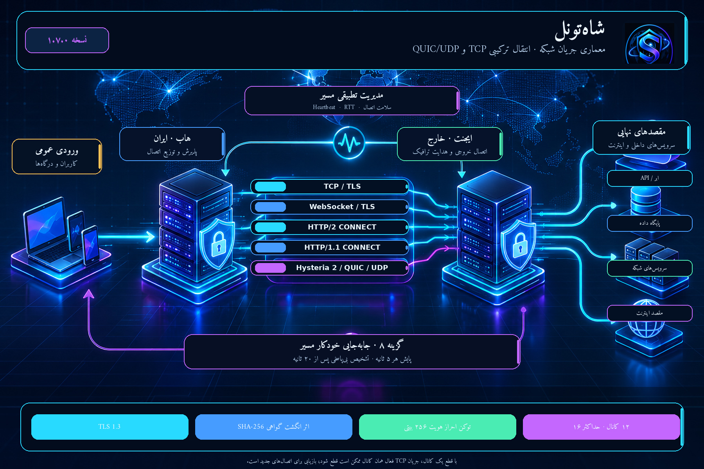

<p align="center">
  
</p>

<h1 align="center">شاه‌تونل</h1>
<p align="center"><strong>نسخهٔ ۱.۸.۱ · تونل معکوس احراز هویت‌شده · انتقال ترکیبی TCP و QUIC/UDP</strong></p>
<p align="center">چهار روش انتقال مبتنی بر TCP به‌همراه یک مسیر مستقل Hysteria 2 روی QUIC/UDP</p>
<p align="center"><a href="README.md">نسخهٔ انگلیسی</a> · <a href="README-fa.md">نسخهٔ فارسی</a></p>

## نصب سریع

پس از انتشار کامل سورس نسخهٔ ۱.۸.۱ روی شاخهٔ عمومی `main` مخزن، روی هر دو سرور با کاربر `root` این دستور را اجرا کنید:

```bash
bash <(curl -fsSL https://raw.githubusercontent.com/ShahNetLab/ShahTunnel/main/S1T-START.sh)
```

تا پیش از انتشار نسخهٔ ۱.۸.۱ روی `main`، از ZIP همین نسخه نصب کنید؛ نصب‌کنندهٔ راه‌دور عمداً نسخهٔ قدیمی یا ناهماهنگ را رد می‌کند:

```bash
unzip ShahTunnel-v1.8.1.zip
cd ShahTunnel-v1.8.1
bash ./S1T-START.sh
```

روی سرور ایران نقش `Hub` و روی سرور خارج نقش `Agent` را انتخاب کنید.

## نمودار جریان شبکه

<p align="center">
  
</p>

## چند تونل نام‌دار روی یک سرور

- از منو می‌توانید چند پروفایل تونل مستقل روی یک VPS بسازید؛ برای هرکدام یک نام یکتا انتخاب کنید.
- هر پروفایل نام‌دار، فایل تنظیمات، گواهی و کلید، فایل‌های Hysteria، پورت SOCKS محلی و سرویس مستقل systemd با نام `ravanreverse@NAME.service` دارد.
- ساخت پروفایل جدید تنظیمات قبلی را بازنویسی نمی‌کند. اگر درگاه TCP یا UDP با پروفایل دیگری تداخل داشته باشد، ذخیرهٔ پروفایل جدید متوقف می‌شود.
- گزینه‌های ۲ تا ۶ نام پروفایل را می‌پرسند. گزینهٔ ۷ نام دقیق را دو بار می‌گیرد، فقط همان تونل را متوقف و پوشهٔ خودش را حذف می‌کند. گزینهٔ ۸ همهٔ پروفایل‌های شاه‌تونل را حذف می‌کند.
- تنظیمات قدیمی `/etc/ravanreverse/config.json` و سرویس `ravanreverse.service` همچنان به‌عنوان پروفایل `default` کار می‌کنند.

## سازوکار تونل

۱. **هاب** اتصال‌های عمومی TCP را می‌پذیرد و هر درگاه عمومی را به شناسهٔ نگاشت مشخصی وصل می‌کند.
۲. **ایجنت** اتصال‌های خروجیِ احراز هویت‌شده را به هاب آغاز می‌کند و ترافیک هر شناسهٔ نگاشت را به سرویس محلی تعریف‌شده می‌رساند.
۳. هر کانال تونل چند جریان TCP قاب‌بندی‌شده را هم‌زمان حمل می‌کند. مقدار پیش‌فرض **۱۲ کانال مستقل** است و تا ۱۶ کانال قابل تنظیم است؛ برای صف‌ها و جریان‌های هم‌زمان نیز سقف وجود دارد.
۴. لایهٔ داخلی شاه‌تونل در همهٔ روش‌های انتقال با TLS 1.3، توکن احراز هویت و تثبیت اثرانگشت SHA-256 گواهی محافظت می‌شود.
۵. در گزینهٔ **۸**، کانال‌های تازه میان پنج مسیر پخش می‌شوند. هر کانال آخرین روش انتقالِ موفق و احراز هویت‌شدهٔ خودش را نگه می‌دارد و پس از اتصال مجدد ابتدا همان روش را امتحان می‌کند.
۶. پنجرهٔ انتقال هر جریان ۱۶ فریمِ ۳۲ کیلوبایتی است؛ در عین حال سقف کلی حافظهٔ صف داده ۶۴ مگابایت باقی می‌ماند تا مصرف RAM روی VPSهای کوچک محدود باشد.

## مدیریت هم‌زمانی آپلود و ترافیک تعاملی

- در نسخهٔ ۱.۸.۱، صف خروجی هر کانال تونل از FIFO ساده به زمان‌بند **Deficit Round Robin (DRR)** بر اساس شناسهٔ جریان TCP تغییر کرده است.
- هر جریان در هر دور تا یک کوانتوم ۳۲ KiB فرصت ارسال می‌گیرد؛ فریم بزرگ‌تر برای دریافت سهم کامل باید چند دور اعتبار جمع کند. در نتیجه یک جریان آپلود طولانی نمی‌تواند صرفاً با پرکردن زودتر صف، تمام نوبت‌های جریان‌های دیگر را پشت سر هم بگیرد.
- پیام‌های کنترلی (بازکردن/بستن جریان، ACK و heartbeat) همچنان صف جدا دارند؛ اولویت آن‌ها محدود است تا دادهٔ کاربر گرسنه نماند.
- این زمان‌بندی در هر دو جهت Hub↔Agent و در همهٔ روش‌های انتقال استفاده می‌شود. فشار برگشتی و سقف حافظهٔ صف قبلی حفظ شده است.
- عدالت در این لایه **به‌ازای جریان TCP داخل تونل** است، نه به‌ازای نام برنامه؛ چون پس از رمزنگاری، ShahTunnel نمی‌تواند تشخیص دهد یک جریان متعلق به Instagram، Telegram یا YouTube است. برنامه‌ای که چندین اتصال موازی باز کند ممکن است سهم تجمیعی بیشتری بگیرد.
- این تغییر سرعت کل آپلود را عمداً محدود نمی‌کند؛ ظرفیت uplink از سرور یا موبایل به‌صورت قابل اعتماد از روی کد تونل قابل حدس نیست. اگر خود لینک فیزیکی اشباع شود، CAKE/SQM باید روی نقطهٔ واقعی گلوگاه و با نرخ اندازه‌گیری‌شده تنظیم شود. جایگزینی خودکار qdisc در زمان نصب انجام نمی‌شود تا تنظیمات شبکهٔ سرور یا مسیر SSH ناخواسته قطع نشود.
- اگر گلوگاه در uplink رادیویی خود گوشی باشد، زمان‌بند سمت VPS نمی‌تواند پیش از ارسال از مودم گوشی بسته‌ها را شکل دهد؛ برای آن حالت، shaping باید در کلاینت VPN اندروید یا روتر محلی انجام شود.

## منوی روش‌های انتقال

نکته: شماره‌های ۱ تا ۸ در جدول زیر، انتخاب روش انتقال در مرحلهٔ تنظیم Hub/Agent هستند؛ با شماره‌های منوی اصلی مدیریت تونل اشتباه نشوند. در منوی اصلی، گزینهٔ ۱ ساخت تونل جدید و گزینهٔ ۷ حذف یک تونل است.

روی هاب و ایجنت باید سیاست یکسان انتخاب شود:

| گزینه | روش انتقال | عملکرد |
|---|---|---|
| `1` | TCP/TLS | جریان رمز‌شده با TLS روی درگاه کنترل. |
| `2` | WebSocket/TLS | فریم‌های دودویی WebSocket روی TLS و درگاه کنترل. |
| `3` | HTTP/2 CONNECT | جریان دوطرفهٔ CONNECT روی درگاه کنترل + ۱. |
| `4` | HTTP/1.1 CONNECT/TLS | جریان CONNECT روی درگاه کنترل + ۲. |
| `5` | جابه‌جایی خودکار HTTP CONNECT | ابتدا HTTP/2 و سپس HTTP/1.1 در صورت شکست راه‌اندازی. |
| `6` | جایگزینی خودکار TCP | ابتدا TCP/TLS و سپس WebSocket/TLS. |
| `7` | Hysteria 2 / QUIC / UDP | مسیر مستقل UDP همراه با مبهم‌سازی بسته‌ها به روش Salamander؛ در این حالت تکی جایگزین TCP فعال نیست. |
| `8` | جابه‌جایی تطبیقی کامل | هر چهار مسیر TCP به‌علاوهٔ مسیر Hysteria 2 روی QUIC/UDP؛ در صورت فراهم‌بودن پورت‌های لازم در دو شبکه، این حالت پیش‌فرض پیشنهادی است. |

### پایش و بازیابی گزینهٔ ۸

- هر کانال فعال شاه‌تونل هر ۵ ثانیه یک پیام سلامت احراز هویت‌شده می‌فرستد.
- اگر تا ۲۰ ثانیه پاسخی دریافت نشود، همان کانال بسته می‌شود تا فرایند آن دوباره متصل شود و روش بعدی را امتحان کند. گم‌شدن یک پیام به‌تنهایی باعث تغییر مسیر نمی‌شود.
- Hysteria 2 به‌صورت فرایند جانبیِ مدیریت‌شده زیرمجموعهٔ سرویس شاه‌تونل اجرا می‌شود. اگر متوقف شود، شاه‌تونل با تأخیر افزایشی و تصادفی آن را دوباره اجرا می‌کند.
- وقتی یک روش انتقال اتصال را برقرار نکند یا کانال آن قطع شود، همان کانال روش‌های باقی‌مانده را به‌ترتیب امتحان می‌کند. روشِ ناموفق ۱۲ ثانیه در مدارشکنِ همان Agent کنار گذاشته می‌شود تا اتصال‌های هم‌زمان همه روی یک مسیر خراب هجوم نبرند؛ پس از پایان این زمان دوباره آزمایش می‌شود. اگر همهٔ روش‌ها در وضعیت موقتاً ناموفق باشند، موتور همه را دوباره بررسی می‌کند.
- در حالت تطبیقی، خطا در تنظیم یا اجرای Hysteria باعث ازکارافتادن چهار مسیر TCP نمی‌شود؛ مسیرهای TCP همچنان فعال می‌مانند. در گزینهٔ ۷ که فقط Hysteria انتخاب شده، شکست اجرای مسیر UDP باعث توقف سرویس می‌شود.
- **جریان TCP در حال اجرا به‌صورت بی‌وقفه از یک کانال خراب به کانال دیگر منتقل نمی‌شود.** اگر کانال از بین برود، جریان‌های فعال همان کانال بسته می‌شوند؛ کانال پس از اتصال مجدد برای جریان‌های تازه آماده خواهد شد. تشخیص قطع بی‌صدا معمولاً حدود ۲۰ تا ۲۵ ثانیه زمان می‌برد و زمان برقراری مسیر بعدی نیز به آن افزوده می‌شود.

## درگاه‌های موردنیاز روی هاب

اگر درگاه کنترل هاب `9443` باشد:

| درگاه | پروتکل | کاربرد |
|---|---|---|
| `9443` | TCP | TCP/TLS، WebSocket/TLS و کنترل داخلی روی loopback. |
| `9444` | TCP | HTTP/2 CONNECT. |
| `9445` | TCP | HTTP/1.1 CONNECT. |
| `9446` | UDP | Hysteria 2 / QUIC. |

- **گزینهٔ ۷:** فقط `9446/UDP` را برای مسیر کنترل تونل در معرض اینترنت قرار دهید. شنوندهٔ داخلی TCP روی `127.0.0.1` است و از بیرون در دسترس نیست. درگاه‌های عمومیِ سرویس‌های خودتان همچنان باید جداگانه باز باشند.
- **گزینهٔ ۸:** درگاه‌های `9443/TCP`، `9444/TCP`، `9445/TCP` و `9446/UDP` را باز کنید. فقط درگاه‌های موردنیاز سیاست انتخاب‌شده و درگاه‌های عمومی سرویس‌ها را در معرض شبکه قرار دهید.
- درگاه UDP همیشه سه شماره از درگاه کنترل بالاتر است. پیش از راه‌اندازی مطمئن شوید برنامهٔ دیگری همان درگاه UDP را اشغال نکرده باشد.

## نمایش و کپی اطلاعات اتصال Agent

پس از ساخت Hub، اطلاعات اتصال در دو کادر نمایش داده می‌شوند: کادر اول شامل Agent Token و اثرانگشت SHA-256 و کادر دوم شامل Hysteria 2 Password و Salamander Password است. هر مقدار در یک خط مستقل و بدون شکستگی چاپ می‌شود. توکن‌های جدید Agent و رمزهای Hysteria و Salamander همچنان ۲۵۶ بیت تصادفی دارند و با Base32 بدون padding و ۵۲ نویسه نمایش داده می‌شوند. اثرانگشت SHA-256 در قالب استاندارد ۶۴ نویسه‌ای hex باقی مانده است تا با نسخه‌های قبلی Agent سازگار باشد.

در Termius اندروید، روی خود مقدار لمس طولانی انجام دهید و گزینهٔ Copy را بزنید. راهنمای تعامل Termius برای اندروید انتخاب متن و کپی با لمس طولانی را توضیح می‌دهد. لمس ساده به‌خودی‌خود ورودی Bash نیست؛ مگر اینکه برنامهٔ SSH آن را صریحاً به شکل کلیک ماوس ترمینال ارسال کند. بنابراین این نسخه ادعای کپی با یک ضربه را نمی‌کند.

## امنیت مسیر UDP

- Hysteria 2 نسخهٔ 2.13.0 کانال داخلی TLS 1.3 شاه‌تونل را روی QUIC/UDP حمل می‌کند.
- مبهم‌سازی Salamander یک گذرواژهٔ تصادفی ۲۵۶ بیتی جداگانه دارد که باید روی هاب و ایجنت یکسان باشد. احراز هویت Hysteria نیز گذرواژهٔ تصادفی ۲۵۶ بیتی مستقلی دارد.
- ایجنت گواهی هاب را در Hysteria با `pinSHA256` بررسی می‌کند. نشست TLS داخلی شاه‌تونل همان اثرانگشت را جداگانه اعتبارسنجی کرده و توکن شاه‌تونل را نیز احراز می‌کند.
- ACL سمت هاب به‌صورت پیش‌فرض همهٔ مقصدها را رد می‌کند و فقط دسترسی به `127.0.0.1:<control-port>` از طریق TCP را مجاز می‌کند. نقطهٔ SOCKS5 محلیِ ایجنت نیز فقط روی `127.0.0.1` گوش می‌دهد.
- نصب‌کننده نسخهٔ Hysteria و ابزار Go را به‌صورت ثابت دریافت و با SHA-256 بررسی می‌کند. پوشهٔ `/etc/ravanreverse` را فقط در اختیار مدیر سیستم نگه دارید؛ این پوشه شامل گذرواژه‌ها و کلید خصوصی است. پروفایل‌های نام‌دار در مسیر `/etc/ravanreverse/profiles/NAME` ذخیره می‌شوند.

## ترافیک برنامه‌ها و پخش ویدئوی اینستاگرام

نگاشت‌های عمومی این نسخه **TCP** هستند. Hysteria 2 / QUIC / UDP مسیر مستقلی برای حمل جریان کنترل و دادهٔ داخلی شاه‌تونل فراهم می‌کند، اما اتصال SOCKS5 ایجنت از TCP CONNECT استفاده می‌کند (`disableUDP: true`). بنابراین این نسخه بسته‌های دلخواه UDP/443 یا دیتاگرام‌های بومی HTTP/3 برنامه‌ها را به‌صورت نگاشت UDP جداگانه عبور نمی‌دهد. اگر اینستاگرام به HTTPS روی TCP برگردد، پنجرهٔ انتقال بزرگ‌ترِ محدودشده و تنظیمات فعلی TCP keepalive و تأخیر کم می‌توانند به کاهش مکث روی مسیرهای پُرتأخیر کمک کنند. اگر برنامه به QUIC/HTTP/3 متکی بماند یا شبکهٔ موبایل حین پخش تغییر کند، این نسخه پخش بدون وقفه را تضمین نمی‌کند. عبور واقعی UDP به یک لایهٔ مستقل برای association و دیتاگرام نیاز دارد که باید در هر دو سمت Hub و Agent جداگانه پیاده‌سازی و آزمایش شود؛ در این نسخه آن را پیاده‌شده معرفی نمی‌کنیم.

## محدودیت‌هایی که باید در نظر بگیرید

QUIC/UDP یک خانوادهٔ انتقال واقعاً مستقل از TCP برای مسیر بیرونی شاه‌تونل فراهم می‌کند. Salamander می‌تواند در شبکه‌ای کمک کند که الگوی QUIC/HTTP/3 را فیلتر می‌کند اما هنوز UDP را عبور می‌دهد. **اگر UDP مسدود یا غیرقابل‌استفاده باشد، این روش هم کار نخواهد کرد.** اگر همهٔ IPهای هاب مسدود شوند، مسیر بالادستی هاب از کار بیفتد یا ارتباط بین‌الملل به‌طور کامل قطع شود، هیچ پروتکلی روی همان سرور نمی‌تواند اتصال را تضمین کند. برای این سطح از خرابی، سرور یا مسیر بالادستیِ مستقل لازم است. جعل IP مبدأ اضافه نشده است؛ چون پاسخ برگشتی یک نشست TCP/UDP با آدرس جعلی قابل اتکا نیست.

قابلیت اختیاری «Mimic / Fake TCP» در Hysteria فعال نشده است. این قابلیت به برنامهٔ جداگانه و پشتیبانی هستهٔ Linux از XDP/eBPF نیاز دارد؛ با جعل نشانی مبدأ UDP یکی نیست و جایگزین نرم‌افزاریِ بی‌نیاز از هسته محسوب نمی‌شود.

## سازگاری و آزمون

فایل‌های تنظیمات نسخه‌های ۱.۶.x همچنان خوانده می‌شوند. گزینه‌های ۱ تا ۶ رفتار قبلی را حفظ می‌کنند. مقدار قدیمی `adaptive` همچنان فقط چهار مسیر TCP قدیمی را فعال می‌کند؛ گزینهٔ ۸ با مقدار `adaptive_all` به‌علاوهٔ گذرواژه‌های Hysteria در هر دو سمت کار می‌کند. ابتدا هاب را راه‌اندازی کنید و سپس توکن، اثرانگشت گواهی، گذرواژهٔ Hysteria و گذرواژهٔ Salamander را در تنظیمات ایجنت وارد کنید.

برای اجرای آزمون‌های محلی، Go نسخهٔ ۱.۲۷.۳ باید نصب باشد:

```bash
./VERIFY-ALL-TRANSPORTS.sh
```

این اسکریپت آزمون‌های کد شاه‌تونل و ساخت باینری‌های Linux برای `amd64` و `arm64` را اجرا می‌کند. این آزمون‌ها اختلال واقعی یک اپراتور اینترنت را شبیه‌سازی نمی‌کنند؛ پیش از اتکا به تونل، دسترسی واقعی به درگاه‌های TCP و UDP انتخاب‌شده را از هر دو شبکهٔ سرور بررسی کنید.
