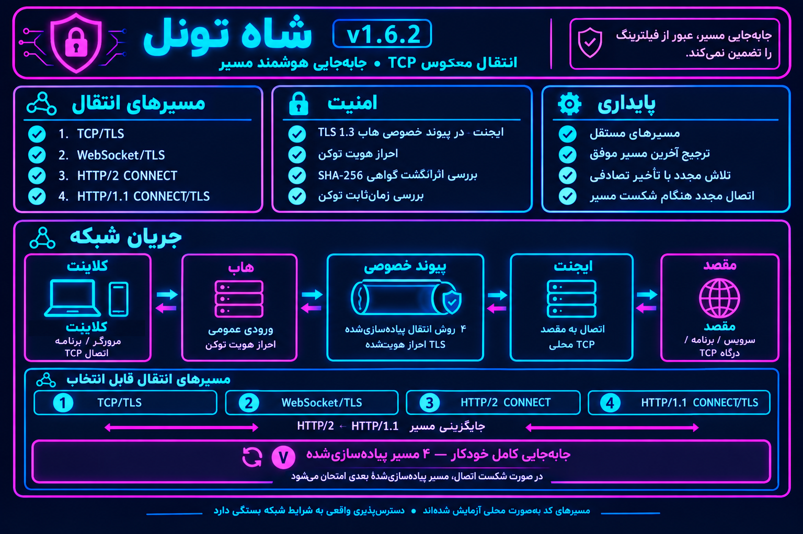

<p align="center">
  
</p>

<h1 align="center">SHAH TUNNEL | شاه تونل</h1>
<p align="center"><strong>نسخهٔ ۲.۱.۰ · تونل معکوس TCP · بازیابی تطبیقی مسیر</strong></p>
<p align="center">هدایت پورت‌های عمومی Hub به سرویس مقصد از طریق Agent، با ارتباط خصوصی TLS 1.3، احراز هویت توکن، تثبیت اثرانگشت گواهی و اتصال مجدد خودکار.</p>
<p align="center"><a href="README.md">🇬🇧 English</a> · <a href="README-fa.md">🇮🇷 فارسی</a></p>

## مسیر شبکه | Network Flow

<p align="center">
  
</p>

## قابلیت‌ها

- **چهار روش انتقال پیاده‌سازی‌شده:** TCP/TLS، ‏WebSocket/TLS، ‏HTTP/2 CONNECT و ‏HTTP/1.1 CONNECT/TLS.
- **بازیابی خودکار:** اتصال مجدد با تأخیر افزایشی و jitter و ترجیح آخرین مسیر احراز هویت‌شدهٔ موفق برای هر lane.
- **امنیت:** TLS 1.3 در ارتباط خصوصی Hub↔Agent، احراز هویت توکن و تثبیت اثرانگشت SHA-256 گواهی.
- **هم‌زمانی:** دوازده lane مستقل به‌صورت پیش‌فرض، صف‌های محدود و انتخاب نشست با توجه به بار.
- **مدیریت:** منوی ترمینال، سرویس systemd، نمایش وضعیت و لاگ، نصب‌کننده و اسکریپت بررسی محلی.

## منوی انتقال

روی هر دو سمت Hub و Agent گزینهٔ سازگار را انتخاب کنید.

| گزینه | انتقال / راهبرد | عملکرد |
|---|---|---|
| `1` | TCP/TLS | جریان تونل روی اتصال TLS. |
| `2` | WebSocket/TLS | انتقال جریان در فریم‌های WebSocket داخل TLS. |
| `3` | HTTP/2 CONNECT | جریان CONNECT روی TLS و پورت TCP شمارهٔ کنترل + ۱. |
| `4` | HTTP/1.1 CONNECT/TLS | جریان CONNECT روی TLS و پورت TCP شمارهٔ کنترل + ۲. |
| `5` | HTTP CONNECT fallback | ابتدا HTTP/2 و در صورت شکست راه‌اندازی، HTTP/1.1 را امتحان می‌کند. |
| `6` | Automatic fallback | ابتدا TCP/TLS و سپس WebSocket/TLS. |
| `7` | Full Adaptive Failover | هر چهار انتقال را امتحان می‌کند و آخرین مسیر احراز‌شدهٔ موفق را برای هر lane ترجیح می‌دهد. |

### پورت‌های فایروال Hub

اگر پورت کنترل Hub برابر `9443` باشد:

- `9443/TCP`: مسیرهای TCP/TLS و WebSocket/TLS.
- `9444/TCP`: ‏HTTP/2 CONNECT در گزینه‌های ۳، ۵ و ۷.
- `9445/TCP`: ‏HTTP/1.1 CONNECT در گزینه‌های ۴، ۵ و ۷.

فقط پورت‌های لازم برای گزینهٔ انتخاب‌شده را باز کنید. هر چهار انتقال این نسخه از TCP استفاده می‌کنند.

## مدیریت چند تانل و کارایی آپلود

- هر بار گزینهٔ «ساخت تانل» یک نام مستقل می‌گیرد و تنظیمات آن در فایل جداگانه ذخیره می‌شود؛ ساخت تانل جدید، تانل‌های قبلی را بازنویسی یا حذف نمی‌کند.
- هر پروفایل یک سرویس systemd مستقل دارد. گزینه‌های شروع، توقف، راه‌اندازی مجدد و وضعیت، ابتدا نام تانل را می‌پرسند.
- گزینهٔ ۷ فقط همان تانل انتخاب‌شده را حذف می‌کند؛ گزینهٔ ۸ برای حذف کامل برنامه و همهٔ تانل‌هاست.
- پنجرهٔ ارسال هر جریان به ۶۴ فریم تا سقف ۶۴ کیلوبایت افزایش یافته است (حداکثر حدود ۴ مگابایت دادهٔ درحال‌پرواز برای هر جریان)، درحالی‌که صف خروجی هر اتصال محدودتر شده تا تأخیر صف و معطلی جریان‌های دیگر کمتر شود. روی کرنل‌های لینوکسِ دارای BBR، برنامه تلاش می‌کند الگوریتم BBR را فقط روی سوکت TCP تونل فعال کند؛ اگر کرنل پشتیبانی نکند، الگوریتم پیش‌فرض دست‌نخورده می‌ماند. این تغییرها می‌توانند محدودیت پنجره در مسیرهای با RTT بالا و تأخیر زیر بار را کاهش دهند؛ اما سرعت واقعی به پهنای‌باند، پکت‌لاس، ازدحام، qdisc کرنل و محدودیت اپراتور وابسته است. اشباع کامل لینک بالادست بدون تعیین سقف نرخ متناسب با ظرفیت واقعی شبکه، با تغییر نرم‌افزار به‌تنهایی قابل تضمین نیست.

## استفادهٔ مسئولانه و حریم خصوصی

ShahTunnel یک رلهٔ عمومی TCP است. آن را فقط برای سرورها و سرویس‌هایی پیکربندی کنید که مالک آن‌ها هستید یا مجوز صریح مدیریتشان را دارید. از آن برای دسترسی بدون مجوز به سامانه‌های اشخاص ثالث، انتقال ترافیک آزاردهنده یا مختل‌کردن سرویس‌ها استفاده نکنید. مسئولیت مقصدها و ترافیکی که عبور می‌دهید با مدیر سامانه است.

بخش نمایش اطلاعات سرور ممکن است برای تشخیص IPv4 عمومی و کشور سرور، درخواست HTTPS به سرویس‌های عمومی تشخیص IP و GeoIP از جمله ipify، icanhazip، checkip.amazonaws.com، ipinfo.io، ip.sb، ipapi.co و ipwho.is بفرستد. این سرویس‌ها می‌توانند IP عمومی سرور و فرادادهٔ درخواست را ببینند؛ درخواست‌های GeoIP شامل توکن تونل یا محتوای ترافیک تونل نیستند.

برای سازگاری هنگام ارتقا، نام واحد systemd و مسیر تنظیمات هنوز نام‌های قدیمی `ravanreverse.service` و `/etc/ravanreverse` را دارند؛ نصب‌کننده فرمان `shah-tunnel` را نیز به‌صورت symlink فراهم می‌کند. این‌ها نام‌های محلی برای سازگاری‌اند، نه مقصد دانلود شخص ثالث. روی سرور فعلی آن‌ها را دستی تغییر ندهید؛ تغییر نام در نسخه‌ای آینده به مهاجرت صریح نیاز دارد.

## نصب

روی Linux amd64 یا arm64 با systemd و دسترسی HTTPS به میزبان‌های دانلود رسمی Go، دستور را در پوشهٔ استخراج‌شدهٔ ZIP با کاربر root اجرا کنید:

```bash
sudo bash S1T-START.sh
```

وقتی ZIP را از حالت فشرده خارج کردید، از همان پوشه `sudo bash S1T-START.sh` را اجرا کنید تا دقیقاً همین سورس محلی ساخته شود. اجرای نسخهٔ یک‌خطی از GitHub، سورس شاخهٔ `main` منتشرشده را می‌گیرد و فقط پس از به‌روزرسانی آن شاخه شامل این اصلاحات خواهد بود. نصب‌کننده ابزار Go نسخهٔ `1.26.1` را ابتدا از آینه‌های منطقه‌ای و سپس از میزبان‌های رسمی دریافت می‌کند. اگر دانلود قطع شود، فایل ناقص هر آینه جداگانه نگهداری می‌شود و فقط از همان آینه، در صورت پشتیبانی HTTP Range، ادامه پیدا می‌کند؛ بنابراین داده‌های چند میزبان با هم مخلوط نمی‌شوند. پیش از استفاده، SHA-256 ثابت فایل بررسی می‌شود و آرشیو تأییدنشده پذیرفته نمی‌شود. اگر سورس محلی کنار اسکریپت باشد، همان نسخهٔ محلی ساخته می‌شود؛ در اجرای راه دورِ بدون سورس محلی، سورس شاخهٔ `main` دریافت می‌شود. سپس باینری متناسب با معماری با `CGO_ENABLED=0` ساخته می‌شود. هیچ باینری از GitHub Releases دانلود نمی‌شود و ابزار Go به‌صورت دائمی روی سرور نصب نمی‌شود. پیش از نصب، نسخه و معماری باینری ساخته‌شده بررسی می‌شود. از باینری قبلی نسخهٔ پشتیبان نگه داشته می‌شود و سرویس فعال برای جلوگیری از قطع اتصال‌های جاری ری‌استارت نمی‌شود. برای نصب مستقیم از GitHub پس از انتشار این اصلاحات در شاخهٔ `main`، می‌توانید از دستور یک‌خطی استفاده کنید: `bash <(curl -fsSL https://raw.githubusercontent.com/ShahNetLab/ShahTunnel/main/S1T-START.sh)`.

## ساخت و تست

برای اجرای اسکریپت تست، Go 1.26.1 باید از قبل روی سیستم موجود باشد؛ این اسکریپت ابزار Go را دانلود نمی‌کند. از ریشهٔ مخزن اجرا کنید:

```bash
./VERIFY-ALL-TRANSPORTS.sh
```

یا بررسی‌های اصلی را مستقیم اجرا کنید:

```bash
gofmt -w S1T-CAPSULE/main.go S1T-CAPSULE/main_test.go
go test -race -count=20 ./S1T-CAPSULE
go vet ./S1T-CAPSULE
mkdir -p dist
CGO_ENABLED=0 GOOS=linux GOARCH=amd64 go build -trimpath -ldflags='-s -w -buildid=' -o dist/shah-tunnel-linux-amd64 ./S1T-CAPSULE
CGO_ENABLED=0 GOOS=linux GOARCH=arm64 go build -trimpath -ldflags='-s -w -buildid=' -o dist/shah-tunnel-linux-arm64 ./S1T-CAPSULE
(cd dist && sha256sum shah-tunnel-linux-amd64 > shah-tunnel-linux-amd64.sha256)
(cd dist && sha256sum shah-tunnel-linux-arm64 > shah-tunnel-linux-arm64.sha256)
```

## پنل پایش محلی (افزودهٔ نسخهٔ بستهٔ ارتقایافته)

یک پنل فقط‌خواندنی با الهام از قابلیت مانیتورینگ Nash به پروژه اضافه شده است. این پنل به کد هستهٔ تونل دست نمی‌زند و آمار Runtime موجود شاه‌تونل را می‌خواند.

نمایش‌ها:
- وضعیت سرویس systemd هر پروفایل و تعداد restartها؛
- اتصال احراز هویت‌شده، تعداد اتصال‌های فعال/کل و حجم بایت‌های ارسال/دریافت از فایل Runtime شاه‌تونل؛
- CPU، RAM، فضای دیسک و مدت روشن‌بودن سرور؛
- آزمون TCP برای آدرس واقعی تنظیم‌شده: Agent به Hub و Targetهای محلی، و Hub/Relay به listenerها و مقصدهای مربوط؛
- نمایش آخرین لاگ‌های همان پروفایل.

### نصب پنل

روی سرور شاه‌تونل، از پوشهٔ استخراج‌شدهٔ پروژه اجرا کنید:

```bash
sudo bash tools/install-panel.sh
```

پنل فقط روی `127.0.0.1:8091` گوش می‌دهد. برای مشاهده از رایانهٔ خود، تونل SSH بسازید:

```bash
ssh -L 8091:127.0.0.1:8091 USER@SERVER
```

سپس در مرورگر رایانهٔ خود `http://127.0.0.1:8091` را باز کنید. اگر پورت متفاوتی لازم دارید، گزینهٔ `--port` را در واحد `/etc/systemd/system/shah-tunnel-panel.service` تغییر دهید و سرویس را reload/restart کنید.

### امنیت و محدودیت پایش

این داشبورد فقط‌خواندنی است؛ هیچ دکمه‌ای برای restart یا تغییر فایروال ندارد. به‌صورت پیش‌فرض احراز هویت وب ندارد، چون فقط به loopback متصل می‌شود؛ آن را مستقیماً روی IP عمومی یا پشت Reverse Proxy عمومی منتشر نکنید. دسترسی از راه دور را با SSH Port Forwarding انجام دهید.

Probeها TCP reachability آدرس‌های ثبت‌شده در پروفایل را می‌سنجند و Ping/ICMP را معیار سلامت نمی‌گیرند. باز بودن TCP به‌تنهایی اثبات‌کنندهٔ سلامت کامل تونل نیست؛ برای تأیید session احراز هویت‌شده، فیلد Connected در آمار Runtime شاه‌تونل نمایش داده می‌شود. این پنل GRE یا FRP را نصب و مدیریت نمی‌کند؛ پیکربندی GRE/FRP موجود در Nash به توپولوژی و آدرس‌های سرورهای همان استقرار وابسته است و عمداً به نصب عمومی شاه‌تونل منتقل نشده است.

برای حذف پنل:

```bash
sudo systemctl disable --now shah-tunnel-panel
sudo rm -f /etc/systemd/system/shah-tunnel-panel.service
sudo rm -rf /opt/shah-tunnel-panel
sudo systemctl daemon-reload
```

برای جزئیات مقایسه و علت انتخاب این ادغام، [گزارش ادغام Nash](docs/nash-integration-report-fa.md) را ببینید.

### تست پنل

روی هر سیستم دارای Python 3:

```bash
python3 -m unittest discover -s tools -p 'test_*.py' -v
```
