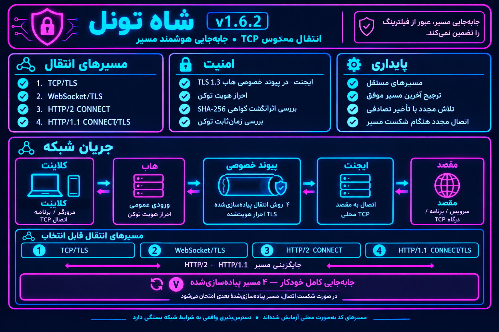

<p align="center">
  
</p>

<h1 align="center">SHAH TUNNEL | شاه تونل</h1>
<p align="center"><strong>نسخهٔ ۱.۶.۲ · تونل معکوس TCP · بازیابی تطبیقی مسیر</strong></p>
<p align="center">هدایت پورت‌های عمومی Hub به سرویس مقصد از طریق Agent، با ارتباط خصوصی TLS 1.3، احراز هویت توکن، تثبیت اثرانگشت گواهی و اتصال مجدد خودکار.</p>
<p align="center"><a href="README.md">🇬🇧 English</a> · <a href="README-fa.md">🇮🇷 فارسی</a></p>

## مسیر شبکه | Network Flow

<p align="center">
  
</p>

## قابلیت‌ها

- **چهار روش انتقال پیاده‌سازی‌شده:** TCP/TLS، ‏WebSocket/TLS، ‏HTTP/2 CONNECT و ‏HTTP/1.1 CONNECT/TLS.
- **بازیابی خودکار:** اتصال مجدد با تأخیر افزایشی و jitter و ترجیح آخرین مسیر احراز هویت‌شدهٔ موفق برای هر lane.
- **امنیت:** TLS 1.3 در ارتباط خصوصی Hub↔Agent، احراز هویت توکن و تثبیت اثرانگشت SHA-256 گواهی.
- **هم‌زمانی:** دوازده lane مستقل به‌صورت پیش‌فرض، صف‌های محدود و انتخاب نشست با توجه به بار.
- **مدیریت:** منوی ترمینال، سرویس systemd، نمایش وضعیت و لاگ، نصب‌کننده و اسکریپت بررسی محلی.

## منوی انتقال

روی هر دو سمت Hub و Agent گزینهٔ سازگار را انتخاب کنید.

| گزینه | انتقال / راهبرد | عملکرد |
|---|---|---|
| `1` | TCP/TLS | جریان تونل روی اتصال TLS. |
| `2` | WebSocket/TLS | انتقال جریان در فریم‌های WebSocket داخل TLS. |
| `3` | HTTP/2 CONNECT | جریان CONNECT روی TLS و پورت TCP شمارهٔ کنترل + ۱. |
| `4` | HTTP/1.1 CONNECT/TLS | جریان CONNECT روی TLS و پورت TCP شمارهٔ کنترل + ۲. |
| `5` | HTTP CONNECT fallback | ابتدا HTTP/2 و در صورت شکست راه‌اندازی، HTTP/1.1 را امتحان می‌کند. |
| `6` | Automatic fallback | ابتدا TCP/TLS و سپس WebSocket/TLS. |
| `7` | Full Adaptive Failover | هر چهار انتقال را امتحان می‌کند و آخرین مسیر احراز‌شدهٔ موفق را برای هر lane ترجیح می‌دهد. |

### پورت‌های فایروال Hub

اگر پورت کنترل Hub برابر `9443` باشد:

- `9443/TCP`: مسیرهای TCP/TLS و WebSocket/TLS.
- `9444/TCP`: ‏HTTP/2 CONNECT در گزینه‌های ۳، ۵ و ۷.
- `9445/TCP`: ‏HTTP/1.1 CONNECT در گزینه‌های ۴، ۵ و ۷.

فقط پورت‌های لازم برای گزینهٔ انتخاب‌شده را باز کنید. هر چهار انتقال این نسخه از TCP استفاده می‌کنند.

## استفادهٔ مسئولانه و حریم خصوصی

ShahTunnel یک رلهٔ عمومی TCP است. آن را فقط برای سرورها و سرویس‌هایی پیکربندی کنید که مالک آن‌ها هستید یا مجوز صریح مدیریتشان را دارید. از آن برای دسترسی بدون مجوز به سامانه‌های اشخاص ثالث، انتقال ترافیک آزاردهنده یا مختل‌کردن سرویس‌ها استفاده نکنید. مسئولیت مقصدها و ترافیکی که عبور می‌دهید با مدیر سامانه است.

بخش نمایش اطلاعات سرور ممکن است برای تشخیص IPv4 عمومی و کشور سرور، درخواست HTTPS به سرویس‌های عمومی تشخیص IP و GeoIP از جمله ipify، icanhazip، checkip.amazonaws.com، ipinfo.io، ip.sb، ipapi.co و ipwho.is بفرستد. این سرویس‌ها می‌توانند IP عمومی سرور و فرادادهٔ درخواست را ببینند؛ درخواست‌های GeoIP شامل توکن تونل یا محتوای ترافیک تونل نیستند.

برای سازگاری هنگام ارتقا، نام واحد systemd و مسیر تنظیمات هنوز نام‌های قدیمی `ravanreverse.service` و `/etc/ravanreverse` را دارند؛ نصب‌کننده فرمان `shah-tunnel` را نیز به‌صورت symlink فراهم می‌کند. این‌ها نام‌های محلی برای سازگاری‌اند، نه مقصد دانلود شخص ثالث. روی سرور فعلی آن‌ها را دستی تغییر ندهید؛ تغییر نام در نسخه‌ای آینده به مهاجرت صریح نیاز دارد.

## نصب

روی Linux amd64 یا arm64 با systemd، با دسترسی HTTPS به میزبان‌های رسمی دانلود Go و مخزن سورس، دستور را با کاربر root اجرا کنید:

```bash
bash <(curl -fsSL https://raw.githubusercontent.com/ShahNetLab/ShahTunnel/main/S1T-START.sh)
```

نصب‌کننده ابزار Go نسخهٔ `1.26.1` را ابتدا از آینه‌های منطقه‌ای و سپس از میزبان‌های رسمی دریافت می‌کند. اگر دانلود قطع شود، فایل ناقص هر آینه جداگانه نگهداری می‌شود و فقط از همان آینه، در صورت پشتیبانی HTTP Range، ادامه پیدا می‌کند؛ بنابراین داده‌های چند میزبان با هم مخلوط نمی‌شوند. پیش از استفاده، SHA-256 ثابت فایل بررسی می‌شود و آرشیو تأییدنشده پذیرفته نمی‌شود. سپس سورس شاخهٔ `main` همین مخزن دریافت شده و روی سرور، باینری متناسب با معماری با `CGO_ENABLED=0` ساخته می‌شود. هیچ باینری از GitHub Releases دانلود نمی‌شود و ابزار Go به‌صورت دائمی روی سرور نصب نمی‌شود. پیش از نصب، نسخه و معماری باینری ساخته‌شده بررسی می‌شود. از باینری قبلی نسخهٔ پشتیبان نگه داشته می‌شود و سرویس فعال برای جلوگیری از قطع اتصال‌های جاری ری‌استارت نمی‌شود.

## ساخت و تست

برای اجرای اسکریپت تست، Go 1.26.1 باید از قبل روی سیستم موجود باشد؛ این اسکریپت ابزار Go را دانلود نمی‌کند. از ریشهٔ مخزن اجرا کنید:

```bash
./VERIFY-ALL-TRANSPORTS.sh
```

یا بررسی‌های اصلی را مستقیم اجرا کنید:

```bash
gofmt -w S1T-CAPSULE/main.go S1T-CAPSULE/main_test.go
go test -race -count=20 ./S1T-CAPSULE
go vet ./S1T-CAPSULE
mkdir -p dist
CGO_ENABLED=0 GOOS=linux GOARCH=amd64 go build -trimpath -ldflags='-s -w -buildid=' -o dist/shah-tunnel-linux-amd64 ./S1T-CAPSULE
CGO_ENABLED=0 GOOS=linux GOARCH=arm64 go build -trimpath -ldflags='-s -w -buildid=' -o dist/shah-tunnel-linux-arm64 ./S1T-CAPSULE
(cd dist && sha256sum shah-tunnel-linux-amd64 > shah-tunnel-linux-amd64.sha256)
(cd dist && sha256sum shah-tunnel-linux-arm64 > shah-tunnel-linux-arm64.sha256)
```
