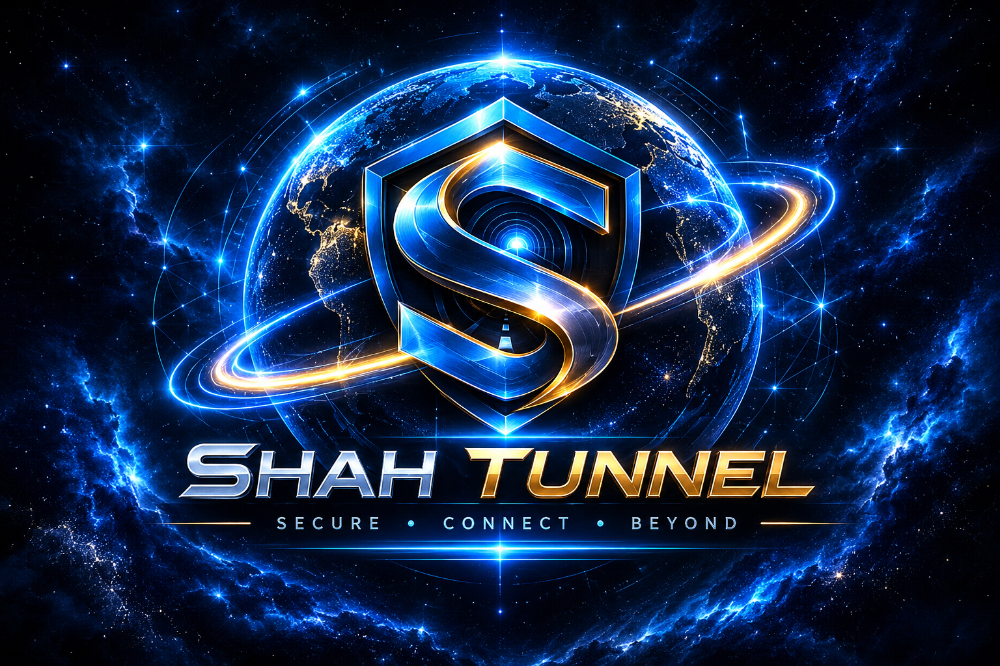
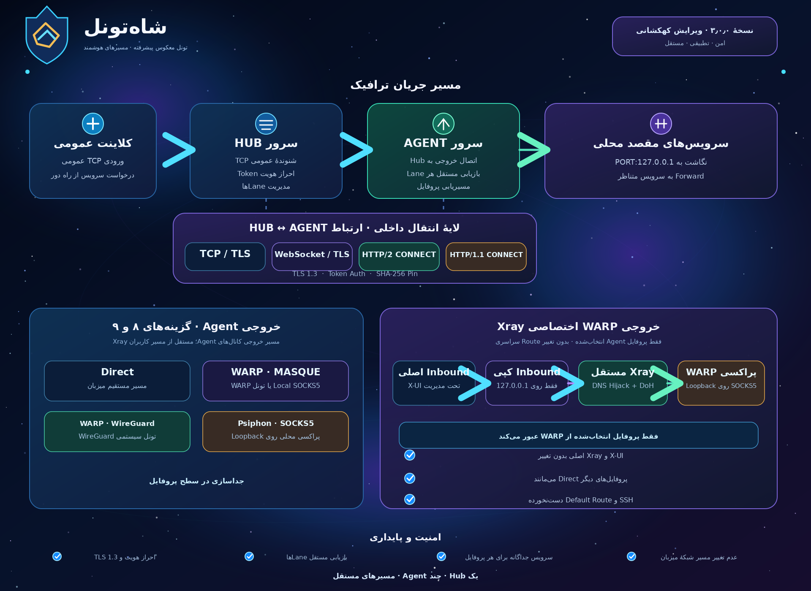

<div align="center">



# شاه‌تونل ۳٫۰٫۲

[](https://github.com/ShahNetLab/ShahTunnel)

[](S1T-START.sh)

<p align="center">
<a href="https://t.me/MediaZet"></a>
&nbsp;
<a href="https://t.me/cloudflare0_bot"></a>
</p>

<div dir="rtl" align="center">برای حمایت از ShahTunnel و دریافت خبرها عضو کانال شوید؛ ربات برای عملیات Cloudflare است.</div>

[English](README.md) · **فارسی**

[⚡ قابلیت‌ها](#capabilities) · [🚀 نصب](#install)

</div>

---

<a id="network-flow"></a>
## Network Flow | جریان شبکه

<div dir="rtl">

مسیر انتقال Hub به Agent و خروجی اینترنت اختیاری هر پروفایل مستقل از یکدیگرند: تونل، Mappingهای TCP را به مقصد محلی Agent می‌رساند؛ مسیر اختیاری Xray فقط Inbound انتخاب‌شده را از خروجی SOCKS5 وایرپ همان پروفایل عبور می‌دهد.

</div>

```text
کاربر → پورت عمومی Hub → Laneهای احرازشده Agent → مقصد محلی Agent
Inbound انتخاب‌شده Xray → Sidecar محدود به Loopback → SOCKS5 وایرپ → اینترنت
```

<p align="center"></p>

<a id="capabilities"></a>

## قابلیت‌ها

| | قابلیت | کارکرد |
|:--:|---|---|
|  | **رله معکوس Hub و Agent** | Hub پورت عمومی TCP را می‌پذیرد؛ Agent اتصال خروجی می‌سازد و هر Mapping را به مقصد محلی می‌رساند. |
|  | **پروفایل‌های مستقل** | هر تونل فایل تنظیمات و سرویس systemd جدا دارد؛ عملیات مدیریت روی پروفایل انتخاب‌شده انجام می‌شود. |
|  | **Laneهای انتقال تطبیقی** | چهار انتقال پیاده‌سازی‌شده به‌صورت جدا یا در حالت‌های Failover قابل استفاده‌اند. |
|  | **بازیابی مستقل Lane** | هر Lane جداگانه دوباره متصل می‌شود؛ خرابی یک Lane الزاماً Laneهای سالم را قطع نمی‌کند. پروفایل Agent جدید به‌صورت پیش‌فرض ۱۲ Lane مستقل دارد (حداکثر ۱۶). |
|  | **چند Mapping پورت** | شناسه هر Mapping، Listener عمومی Hub را به مقصد محلی Agent متصل می‌کند و باید در دو سمت یکسان باشد. |
|  | **خروجی مستقل Agent** | خروجی Agent می‌تواند Direct، ‏WARP/MASQUE، ‏WARP/WireGuard یا Psiphon/SOCKS5 باشد. |
|  | **WARP اختصاصی Xray** | Inbound انتخاب‌شده به Sidecar محدود به Loopback کپی و از SOCKS5 محلی WARP عبور داده می‌شود. |
|  | **مسیر خودکار DNS در WARP** | Sidecar درخواست DNS کاربر را مدیریت می‌کند و درخواست DoH مربوط به Resolver را نیز از همان خروجی WARP می‌فرستد. |

## انتقال‌های Hub↔Agent

در زمان ساخت تونل یک حالت را انتخاب کنید. تنظیمات Hub و Agent باید با هم سازگار باشند.

| گزینه ویزارد | حالت | عملکرد |
|:--:|---|---|
| `1` | TCP/TLS | جریان TLS بین Hub و Agent. |
| `2` | WebSocket/TLS | انتقال جریان تونل در فریم‌های باینری WebSocket روی TLS. |
| `3` | HTTP/2 CONNECT | انتقال CONNECT روی TLS و پورت کنترل + ۱. |
| `4` | HTTP/1.1 CONNECT/TLS | انتقال CONNECT روی TLS و پورت کنترل + ۲. |
| `5` | HTTP CONNECT fallback | ابتدا HTTP/2 و در صورت نیاز HTTP/1.1. |
| `6` | Automatic fallback | ابتدا TCP/TLS و سپس WebSocket/TLS. |
| `7` | Full Adaptive Failover | هر چهار انتقال؛ هر Lane آخرین انتقال موفق خود را ترجیح می‌دهد. |
| `8` | External egress | در Agent انتخاب Cloudflare MASQUE، ‏WARP/WireGuard یا Psiphon/SOCKS5. |
| `9` | All-protocol adaptive | در Agent ترکیب هر چهار انتقال با Failover خروجی Direct/Psiphon. |

### روش‌های خروجی Agent

| روش | پیش‌نیاز / مسیر |
|---|---|
| `Direct` | اتصال Agent به Hub از مسیر عادی سرور. |
| `WARP / MASQUE` | تونل WARP با MASQUE یا Cloudflare Local Proxy باید از قبل فعال باشد. |
| `WARP / WireGuard` | تونل سیستمی WARP باید از قبل متصل باشد. |
| `Psiphon / SOCKS5` | ShahTunnel در اولین استفاده ConsoleClient رسمی را می‌سازد، تنظیمات امضاشدهٔ دریافت فهرست سرورها و SOCKS5 اختصاصی را خودکار آماده می‌کند؛ نیازی به فایل باینری یا JSON دستی نیست. |
| `Adaptive` | مسیر Failover خروجی Direct/Psiphon. |

### اتصال Psiphon از پورت عمومی ۴۴۳

اگر Psiphon به پورت کنترل Hub (برای نمونه `9448`) دسترسی نداشته باشد، Agent مسیر Psiphon را از نشانی Mapping عمومی Hub روی `443` عبور می‌دهد؛ مسیر Direct همچنان از پورت کنترل تنظیم‌شده استفاده می‌کند. مقدار پیش‌فرض Step 06 اکنون از پورت کنترل مستقل است و روی TCP/443 قرار می‌گیرد. Hub اتصال ShahTunnel را با ALPN اختصاصی `shah-tunnel-control/1` از ترافیک عادی TLS تشخیص می‌دهد و بایت‌های ClientHello کاربران عادی را بدون تغییر به Agent می‌فرستد. بنابراین نیازی به اشغال مجدد پورت ۴۴۳، تغییر X-UI، یا جابه‌جایی Mapping نیست.

Hub باید نسخهٔ `3.0.3` یا جدیدتر با پشتیبانی ALPN روی Mapping عمومی داشته باشد؛ Agent باید نسخهٔ `3.0.4` یا جدیدتر را اجرا کند تا جداسازی آدرس Mapping و پورت کنترل به‌درستی انجام شود. Mapping عمومی باید روی Hub فعال و از مسیر Psiphon قابل دسترسی باشد. در ویزارد Agent می‌توان نشانی جایگزین را تغییر داد؛ برای پروفایل‌های قدیمی که HubAddr آن‌ها روی `9443` است، مقدار `PsiphonHubAddr` هنگام بارگذاری به‌طور خودکار به همان IP روی `443` تبدیل می‌شود.

### راه‌اندازی خودکار Psiphon

با انتخاب `Psiphon / SOCKS5` یا مسیر خروجی تطبیقی در Agent، شاه‌تونل به‌صورت خودکار:

- ConsoleClient رسمی Psiphon را از نسخهٔ منبع ثابت‌شده، برای معماری `amd64` یا `arm64` می‌سازد.
- معماری و اجرای فایل باینری را پیش از نصب بررسی می‌کند.
- فایل JSON خصوصی هر Agent را با شناسه‌های عمومی کلاینت، آینه‌های فهرست سرور، کلید امضای فهرست، کلید امضای Server Entry و کلید Exchange می‌سازد.
- یک پورت SOCKS5 یکتا روی `127.0.0.1` و پوشهٔ دادهٔ مستقل اختصاص می‌دهد.
- دسترسی نوشتن systemd را فقط به پوشهٔ دادهٔ همان Agent محدود می‌کند.
- ConsoleClient را در حالت پراکسی محلی اجرا می‌کند. آماده‌شدن SOCKS5 محلی از اتصال واقعی Psiphon و از اتصال Lane به Hub جدا گزارش می‌شود. اگر SOCKS5 آماده شود اما مسیر هنوز کامل نشده باشد، سرویس فعال می‌ماند و وضعیت `PENDING` نشان داده می‌شود؛ اتصال موفق ادعا نمی‌شود. گزینهٔ `ListenInterface` ارسال نمی‌شود تا Psiphon از bind پیش‌فرض `127.0.0.1` استفاده کند و برای شناسایی اینترفیس به Netlink نیاز نداشته باشد. گزارش‌های تشخیصی فقط در Journal محلی ذخیره می‌شوند و می‌توانند اطلاعات حساس نشست/شبکه داشته باشند.

برای تعمیر پروفایلی که با تنظیمات قبلی Psiphon وصل نشده، از پوشهٔ پروژه اجرا کنید: `sudo bash repair-psiphon-profile.sh PROFILE`. این ابزار از JSON همان پروفایل نسخهٔ پشتیبان می‌گیرد و فقط سرویس `ravanreverse@PROFILE` را راه‌اندازی مجدد می‌کند. اگر SOCKS5 محلی آماده شود اما Psiphon یا Lane ارتباط با Hub هنوز متصل نشده باشد، وضعیت `PENDING` می‌دهد و سرویس را برای تلاش مجدد روشن می‌گذارد؛ فقط در صورت آماده‌نشدن SOCKS5، همان پروفایل را متوقف می‌کند.

نیازی به تهیهٔ دستی باینری یا JSON نیست. راه‌اندازی اولیه برای دریافت سورس رسمی و ابزار Go به دسترسی اینترنت نیاز دارد. هیچ TUN، مسیر پیش‌فرض سرور، SSH یا سرویس X-UI تغییر نمی‌کند. خروجی Psiphon در این پیاده‌سازی برای Laneهای TCP ارتباط Agent با Hub است و به معنی خروجی اینترنت کاربران Xray نیست.

> **دو گزینه ۹ متفاوت هستند:** گزینه `9` در ویزارد ساخت تونل یعنی All-protocol adaptive؛ گزینه `9` در منوی اصلی مدیریت، خروجی WARP مستقل Xray را برای Agent انتخاب‌شده فعال می‌کند.

## خروجی WARP مستقل برای هر تونل Xray

- **Agent جدید:** هنگام ساخت Agent با MASQUE، اگر Cloudflare Local Proxy شناسایی شود، ShahTunnel پیش از شروع Agent، Sidecar مستقل Xray و مسیر DNS مبتنی بر WARP را آماده می‌کند.
- **Agent موجود:** پروفایل Agent را در منوی مدیریت انتخاب کنید و گزینه **`[9] WARP egress`** را بزنید.
- **جداسازی:** فقط Inbound کپی‌شده از پروفایل انتخاب‌شده از SOCKS5 محلی WARP عبور می‌کند؛ سایر Inboundها و پروفایل‌ها Direct می‌مانند.
- **امنیت مسیر میزبان:** تنظیمات و سرویس اصلی Xray تحت مدیریت X-UI، سرویس SSH و Default Route سرور توسط این اتصال مستقل تغییر یا Restart نمی‌شوند.

این قابلیت به Listener محلی **Cloudflare WarpProxy / Local Proxy** از نوع SOCKS5 نیاز دارد. این قابلیت WARP سراسری سرور نیست. اگر Local Proxy در دسترس نباشد، مسیر اختصاصی بی‌صدا با Route سراسری جایگزین نمی‌شود.

## مدیریت روزمره

`sudo shah-tunnel menu` منوی مدیریت را باز می‌کند. عملیات روی پروفایل انتخاب‌شده انجام می‌شود:

| گزینه منو | عملکرد |
|:--:|---|
| `1` | ساخت پروفایل جدید Hub، Agent یا Relay. |
| `2` | شروع تونل انتخاب‌شده. |
| `3` | توقف تونل انتخاب‌شده. |
| `4` | راه‌اندازی مجدد تونل انتخاب‌شده. |
| `5` | نمایش وضعیت و لاگ‌های اخیر. |
| `6` | تنظیم Restart زمان‌بندی‌شده تونل‌های فعال. |
| `7` | حذف فقط یک پروفایل انتخاب‌شده. |
| `8` | حذف کامل ShahTunnel. |
| `9` | فعال‌سازی WARP مستقل برای Agent انتخاب‌شده. |

<div dir="rtl">

دستورهای کاربردی:

</div>

```bash
sudo shah-tunnel version
sudo shah-tunnel menu
sudo systemctl status 'ravanreverse@PROFILE.service' --no-pager -l
sudo journalctl -u 'ravanreverse@PROFILE.service' -n 80 --no-pager
```

<div dir="rtl">

به‌جای `PROFILE` نام Instance سرویس همان پروفایل را قرار دهید. برای بررسی ساده‌تر، گزینه **Status & Logs** در منوی مدیریت، وضعیت و ۴۰ لاگ اخیر را نشان می‌دهد.

## امنیت

- توکن Hub و اثر انگشت گواهی را محرمانه نگه دارید. Agent باید دقیقاً از مقادیر تولیدشده در Hub استفاده کند.
- در فایروال Hub فقط پورت کنترل/CONNECT انتخاب‌شده و پورت‌های عمومی Mapping موردنیاز را باز کنید.
- توکن، کلید خصوصی، فایل کامل تنظیمات یا لاگ بدون حذف اطلاعات حساس را در Issue یا تصویر عمومی منتشر نکنید.
- Sidecar اختصاصی WARP برای Inbound کپی‌شده روی Loopback گوش می‌دهد و جایگزین سرویس اصلی Xray تحت مدیریت X-UI نمی‌شود.
- ShahTunnel را فقط روی سرورها و سرویس‌هایی استفاده کنید که مالک آن هستید یا مجوز مدیریتشان را دارید. [سیاست امنیتی](SECURITY.md).

<a id="install"></a>
## نصب

ShahTunnel از معماری **Hub / Agent** استفاده می‌کند. برنامه را روی سرور Hub و هر Agent نصب کنید. در صورت نیاز، یک سرور سوم نیز می‌تواند نقش Relay داشته باشد.

**پیش‌نیازها:** لینوکس `amd64` یا `arm64`، سرویس `systemd` و دسترسی root. نصب‌کننده ابزار Go نسخهٔ 1.26.1 را دریافت و با SHA-256 بررسی می‌کند، سپس باینری لینوکس را روی همان سرور می‌سازد.

**۱. نصب روی هر سرور**

```bash
bash <(curl -fsSL https://raw.githubusercontent.com/ShahNetLab/ShahTunnel/main/S1T-START.sh)
```

<div dir="rtl">

پس از نصب، منوی مدیریت باز می‌شود. برای ورود دوباره:

</div>

```bash
sudo shah-tunnel menu
```

<div dir="rtl">

**۲. ساخت Hub**

1. گزینه ساخت تونل جدید را انتخاب کنید و نقش **HUB** را بزنید.
2. پورت کنترل را تعیین کنید (پیش‌فرض `0.0.0.0:9443`) و انتقال مورد قبول Hub را انتخاب کنید.
3. نگاشت پورت‌های عمومی را بسازید. برای هر نگاشت یک شناسه مانند `main` یا `web` تعیین کنید.
4. **توکن Agent** و **اثر انگشت SHA-256 گواهی** را ذخیره کنید؛ Agent باید دقیقاً از همین دو مقدار استفاده کند.

**۳. ساخت Agent**

1. روی سرور مقصد، تونل جدید بسازید و نقش **AGENT** را انتخاب کنید.
2. آدرس Hub و پورت کنترل را وارد کنید و انتقال سازگار با Hub را برگزینید.
3. توکن و اثر انگشت گواهی Hub را وارد کنید.
4. همان شناسه‌های Mapping را بسازید و مقصد محلی هرکدام را وارد کنید؛ برای نمونه `127.0.0.1:443`.
5. پروفایل را ذخیره کنید. ShahTunnel سرویس مستقل آن را فعال می‌کند و Laneهای قطع‌شده را به‌صورت خودکار دوباره متصل می‌کند.

**۴. فایروال:** فقط پورت‌های لازم را باز کنید. Hub به پورت کنترل انتخاب‌شده، پورت CONNECT در صورت نیاز (`کنترل + ۱` برای HTTP/2 یا `کنترل + ۲` برای HTTP/1.1) و پورت‌های عمومی Mapping نیاز دارد. Agent اتصال خروجی را به Hub برقرار می‌کند و مقصدهای محلی در سمت Agent هستند.

</div>

## عیب‌یابی

</div>

| مشکل | اولین بررسی |
|---|---|
| Agent متصل نمی‌شود | آدرس Hub، توکن، اثر انگشت گواهی، سازگاری حالت انتقال و پورت‌های فایروال را بررسی کنید. |
| HTTP/2 یا HTTP/1.1 CONNECT کار نمی‌کند | پورت TCP اضافه Hub را بررسی کنید (`کنترل + ۱` یا `کنترل + ۲`). |
| Mapping ترافیک را عبور نمی‌دهد | شناسه Mapping در Hub و Agent و دسترسی به مقصد محلی Agent را بررسی کنید. |
| WARP مستقل فعال نمی‌شود | مطمئن شوید Agent روی MASQUE است و Cloudflare Local Proxy پیش از گزینه `9` فعال است. |
| DNS گوگل/یوتیوب روی WARP مستقل مشکل دارد | وضعیت سرویس `shah-tunnel-xray-warp-<profile>.service` و لاگ‌های همان Sidecar را ببینید؛ مسیرهای میزبان را تغییر ندهید. |

---

<a id="network-flow"></a>

> **رفتار شروع Psiphon در نسخه ۳٫۰٫۳:** آماده‌شدن SOCKS5 محلی با وصل‌شدن تونل Psiphon یکسان نیست. اگر SOCKS5 آماده شود اما اتصال خارجی هنوز برقرار نشده باشد، سرویس Agent فعال می‌ماند و ConsoleClient به تلاش مجدد ادامه می‌دهد؛ ویزارد وضعیت را «در حال اتصال» گزارش می‌کند، نه اتصال موفق. پیام‌های تشخیصی Psiphon در Journal محلی ثبت می‌شوند و ممکن است جزئیات شبکه/سرورها داشته باشند؛ آن‌ها را عمومی منتشر نکنید.

> **اصلاح مسیریابی Psiphon در نسخه 3.0.4:** اتصال‌های TCP/TLS و WebSocket/TLS از Public Mapping تنظیم‌شده و از طریق SOCKS5 محلی عبور می‌کنند. HTTP/2 CONNECT و HTTP/1.1 CONNECT همچنان به‌ترتیب از پورت کنترل +1 و +2 استفاده می‌کنند؛ پورت Mapping مبنای محاسبه پورت‌های CONNECT نیست.
