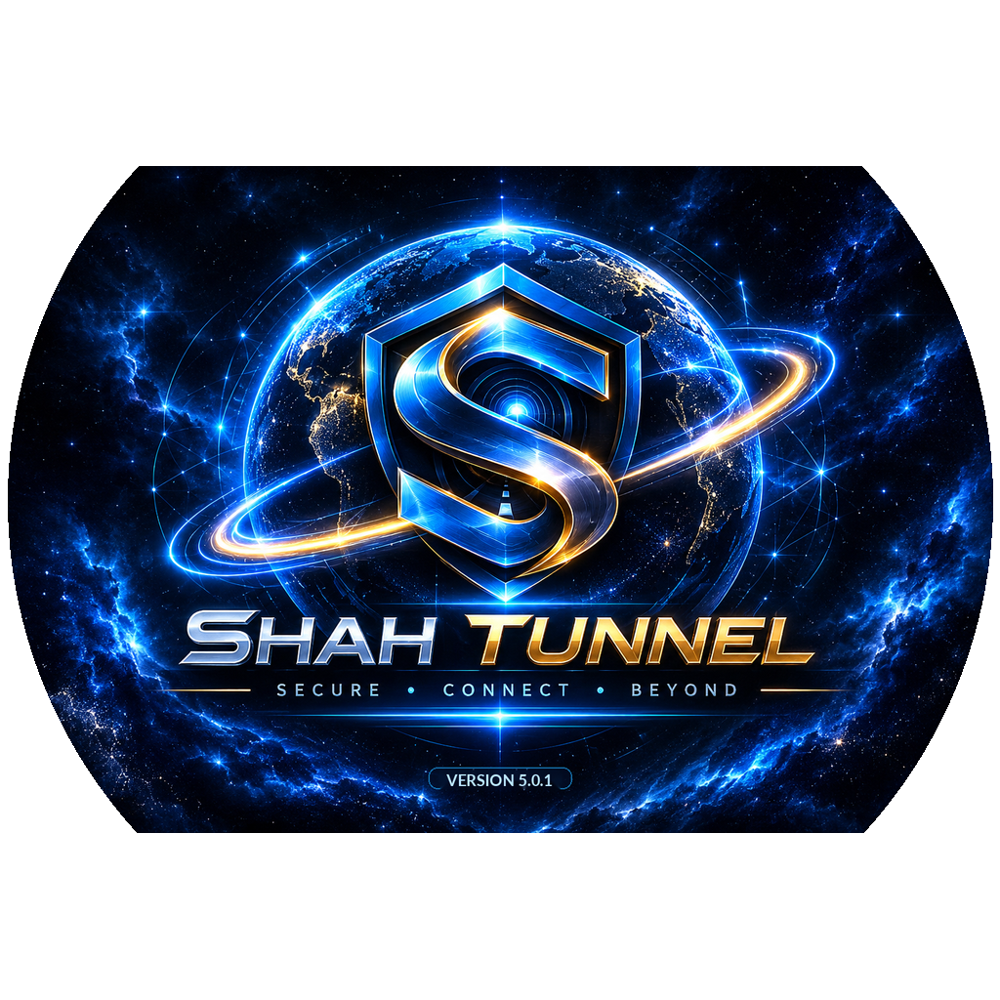
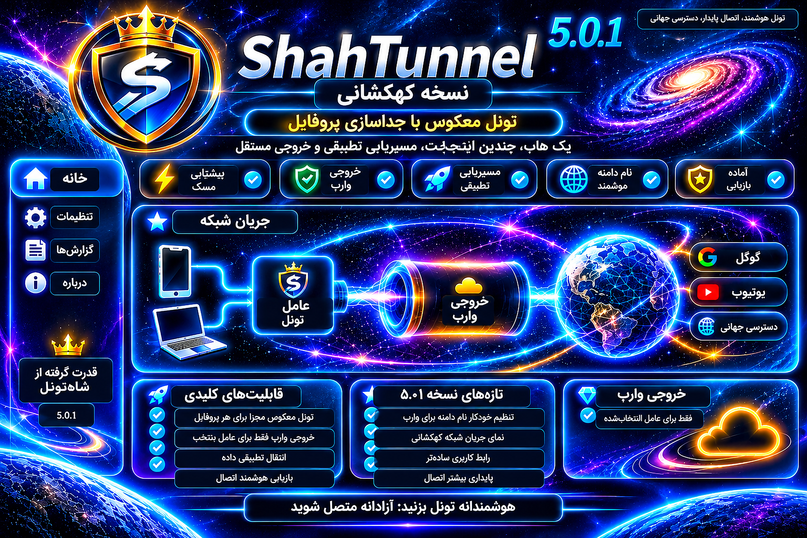

<div align="center">
# شاه‌تونل 5.5.10

<p align="center"></p>

[](https://github.com/ShahNetLab/ShahTunnel)

[](S1T-START.sh)

<p align="center">
<a href="https://t.me/MediaZet"></a>
&nbsp;
<a href="https://t.me/cloudflare0_bot"></a>
</p>

<div dir="rtl" align="center">برای حمایت از ShahTunnel و دریافت خبرها عضو کانال شوید؛ ربات برای عملیات Cloudflare است.</div>

[English](README.md) · **فارسی**

[⚡ قابلیت‌ها](#capabilities) · [🚀 نصب](#install)

</div>

---

<a id="network-flow"></a>
## Network Flow | جریان شبکه

<p align="center"><a href="docs/img/ShahTunnel-Network-Flow-v5-fa.png"></a></p>

<div dir="rtl">

مسیر انتقال Hub به Agent و خروجی اینترنت اختیاری هر پروفایل مستقل از یکدیگرند: تونل، Mappingهای TCP را به مقصد محلی Agent می‌رساند؛ مسیر اختیاری Xray فقط Inbound انتخاب‌شده را از خروجی SOCKS5 همان پروفایل (WARP، Psiphon) عبور می‌دهد.

</div>

```text
کاربر → پورت عمومی Hub → Laneهای احرازشده Agent → مقصد محلی Agent
Inbound انتخاب‌شده Xray → Sidecar محدود به Loopback → SOCKS5 خروجی WARP / Psiphon → اینترنت
```
<a id="capabilities"></a>

## نسخهٔ 5.5.10

رفع مشکل انتخاب خروجی Psiphon: Laneهای Agent فقط TCP/TLS و WebSocket/TLS را از نشانی مستقل `PsiphonHubAddr` عبور می‌دهند و HTTP/2 یا HTTP/1.1 CONNECT را که به پورت‌های مجاور پورت کنترل نیاز دارند امتحان نمی‌کنند. پورت سفارشی صریح مانند `2083` حفظ می‌شود و هنگام بارگذاری به `443` تغییر نمی‌کند. مهم‌تر اینکه از این نسخه، صرف موفقیت IP عمومی و DoH برای سالم دانستن Exit کافی نیست؛ شاه‌تونل از همان SOCKS5 تا آدرس دقیق Hub یک اتصال واقعی TLS با Fingerprint، ALPN و Token احرازشده برقرار می‌کند. اگر Exit مقصد یا پورت Hub را با خطایی مانند `SOCKS5 reply=5` رد کند یا احراز اتصال شکست بخورد، گزینهٔ بعدی Psiphon امتحان می‌شود. این آزمایش فقط مربوط به مسیر انتقال Agent↔Hub است؛ پورت سرویس کاربران و مقصدهای Xray مانند `127.0.0.1:2083` مستقل و بدون تغییر می‌مانند.

این نسخه مسیر خروجی کاربران Psiphon را در Sidecar اختصاصی Xray اصلاح می‌کند؛ بدون افزودن فایل به مخزن و بدون تغییر پورت کاربران، اطلاعات Inboundهای کپی‌شده، Mappingهای Hub، فایل اصلی X-UI، SSH یا Routeهای میزبان. Sidecar اکنون می‌تواند گواهی و کلید TLS موجود در مسیرهای زیر `/root` و `/home` را فقط به‌صورت خواندنی ببیند. DNS داخلی Xray از Tag یکتای همان پروفایل استفاده می‌کند و درخواست‌های DoH را از Outbound اختصاصی SOCKS5 سایفون عبور می‌دهد. هنگام انتخاب خروجی Psiphon، علاوه بر بررسی IP عمومی، دریافت پاسخ واقعی DoH از طریق SOCKS5 نیز آزمایش می‌شود تا بازبودن صرفِ پورت SOCKS به‌اشتباه سلامت DNS تلقی نشود. گزارش عبور هر اتصال کاربر از Mapping عمومی Hub تا مقصد محلی Agent نیز دقیق‌تر شده است. صفحهٔ «وضعیت و لاگ‌ها» علاوه بر Agent، وضعیت و گزارش‌های Sidecar اختصاصی Xray و سرویس Psiphon همان پروفایل را هم نشان می‌دهد تا محل قطع مسیر مشخص باشد. نصب‌کننده پیش از Restart کردن Agent، فقط سرویس Sidecar متعلق به همان پروفایل را شناسایی، اعتبارسنجی و درجا اصلاح می‌کند؛ در صورت شکست اعتبارسنجی یا Restart، تنظیمات قبلی بازگردانی می‌شوند. تشخیص آمادگی Agent بر سرویس مستقل Psiphon، Handshake واقعی SOCKS5 و لاگ اتصال احراز‌شدهٔ Lane تکیه دارد، نه پیام‌های ConsoleClient که در Journal سرویس دیگری ثبت نمی‌شوند.

## قابلیت‌ها

| | قابلیت | کارکرد |
|:--:|---|---|
|  | **رله معکوس Hub و Agent** | Hub پورت عمومی TCP را می‌پذیرد؛ Agent اتصال خروجی می‌سازد و هر Mapping را به مقصد محلی می‌رساند. |
|  | **پروفایل‌های مستقل** | هر تونل فایل تنظیمات و سرویس systemd جدا دارد؛ عملیات مدیریت روی پروفایل انتخاب‌شده انجام می‌شود. |
|  | **Laneهای انتقال تطبیقی** | چهار انتقال پیاده‌سازی‌شده به‌صورت جدا یا در حالت‌های Failover قابل استفاده‌اند. |
|  | **بازیابی مستقل Lane** | هر Lane جداگانه دوباره متصل می‌شود؛ خرابی یک Lane الزاماً Laneهای سالم را قطع نمی‌کند. پروفایل Agent جدید به‌صورت پیش‌فرض ۱۲ Lane مستقل دارد (حداکثر ۱۶). |
|  | **چند Mapping پورت** | شناسه هر Mapping، Listener عمومی Hub را به مقصد محلی Agent متصل می‌کند و باید در دو سمت یکسان باشد. |
|  | **WARP اختصاصی Xray** | Inbound انتخاب‌شده به Sidecar محدود به Loopback کپی و از SOCKS5 محلی WARP عبور داده می‌شود. |
|  | **خروجی کاربر از Psiphon** | Inboundهای همان Agent در Sidecar مستقل Xray کپی می‌شوند؛ TCP و DNS از SOCKS5 انتخاب‌شده می‌روند و UDP برای جلوگیری از نشت مستقیم مسدود می‌شود. |


### سیاست انتخاب خروجی Psiphon

Psiphon در هر ConsoleClient فقط یک مقدار `EgressRegion` می‌پذیرد؛ بنابراین شاه‌تونل گزینه‌های خروجی را به‌ترتیب بررسی می‌کند و به چرخش خودکار سمت سرویس‌دهنده متکی نیست. خروجی فقط زمانی پذیرفته می‌شود که IP عمومی مشاهده‌شده در SOCKS5 با IP مستقیم VPS متفاوت باشد. اگر خروجی معتبر پیدا نشود یا IP خروجی با IP مستقیم یکسان باشد، مسیر کاربران به‌صورت امن غیرفعال می‌ماند. پس از فعال‌شدن خروجی، زمان‌بند مستقل systemd هر ساعت مسیر انتخاب‌شده را دوباره بررسی و در صورت امکان جایگزین می‌کند؛ اگر گزینه‌های جایگزین موفق نباشند، آخرین مسیر تأییدشده بازیابی می‌شود. دسترس‌پذیری خروجی به Relayهای فعال Psiphon وابسته است و تضمین‌شده نیست.

### خروجی خودکار کاربران از Psiphon

این رفتار برای Agentهایی که گزینهٔ اختصاصی `Psiphon / SOCKS5` یا گزینهٔ `9` را انتخاب می‌کنند فعال است. برای همان پروفایل یک سرویس مستقل `shah-tunnel-psiphon-*.service` با `Restart=always` ساخته می‌شود و سرویس Agent با ترتیب `Wants` و `After` آن را همراه خود راه‌اندازی می‌کند؛ اما Restart شدن Psiphon دیگر Agent را متوقف نمی‌کند و Laneها می‌توانند مستقل Failover و تلاش مجدد کنند. شاه‌تونل گزینه‌های خروجی را به‌ترتیب بررسی و IP عمومی SOCKS5 را با IP مستقیم VPS مقایسه می‌کند؛ تنها پس از تأیید IP متفاوت، Inboundهای Xray متناظر با Mappingها در Sidecar مجزا و فقط روی `127.0.0.1` کپی می‌شوند. ترافیک TCP و DNS کاربران از SOCKS5 همان پروفایل عبور می‌کند. چون SOCKS5 محلی Psiphon یک پراکسی port-forward برای جریان TCP است و UDP را حمل نمی‌کند، UDP و هر نوع شبکهٔ ناشناخته در Sidecar به Blackhole می‌روند؛ بنابراین UDP/QUIC و ICMP ping از این مسیر پشتیبانی نمی‌شوند. در گزینهٔ ۹، علاوه بر خروجی کاربران، Laneهای ارتباط Agent با Hub نیز Failover مستقل بین Direct، Psiphon و MASQUE فعال دارند. تغییر مسیر خروجی ممکن است برای چند ثانیه اتصال‌های جاری را قطع کند؛ مسیر در این فاصله به IP مستقیم VPS برنمی‌گردد. این عملیات X-UI، کانفیگ اصلی Xray، سایر Inboundها، SSH و Routeهای میزبان را تغییر نمی‌دهد.

**بازیابی نصب نیمه‌کاره در 5.5.0:** اگر اجرای قبلی بعد از ساخت سرویس `shah-tunnel-xray-psiphon-*.service` متوقف شده باشد، اجرای مجدد همان پروفایل، سرویس متعلق به خود شاه‌تونل و فایل تنظیمات همان پروفایل را تشخیص می‌دهد و به‌روزرسانی می‌کند. سرویس ناشناس، لینک نمادین یا سرویسی که به فایل پروفایل دیگری اشاره کند بازنویسی نمی‌شود؛ نیازی به حذف دستی فایل‌های systemd نیست.

### بهینه‌سازی چندکاربره و اصلاح گزینهٔ ۹ (نسخهٔ 5.5.0)

در نسخهٔ اصلاح‌شدهٔ 5.5.0، گزینهٔ ۹ ترافیک TCP/DNS کاربران Xray را از Sidecar اختصاصی همان پروفایل و SOCKS5 سایفون عبور می‌دهد؛ در عین حال Laneهای Agent↔Hub مسیر Failover مستقل خود را حفظ می‌کنند. خروجی کاربران از IP مستقیم سرور عبور نمی‌کند. با این حال، ظرفیت Psiphon بین کاربران همان پروفایل مشترک است و می‌تواند در اتصال هم‌زمان ۱۶ نفر گلوگاه سرعت باشد؛ ظرفیت واقعی به CPU، RAM، پهنای باند، کیفیت مسیر و Relayهای فعال Psiphon بستگی دارد.

**بهینه‌سازی Psiphon در نسخه 5.5.0:** اندازه‌گیری PING/PONG بین Hub و Agent هر ۵ ثانیه تازه می‌شود؛ میانگین‌گیری سریع‌تر (EWMA یک‌چهارم) است و فقط نمونه‌های تازه‌تر از ۱۵ ثانیه در انتخاب Lane نقش دارند. بار Streamهای فعال هم در امتیاز باقی می‌ماند و Cache DNS در Sidecar اختصاصی Xray فعال است. تنظیمات انتقال Psiphon متناسب با منابع میزبان است: زیر ۳ GiB RAM محدودیت محافظه‌کارانهٔ Meek/Relay و مقدار پیش‌فرض پنجرهٔ کانال SSH یعنی ۴ واحد (۱۲۸ KiB) حفظ می‌شود؛ از ۳ GiB به بالا محدودیت Meek/Relay برداشته و پنجرهٔ کانال SSH روی ۱۶ واحد (۵۱۲ KiB) تنظیم می‌شود تا توان TCP در مسیرهای دارای RTT زیاد بهتر شود. محدودیت Threadهای CPU فقط روی میزبان‌های حداقل دو هسته‌ای برداشته می‌شود و اندازهٔ Tunnel Pool سایفون با منابع واقعی میزبان بین ۲ تا ۱۶ تونل مستقل مقیاس می‌شود. این تغییرها برای انتخاب Lane بهتر و افزایش توان TCP هستند؛ زمان اتصال انتهابه‌انتهای برنامهٔ کاربر یا تأخیر فیزیکی مسیر Psiphon را تضمینی کاهش نمی‌دهند. SOCKS5 سایفون فقط TCP/DNS را حمل می‌کند؛ UDP/QUIC و ICMP ping پشتیبانی نمی‌شوند و به‌جای خروج مستقیم مسدود می‌شوند.
## انتقال‌های Hub↔Agent

در زمان ساخت تونل یک حالت را انتخاب کنید. تنظیمات Hub و Agent باید با هم سازگار باشند.

| گزینه ویزارد | حالت | عملکرد |
|:--:|---|---|
| `1` | TCP/TLS | جریان TLS بین Hub و Agent. |
| `2` | WebSocket/TLS | انتقال جریان تونل در فریم‌های باینری WebSocket روی TLS. |
| `3` | HTTP/2 CONNECT | انتقال CONNECT روی TLS و پورت کنترل + ۱. |
| `4` | HTTP/1.1 CONNECT/TLS | انتقال CONNECT روی TLS و پورت کنترل + ۲. |
| `5` | HTTP CONNECT fallback | ابتدا HTTP/2 و در صورت نیاز HTTP/1.1. |
| `6` | Automatic fallback | ابتدا TCP/TLS و سپس WebSocket/TLS. |
| `7` | Full Adaptive Failover | هر چهار انتقال؛ هر Lane آخرین انتقال موفق خود را ترجیح می‌دهد. |
| `8` | External egress | در Agent انتخاب Cloudflare MASQUE یا Psiphon/SOCKS5. |
| `9` | All-protocol adaptive | در Agent، هر چهار انتقال به‌همراه خروجی TCP/DNS کاربران Xray از Sidecar اختصاصی Psiphon و Failover مستقل Laneهای Agent↔Hub بین Direct، Psiphon و MASQUE فعال. |

### روش‌های خروجی Agent

| روش | پیش‌نیاز / مسیر |
|---|---|
| `Direct` | اتصال Agent به Hub از مسیر عادی سرور. |
| `WARP / MASQUE` | WARP باید با MASQUE متصل باشد و Listener محلی WarpProxy / Local Proxy داشته باشد؛ حالت System Tunnel برای جداسازی خروجی یک پروفایل پذیرفته نمی‌شود. |
| `Psiphon / SOCKS5` | ShahTunnel در اولین استفاده ConsoleClient رسمی را می‌سازد و SOCKS5 اختصاصی را برای مسیر Agent و خروجی انتخابی کاربران آماده می‌کند. |
| `Adaptive` | از MASQUE فعال، Psiphon پیکربندی‌شده و مسیر جایگزین Direct استفاده می‌کند؛ پروتکل‌های پشتیبانی‌نشدهٔ WARP انتخاب نمی‌شوند. |

### اتصال Psiphon از پورت عمومی ۴۴۳

شبکهٔ Psiphon ممکن است برخی پورت‌های مقصد را در سطح Exit محدود کند؛ به همین دلیل ShahTunnel روی مسیر Psiphon فقط TCP/TLS و WebSocket/TLS را روی نشانی مستقل Mapping عمومی Hub امتحان می‌کند و HTTP/2 و HTTP/1.1 CONNECT را که به پورت‌های مجاور پورت کنترل نیاز دارند، از این مسیر کنار می‌گذارد. با این حال، ShahTunnel پورت سفارشی `PsiphonHubAddr` را با یک فهرست ثابت محلی مسدود یا به `443` بازنویسی نمی‌کند؛ آن را از SOCKS5 امتحان می‌کند و نتیجهٔ واقعی را گزارش می‌دهد. پورت مقصد کاربران و Xray مثل `2083` مستقل باقی می‌ماند.

اگر Psiphon به پورت کنترل Hub (برای نمونه `9448`) دسترسی نداشته باشد، Agent مسیر Psiphon را از نشانی Mapping عمومی Hub روی `443` عبور می‌دهد؛ مسیر Direct همچنان از پورت کنترل تنظیم‌شده استفاده می‌کند. مقدار پیش‌فرض Step 06 اکنون از پورت کنترل مستقل است و روی TCP/443 قرار می‌گیرد. Hub اتصال ShahTunnel را با ALPN اختصاصی `shah-tunnel-control/1` از ترافیک عادی TLS تشخیص می‌دهد و بایت‌های ClientHello کاربران عادی را بدون تغییر به Agent می‌فرستد. بنابراین نیازی به اشغال مجدد پورت ۴۴۳، تغییر X-UI، یا جابه‌جایی Mapping نیست.

برای استفاده از قابلیت‌های نسخهٔ جدید، هر دو سمت Hub و Agent باید نسخهٔ **5.5.10** را اجرا کنند. Mapping عمومی باید روی Hub فعال و از مسیر Exit انتخاب‌شدهٔ Psiphon قابل دسترسی باشد. مقدار پیش‌فرض نشانی Psiphon برابر TCP/443 است، اما هر پورت سفارشی که صریحاً وارد شود (از جمله `2083`) حفظ و از طریق SOCKS5 امتحان می‌شود؛ پروفایل‌های ذخیره‌شده نیز دیگر پورت صریح را هنگام بارگذاری به `443` مهاجرت نمی‌دهند. خود شبکهٔ Psiphon محدودیت پورت خروجی دارد و ممکن است پورت‌های خارج از مجموعهٔ مورد پشتیبانی را در زمان اتصال رد کند؛ در این صورت خطای SOCKS5 واقعی گزارش می‌شود. این منطق پورت مقصد کاربران، مانند `127.0.0.1:2083`، را تغییر نمی‌دهد.

### راه‌اندازی خودکار Psiphon

با انتخاب `Psiphon / SOCKS5` یا مسیر خروجی تطبیقی در Agent، شاه‌تونل به‌صورت خودکار:

- ConsoleClient رسمی Psiphon را از نسخهٔ منبع ثابت‌شده، برای معماری `amd64` یا `arm64` می‌سازد.
- معماری و اجرای فایل باینری را پیش از نصب بررسی می‌کند.
- فایل JSON خصوصی هر Agent را با شناسه‌های عمومی کلاینت، آینه‌های فهرست سرور، کلید امضای فهرست، کلید امضای Server Entry و کلید Exchange می‌سازد.
- یک پورت SOCKS5 یکتا روی `127.0.0.1` و پوشهٔ دادهٔ مستقل اختصاص می‌دهد.
- دسترسی نوشتن systemd را فقط به پوشهٔ دادهٔ همان Agent محدود می‌کند.
- برای هر پروفایل سرویس مستقل systemd با `Restart=always` می‌سازد. سرویس ConsoleClient عمداً با `PartOf` به Agent متصل نیست؛ بنابراین Restart کردن Agent، Psiphon و Tunnel Pool گرم آن را دوباره از صفر راه‌اندازی نمی‌کند. سرویس Agent از `Wants` و `After` برای راه‌اندازی Psiphon استفاده می‌کند؛ بنابراین Restart شدن Psiphon باعث توقف Agent نمی‌شود. آماده‌بودن SOCKS5 هنگام Start از سوی ویزارد جداگانه بررسی می‌شود. ویزارد، Sidecar مستقل Xray را آماده و خروجی HTTPS واقعی Psiphon را بررسی می‌کند و سپس Agent را شروع می‌کند؛ در نتیجه برای تغییر Mappingها نیازی به Restart دوم Agent نیست. در Startهای بعدی نیز خروجی واقعی Psiphon و Sidecar همان پروفایل پیش از در دسترس قرارگرفتن Agent بررسی/آماده می‌شوند. دستور Stop، Sidecar و سرویس Psiphon همان پروفایل را متوقف می‌کند و Start بعدی آن‌ها را دوباره روشن می‌کند. ConsoleClient در حالت پراکسی محلی اجرا می‌شود و فرزند فرایندی Agent نیست. آماده‌شدن SOCKS5 محلی از اتصال واقعی Psiphon و از اتصال Lane به Hub جدا گزارش می‌شود. گزینهٔ `ListenInterface` ارسال نمی‌شود تا Listener فقط روی Loopback بماند. گزارش‌های تشخیصی فقط در Journal محلی ذخیره می‌شوند و می‌توانند اطلاعات حساس نشست/شبکه داشته باشند.

برای تعمیر پروفایلی که با تنظیمات قبلی Psiphon وصل نشده، از پوشهٔ پروژه اجرا کنید: `sudo bash scripts/repair-psiphon-profile.sh PROFILE`. این ابزار از JSON همان پروفایل نسخهٔ پشتیبان می‌گیرد و فقط سرویس `ravanreverse@PROFILE` را راه‌اندازی مجدد می‌کند. اگر SOCKS5 محلی آماده شود اما Psiphon یا Lane ارتباط با Hub هنوز متصل نشده باشد، وضعیت `PENDING` می‌دهد و سرویس را برای تلاش مجدد روشن می‌گذارد؛ فقط در صورت آماده‌نشدن SOCKS5، همان پروفایل را متوقف می‌کند.

نیازی به تهیهٔ دستی باینری یا JSON نیست. راه‌اندازی اولیه برای دریافت سورس رسمی و ابزار Go به دسترسی اینترنت نیاز دارد. هیچ TUN، مسیر پیش‌فرض سرور، SSH یا سرویس X-UI تغییر نمی‌کند. در گزینهٔ ۹، خروجی TCP/DNS کاربران Xray از Sidecar اختصاصی Psiphon عبور می‌کند و Laneهای ارتباط Agent با Hub نیز Failover مستقل دارند. این مسیر برای UDP/QUIC و ICMP نیست؛ UDP به‌جای خروج مستقیم مسدود می‌شود.

> گزینه `9` در ویزارد ساخت تونل به معنی **All-protocol adaptive** است. ترافیک TCP/DNS کاربران Xray از Sidecar اختصاصی و SOCKS5 سایفون عبور می‌کند؛ هم‌زمان Laneهای Agent↔Hub چهار انتقال داخلی و مسیرهای جایگزین Direct، Psiphon و MASQUE فعال را به‌صورت مستقل استفاده می‌کنند. UDP/QUIC و ICMP از مسیر SOCKS سایفون عبور نمی‌کنند و UDP برای جلوگیری از نشت مستقیم مسدود است. خروجی WARP در صورت انتخاب هنگام ساخت Agent به‌صورت خودکار اعمال می‌شود.

## اعمال خودکار خروجی WARP هنگام ساخت Agent

- هنگام ساخت Agent، گزینهٔ Cloudflare WARP over MASQUE را انتخاب کنید.
- ShahTunnel پیش از ذخیره و شروع سرویس بررسی می‌کند که WARP با پروتکل MASQUE متصل است و Listener محلی **WarpProxy / Local Proxy** در دسترس است.
- سپس Sidecar مستقل Xray و مسیر DNS مبتنی بر WARP را فقط برای Mappingهای همان پروفایل آماده می‌کند.
- سایر پروفایل‌ها، Inboundهای دیگر، تنظیمات X-UI، SSH و مسیرهای میزبان تغییر نمی‌کنند.
- برای Agentهای موجود، این رفتار در زمان ساخت اعمال می‌شود؛ برای افزودن آن به یک Agent قدیمی، پروفایل Agent را دوباره با خروجی WARP بسازید. عملیات جداگانه‌ای در منوی مدیریت وجود ندارد.

**نکته مهم:** قابلیت خروجی اختصاصی هر پروفایل به **WarpProxy / Local Proxy در حالت MASQUE** نیاز دارد. حالت **System Tunnel** به‌دلیل اعمال مسیر در سطح کل سرور برای جداسازی یک پروفایل پذیرفته نمی‌شود. اگر Local Proxy فعال یا قابل دسترسی نباشد، ویزارد با پیام خطا متوقف می‌شود؛ ShahTunnel مسیر را بی‌صدا به Direct تغییر نمی‌دهد و Route میزبان را هم دست‌کاری نمی‌کند.

## مدیریت روزمره

`sudo shah-tunnel menu` منوی مدیریت را باز می‌کند. عملیات روی پروفایل انتخاب‌شده انجام می‌شود:

| گزینه منو | عملکرد |
|:--:|---|
| `1` | ساخت پروفایل جدید Hub، Agent یا Relay. |
| `2` | شروع تونل انتخاب‌شده. |
| `3` | توقف تونل انتخاب‌شده. |
| `4` | راه‌اندازی مجدد تونل انتخاب‌شده. |
| `5` | نمایش وضعیت و لاگ‌های اخیر. |
| `6` | تنظیم Restart زمان‌بندی‌شده تونل‌های فعال. |
| `7` | حذف فقط یک پروفایل انتخاب‌شده. |
| `8` | حذف کامل ShahTunnel. |

<div dir="rtl">

دستورهای کاربردی:

</div>

```bash
sudo shah-tunnel version
sudo shah-tunnel menu
sudo systemctl status 'ravanreverse@PROFILE.service' --no-pager -l
sudo journalctl -u 'ravanreverse@PROFILE.service' -n 80 --no-pager
```

<div dir="rtl">

به‌جای `PROFILE` نام Instance سرویس همان پروفایل را قرار دهید. برای بررسی ساده‌تر، گزینه **Status & Logs** در منوی مدیریت، وضعیت و ۴۰ لاگ اخیر را نشان می‌دهد.

## امنیت

- توکن Hub و اثر انگشت گواهی را محرمانه نگه دارید. Agent باید دقیقاً از مقادیر تولیدشده در Hub استفاده کند.
- در فایروال Hub فقط پورت کنترل/CONNECT انتخاب‌شده و پورت‌های عمومی Mapping موردنیاز را باز کنید.
- توکن، کلید خصوصی، فایل کامل تنظیمات یا لاگ بدون حذف اطلاعات حساس را در Issue یا تصویر عمومی منتشر نکنید.
- Sidecar اختصاصی WARP برای Inbound کپی‌شده روی Loopback گوش می‌دهد و جایگزین سرویس اصلی Xray تحت مدیریت X-UI نمی‌شود.
- ShahTunnel را فقط روی سرورها و سرویس‌هایی استفاده کنید که مالک آن هستید یا مجوز مدیریتشان را دارید. [سیاست امنیتی](SECURITY.md).

<a id="install"></a>
## نصب

ShahTunnel از معماری **Hub / Agent** استفاده می‌کند. برنامه را روی سرور Hub و هر Agent نصب کنید. در صورت نیاز، یک سرور سوم نیز می‌تواند نقش Relay داشته باشد.

**پیش‌نیازها:** لینوکس `amd64` یا `arm64`، سرویس `systemd` و دسترسی root. نصب‌کننده ابزار Go نسخهٔ 1.26.1 را دریافت و با SHA-256 بررسی می‌کند، سپس باینری لینوکس را روی همان سرور می‌سازد.

**۱. نصب روی هر سرور**

```bash
bash <(curl -fsSL https://raw.githubusercontent.com/ShahNetLab/ShahTunnel/main/S1T-START.sh)
```

اگر دامنهٔ `raw.githubusercontent.com` در دسترس نبود، روش جایگزین GitHub API در ادامه قرار دارد:

```bash
set -o pipefail
curl -fsSL --connect-timeout 10 --max-time 30 \
  -H 'Accept: application/vnd.github+json' \
  -H 'User-Agent: ShahTunnel-bootstrap' \
  'https://api.github.com/repos/ShahNetLab/ShahTunnel/contents/S1T-START.sh?ref=main' \
| python3 -c 'import sys,json,base64; d=json.load(sys.stdin); sys.stdout.buffer.write(base64.b64decode(d["content"]))' \
| bash
```

<div dir="rtl">

پس از نصب، منوی مدیریت باز می‌شود. برای ورود دوباره:

</div>

```bash
sudo shah-tunnel menu
```

<div dir="rtl">

**۲. ساخت Hub**

1. گزینه ساخت تونل جدید را انتخاب کنید و نقش **HUB** را بزنید.
2. پورت کنترل را تعیین کنید (پیش‌فرض `0.0.0.0:9443`) و انتقال مورد قبول Hub را انتخاب کنید.
3. نگاشت پورت‌های عمومی را بسازید. برای هر نگاشت یک شناسه مانند `main` یا `web` تعیین کنید.
4. **توکن Agent** و **اثر انگشت SHA-256 گواهی** را ذخیره کنید؛ Agent باید دقیقاً از همین دو مقدار استفاده کند.

**۳. ساخت Agent**

1. روی سرور مقصد، تونل جدید بسازید و نقش **AGENT** را انتخاب کنید.
2. آدرس Hub و پورت کنترل را وارد کنید و انتقال سازگار با Hub را برگزینید.
3. توکن و اثر انگشت گواهی Hub را وارد کنید.
4. همان شناسه‌های Mapping را بسازید و مقصد محلی هرکدام را وارد کنید؛ برای نمونه `127.0.0.1:443`.
5. پروفایل را ذخیره کنید. ShahTunnel سرویس مستقل آن را فعال می‌کند و Laneهای قطع‌شده را به‌صورت خودکار دوباره متصل می‌کند.

**۴. فایروال:** فقط پورت‌های لازم را باز کنید. Hub به پورت کنترل انتخاب‌شده، پورت CONNECT در صورت نیاز (`کنترل + ۱` برای HTTP/2 یا `کنترل + ۲` برای HTTP/1.1) و پورت‌های عمومی Mapping نیاز دارد. Agent اتصال خروجی را به Hub برقرار می‌کند و مقصدهای محلی در سمت Agent هستند.

</div>

## عیب‌یابی

</div>

| مشکل | اولین بررسی |
|---|---|
| Agent متصل نمی‌شود | آدرس Hub، توکن، اثر انگشت گواهی، سازگاری حالت انتقال و پورت‌های فایروال را بررسی کنید. |
| HTTP/2 یا HTTP/1.1 CONNECT کار نمی‌کند | پورت TCP اضافه Hub را بررسی کنید (`کنترل + ۱` یا `کنترل + ۲`). |
| Mapping ترافیک را عبور نمی‌دهد | شناسه Mapping در Hub و Agent و دسترسی به مقصد محلی Agent را بررسی کنید. |
| خروجی WARP فعال نمی‌شود | قبل از ساخت Agent بررسی کنید WARP با MASQUE متصل است و `warp-cli settings` یک Listener محلی `WarpProxy` قابل دسترسی نشان می‌دهد. حالت System Tunnel برای جداسازی هر پروفایل پذیرفته نیست. |
| DNS گوگل/یوتیوب روی WARP مستقل مشکل دارد | وضعیت سرویس `shah-tunnel-xray-warp-<profile>.service` و لاگ‌های همان Sidecar را ببینید؛ مسیرهای میزبان را تغییر ندهید. |

---

## رفتار و بهینه‌سازی Psiphon در نسخهٔ ۴٫۰٫۰

- آماده‌شدن Listener محلی SOCKS5 به‌تنهایی به معنی اتصال واقعی Psiphon نیست. سرویس Agent روشن می‌ماند تا ConsoleClient تلاش مجدد کند؛ ویزارد فقط پس از برقراری تونل واقعی و آماده‌شدن Laneها، اتصال را موفق اعلام می‌کند.
- در حالت اختصاصی `Psiphon / SOCKS5`، ترافیک TCP و DNS ورودی‌های Xray همان پروفایل از SOCKS5 محلی Psiphon عبور می‌کند. UDP، QUIC و نوع‌های ناشناختهٔ شبکه در Sidecar مستقل مسدود می‌شوند و به مسیر مستقیم سرور برنمی‌گردند. این مسیر SOCKS5، ICMP ping را حمل نمی‌کند.
- Psiphon فقط در حالت Local SOCKS اجرا می‌شود. ShahTunnel دستگاه TUN نمی‌سازد، مسیر پیش‌فرض میزبان را تغییر نمی‌دهد، `CAP_NET_ADMIN` نمی‌دهد و سرویس Xray تحت مدیریت X-UI را تغییر نمی‌دهد.
- RTT داخلی Laneهای Hub↔Agent با PING/PONG احرازشده هر ۵ ثانیه اندازه‌گیری می‌شود. Hub انتخاب مسیر را بر اساس RTT تازه و بار جریان‌های فعال انجام می‌دهد؛ نمونه‌های قدیمی‌تر از ۱۵ ثانیه از رتبه‌بندی کنار می‌روند. این عدد با تأخیر سرتاسری‌ای که برنامهٔ کلاینت نمایش می‌دهد یکسان نیست.
- روی میزبان‌های دارای کمتر از ۳ GiB RAM، محدودیت بافرهای Psiphon حفظ می‌شود. از ۳ GiB به بالا، محدودیت بافر Meek و Relay برداشته و پنجرهٔ کانال SSH روی ۱۶ واحد (۵۱۲ KiB) تنظیم می‌شود؛ میزبان کم‌حافظه مقدار پیش‌فرض مستند ۴ واحد (۱۲۸ KiB) را نگه می‌دارد. محدودیت Thread روی میزبان تک‌هسته‌ای فعال می‌ماند و اندازهٔ پیش‌فرض Tunnel Pool سایفون تغییر نمی‌کند.
- این تنظیمات برای افزایش توان TCP و واکنش سریع‌تر انتخاب Lane هستند؛ تأخیر فیزیکی مسیر کاربر تا Hub، رلهٔ Psiphon و مقصد را حذف نمی‌کنند. عددی مثل ۶۳۵ میلی‌ثانیه باید قبل و بعد از نصب از سمت کلاینت و در شرایط مشابه اندازه‌گیری شود؛ کاهش عدد مشخصی تضمین‌شدنی نیست.

برای مجموعهٔ کامل قابلیت‌ها، هر دو سرور Hub و Agent را روی نسخهٔ 5.5.10 نگه دارید. شماره‌های نسخهٔ قدیمی در بخش‌های تاریخی این مستند به انتشارهای قبلی اشاره دارند.


## نکات کارایی چندکاربره (نسخهٔ 5.5.0)

زمان‌بند Hub علاوه بر RTT معتبر و تعداد جریان‌های فعال، بایت‌های منتظر ارسال و میانگین زمان انتظار نوشتن داده روی سوکت را هم بررسی می‌کند. وزن بار جریان‌های فعال در حضور RTT تازه نیز تقویت شده تا اختلاف کوچک RTT باعث تجمع اتصال‌های جدید روی یک Lane شلوغ نشود. پنجرهٔ دادهٔ درحال‌پرواز هر جریان به ۵۱۲ فریم ۶۴ کیلوبایتی (۳۲ مگابایت) افزایش یافته، اما سقف صف دادهٔ کل فرایند همچنان ۶۴ مگابایت است؛ بنابراین فضای بیشتری برای مسیرهای دارای تأخیر بالا فراهم می‌شود، بدون آنکه بافر تجمیعی نامحدود شود. نکتهٔ مهم: پروتکل فعلی اتصال‌های TCP مستقل را بین Laneها پخش می‌کند؛ یک اتصال TCP طولانی روی یک Lane باقی می‌ماند و سرعت آن برابر مجموع سرعت ۱۲ Lane نیست. در گزینهٔ ۹ نسخهٔ 5.5.0، ترافیک TCP/DNS کاربران Xray از Sidecar اختصاصی همان پروفایل و SOCKS5 سایفون خارج می‌شود؛ Laneهای Agent↔Hub همچنان Failover مستقل Direct/Psiphon/MASQUE فعال دارند. این مسیر host-wide نیست و SSH یا Inboundهای نامرتبط Xray را تغییر نمی‌دهد. ظرفیت Psiphon بین کاربران همان پروفایل مشترک است و در بار هم‌زمان می‌تواند گلوگاه سرعت باشد. مقدار `TunnelPoolSize` سایفون با RAM و CPU بین ۲ تا ۱۶ تنظیم می‌شود و گزینه‌های خارج از سیاست پیکربندی‌شده رد می‌شوند؛ تأیید IP خروجی واقعی همچنان الزامی است. اتصال Xray به WARP فعلاً فقط با Local Proxy مبتنی بر MASQUE پشتیبانی می‌شود؛ WireGuard در این مسیر سازگار معرفی نشده است. 

این اصلاح‌ها زمان‌بندی و کنترل صف را بهتر می‌کنند، اما ظرفیت قطعی ۱۰۰ کاربر روی هر VPS را تضمین نمی‌کنند. ظرفیت واقعی به CPU، RAM، پهنای‌باند کارت شبکه و ظرفیت خروجی Hub و رله‌های WARP/Psiphon بستگی دارد. پیش از استفادهٔ عملیاتی، بار را مرحله‌ای آزمایش کنید.
