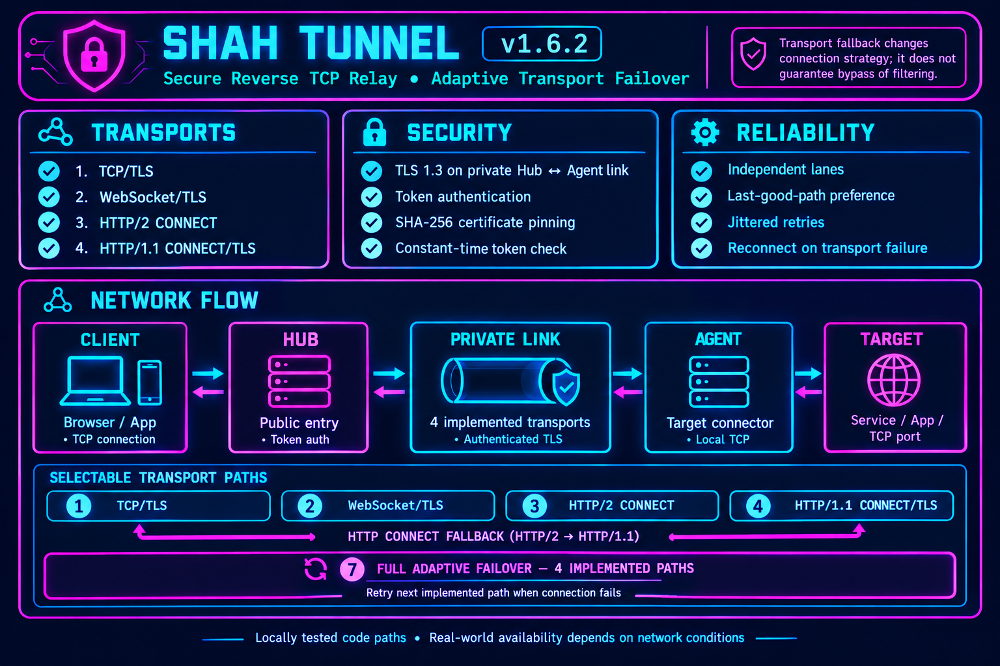

<p align="center">
  
</p>

<h1 align="center">SHAH TUNNEL</h1>
<p align="center"><strong>v1.6.2 · Secure Reverse TCP Relay · Adaptive Transport Failover</strong></p>
<p align="center">A reverse TCP relay with an authenticated TLS 1.3 Hub↔Agent channel, certificate pinning, independent lanes and automatic transport recovery.</p>
<p align="center"><a href="README.md">🇬🇧 English</a> · <a href="README-fa.md">🇮🇷 فارسی</a></p>

## Network flow

<p align="center">
  
</p>

## Features

- **Four implemented transports:** TCP/TLS, WebSocket/TLS, HTTP/2 CONNECT and HTTP/1.1 CONNECT/TLS.
- **Automatic recovery:** reconnect with jittered backoff and adaptive selection of the last successful transport per lane.
- **Security:** TLS 1.3 for the private Hub↔Agent channel, token authentication and SHA-256 certificate pinning.
- **Concurrency:** twelve independent lanes by default, bounded queues and load-aware session selection.
- **Management:** interactive CLI, systemd integration, status and logs, installer and local verification script.

## Transport menu

Choose the same transport or strategy on both Hub and Agent.

| Option | Transport / strategy | Behaviour |
|---|---|---|
| `1` | TCP/TLS | Native TLS-protected stream. |
| `2` | WebSocket/TLS | Tunnel stream carried in WebSocket binary frames over TLS. |
| `3` | HTTP/2 CONNECT | Bidirectional CONNECT stream over TLS on control port + 1. |
| `4` | HTTP/1.1 CONNECT/TLS | CONNECT stream over TLS on control port + 2. |
| `5` | HTTP CONNECT fallback | Tries HTTP/2 CONNECT, then HTTP/1.1 CONNECT if setup fails. |
| `6` | Automatic fallback | TCP/TLS, then WebSocket/TLS. |
| `7` | Full adaptive failover | Tries all four implemented transports and remembers the last successful authenticated transport per lane. |

### Hub firewall ports

If the Hub control port is `9443`:

- `9443/TCP`: native TCP/TLS and WebSocket/TLS.
- `9444/TCP`: HTTP/2 CONNECT (options 3, 5 and 7).
- `9445/TCP`: HTTP/1.1 CONNECT (options 4, 5 and 7).

Open only the ports needed by the selected mode. All four transports in this version use TCP.

## Responsible use and privacy

ShahTunnel is a general-purpose TCP relay. Configure it only for servers and services you own or are explicitly authorized to administer. Do not use it to access third-party systems without permission, relay abusive traffic, or disrupt services. Operators are responsible for the endpoints and traffic they choose to forward.

The server information display may make outbound HTTPS requests to public IP and GeoIP providers (including ipify, icanhazip, checkip.amazonaws.com, ipinfo.io, ip.sb, ipapi.co and ipwho.is) to determine the server's public IPv4 address and country. These providers can observe the server's public IP and request metadata; the GeoIP lookups do not include the tunnel token or tunnel payload.

For upgrade compatibility, the installed systemd unit and configuration directory still use the legacy names `ravanreverse.service` and `/etc/ravanreverse`; the installer also provides the `shah-tunnel` command as a symlink. These are local compatibility names, not third-party download destinations. Do not rename them manually on an existing server; a future rename would need an explicit migration.

## Install

Run as root on Linux amd64 or arm64 with systemd and HTTPS access to the official Go download hosts and the source repository:

```bash
bash <(curl -fsSL https://raw.githubusercontent.com/ShahNetLab/ShahTunnel/main/S1T-START.sh)
```

The installer downloads the Go `1.26.10` toolchain from the official Go distribution host `https://dl.google.com/go` (with `https://go.dev/dl` as a fallback) and verifies its pinned SHA-256 checksum before use. It then downloads the source archive from the `main` branch of this repository and compiles `S1T-CAPSULE` locally for the server architecture with CGO disabled. It does not use GitHub Release assets or install the Go toolchain permanently. The built binary's application version and target architecture are checked before installation. An existing binary is backed up before replacement, and an already-active service is not restarted during installation to avoid dropping live tunnel sessions.

## Build and tests

The verification helper requires Go 1.26.10 to already be installed locally; it will not download a toolchain. From the repository root:

```bash
./VERIFY-ALL-TRANSPORTS.sh
```

Or run the main checks directly:

```bash
gofmt -w S1T-CAPSULE/main.go S1T-CAPSULE/main_test.go
go test -race -count=20 ./S1T-CAPSULE
go vet ./S1T-CAPSULE
mkdir -p dist
CGO_ENABLED=0 GOOS=linux GOARCH=amd64 go build -trimpath -ldflags='-s -w -buildid=' -o dist/shah-tunnel-linux-amd64 ./S1T-CAPSULE
CGO_ENABLED=0 GOOS=linux GOARCH=arm64 go build -trimpath -ldflags='-s -w -buildid=' -o dist/shah-tunnel-linux-arm64 ./S1T-CAPSULE
(cd dist && sha256sum shah-tunnel-linux-amd64 > shah-tunnel-linux-amd64.sha256)
(cd dist && sha256sum shah-tunnel-linux-arm64 > shah-tunnel-linux-arm64.sha256)
```
