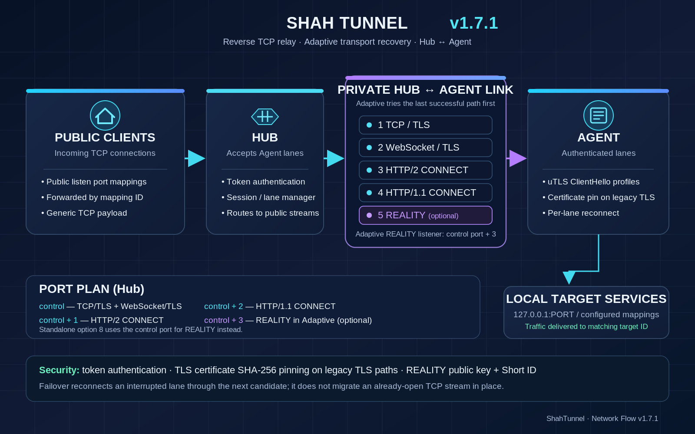

<p align="center">
  
</p>

<h1 align="center">SHAH TUNNEL</h1>
<p align="center"><strong>v1.7.1 · Secure Reverse TCP Relay · Adaptive REALITY + uTLS</strong></p>
<p align="center">A reverse TCP relay with an authenticated TLS 1.3 Hub↔Agent channel, certificate pinning, independent lanes and automatic transport recovery.</p>
<p align="center"><a href="README.md">🇬🇧 English</a> · <a href="README-fa.md">🇮🇷 فارسی</a></p>

## Network flow

<p align="center">
  
</p>

## Features

- **Four legacy transports plus REALITY:** TCP/TLS, WebSocket/TLS, HTTP/2 CONNECT, HTTP/1.1 CONNECT/TLS, and an optional independent REALITY transport.
- **Automatic recovery:** reconnect with jittered backoff and adaptive selection of the last successful transport per lane.
- **Security:** TLS 1.3 for the private Hub↔Agent channel, token authentication and SHA-256 certificate pinning.
- **Concurrency:** twelve independent lanes by default, bounded queues and load-aware session selection.
- **Management:** interactive CLI, systemd integration, status and logs, installer and local verification script.

## Transport menu

Choose the same transport or strategy on both Hub and Agent.

| Option | Transport / strategy | Behaviour |
|---|---|---|
| `1` | TCP/TLS | Native TLS-protected stream. |
| `2` | WebSocket/TLS | Tunnel stream carried in WebSocket binary frames over TLS. |
| `3` | HTTP/2 CONNECT | Bidirectional CONNECT stream over TLS on control port + 1. |
| `4` | HTTP/1.1 CONNECT/TLS | CONNECT stream over TLS on control port + 2. |
| `5` | HTTP CONNECT fallback | Tries HTTP/2 CONNECT, then HTTP/1.1 CONNECT if setup fails. |
| `6` | Automatic fallback | TCP/TLS, then WebSocket/TLS. |
| `7` | Full adaptive failover | Tries the four legacy transports and, when configured on both endpoints, REALITY on a separate listener; remembers the last successful authenticated transport per lane. |

### Hub firewall ports

If the Hub control port is `9443`:

- `9443/TCP`: native TCP/TLS and WebSocket/TLS.
- `9444/TCP`: HTTP/2 CONNECT (options 3, 5 and 7).
- `9445/TCP`: HTTP/1.1 CONNECT (options 4, 5 and 7).

Open only the ports needed by the selected mode. REALITY uses TCP on the control port; the control+1 and control+2 ports are not needed for this mode. In Adaptive mode, optional REALITY listens on control port + 3 by default (for example, `9446/TCP` when control is `9443`). Override it with `reality_listen` on Hub and `reality_addr` on Agent. The standalone REALITY mode (option 8) continues to use the control address itself.

## REALITY setup (option 8 or optional Adaptive path)

Configure the Hub with option 8 first. It generates an X25519 private/public key pair; enter only the public key, Short ID, and SNI on the Agent. **The private key stays on the Hub.** The control port (default `9443/TCP`) must be reachable from the Agent.

`reality_sni` is the TLS hostname; `reality_dest` is the target in `host:port` form. For example, use your real cover-site hostname as `reality_sni` and the origin IP that serves it as `reality_dest` (`host:port`); the destination may differ from the SNI hostname only when that origin actually serves the selected name and you are authorized to use it. The destination must be reachable from the Hub and compatible with the chosen SNI; an invalid destination can break fallback handshakes. Unauthenticated TLS attempts are intentionally forwarded to this single fixed destination so probes receive its real response; this consumes outbound bandwidth and behaves like a fixed-target TCP proxy, so choose the destination deliberately.

The Agent uses uTLS with `chrome`, `firefox`, `edge`, or `randomized` ClientHello profiles. The REALITY public key and Short ID authenticate this mode; the SHA-256 certificate fingerprint used by legacy transports is not used here. ShahTunnel's token authentication remains required after a successful REALITY handshake.

> Scope of this release: Adaptive selection now includes REALITY when its settings exist on both sides. Agent-side uTLS profiles are also used for legacy TLS transports while certificate SHA-256 pinning is retained. QUIC/HTTP3, true simultaneous multipath, and configurable traffic padding/morphing are not included. Adaptive failover is sequential per lane and does not migrate an already-open TCP stream to another transport; the lane reconnects through its next candidate.

## Responsible use and privacy

ShahTunnel is a general-purpose TCP relay. Configure it only for servers and services you own or are explicitly authorized to administer. Do not use it to access third-party systems without permission, relay abusive traffic, or disrupt services. Operators are responsible for the endpoints and traffic they choose to forward.

The server information display may make outbound HTTPS requests to public IP and GeoIP providers (including ipify, icanhazip, checkip.amazonaws.com, ipinfo.io, ip.sb, ipapi.co and ipwho.is) to determine the server's public IPv4 address and country. These providers can observe the server's public IP and request metadata; the GeoIP lookups do not include the tunnel token or tunnel payload.

For upgrade compatibility, the installed systemd unit and configuration directory still use the legacy names `ravanreverse.service` and `/etc/ravanreverse`; the installer also provides the `shah-tunnel` command as a symlink. These are local compatibility names, not third-party download destinations. Do not rename them manually on an existing server; a future rename would need an explicit migration.

## Install

Run as root on Linux amd64 or arm64 with systemd and HTTPS access to the official Go download hosts and the source repository:

```bash
bash <(curl -fsSL https://raw.githubusercontent.com/ShahNetLab/ShahTunnel/main/S1T-START.sh)
```

The installer first reuses an existing Go `1.26.x` or `1.27.x` toolchain when available and architecture-compatible. Otherwise it downloads Go `1.26.10` only from mirrors whose final HTTPS HEAD response is HTTP 200 and has a plausible Content-Length. It retains a separate partial file per mirror and resumes only from that same mirror with HTTP Range where supported. It verifies the pinned official SHA-256 checksum before using the archive; unverified archives are never accepted. When launched from an extracted or cloned project directory, the installer builds that local source; when launched remotely with `bash <(curl ...)`, it downloads the source archive from this repository's `main` branch. It then compiles `S1T-CAPSULE` locally for the server architecture with CGO disabled. It does not use GitHub Release assets; it retains the SHA-256-verified Go toolchain under `/usr/local/lib/shah-tunnel/toolchains/` for reuse by later installs. The built binary's application version and target architecture are checked before installation. An existing binary is backed up before replacement, and an already-active service is not restarted during installation to avoid dropping live tunnel sessions.

## Build and tests

The module requires Go 1.26.0 or newer. REALITY is pinned to a revision whose own go.mod declares Go 1.24.0, while golang.org/x/net v0.62.0 requires Go 1.26.0. The verification helper requires Go 1.26.x or 1.27.x to already be installed locally; it will not download a toolchain. From the repository root:

```bash
./VERIFY-ALL-TRANSPORTS.sh
```

Or run the main checks directly:

```bash
gofmt -w S1T-CAPSULE/main.go S1T-CAPSULE/main_test.go S1T-CAPSULE/reality_transport.go
go mod tidy
go test -race -count=20 ./S1T-CAPSULE
go vet ./S1T-CAPSULE
mkdir -p dist
CGO_ENABLED=0 GOOS=linux GOARCH=amd64 go build -trimpath -ldflags='-s -w -buildid=' -o dist/shah-tunnel-linux-amd64 ./S1T-CAPSULE
CGO_ENABLED=0 GOOS=linux GOARCH=arm64 go build -trimpath -ldflags='-s -w -buildid=' -o dist/shah-tunnel-linux-arm64 ./S1T-CAPSULE
(cd dist && sha256sum shah-tunnel-linux-amd64 > shah-tunnel-linux-amd64.sha256)
(cd dist && sha256sum shah-tunnel-linux-arm64 > shah-tunnel-linux-arm64.sha256)
```
