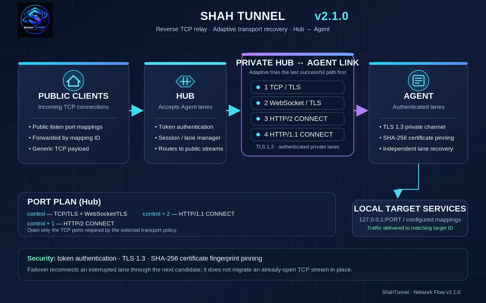

<p align="center">
  
</p>

<h1 align="center">SHAH TUNNEL</h1>
<p align="center"><strong>v2.1.0 · Secure Reverse TCP Relay · Adaptive Transport Failover</strong></p>
<p align="center">A reverse TCP relay with an authenticated TLS 1.3 Hub↔Agent channel, certificate pinning, independent lanes and automatic transport recovery.</p>
<p align="center"><a href="README.md">🇬🇧 English</a> · <a href="README-fa.md">🇮🇷 فارسی</a></p>

## Network flow

<p align="center">
  
</p>

## Features

- **Four implemented transports:** TCP/TLS, WebSocket/TLS, HTTP/2 CONNECT and HTTP/1.1 CONNECT/TLS.
- **Automatic recovery:** reconnect with jittered backoff and adaptive selection of the last successful transport per lane.
- **Security:** TLS 1.3 for the private Hub↔Agent channel, token authentication and SHA-256 certificate pinning.
- **Concurrency:** twelve independent lanes by default, bounded queues and load-aware session selection.
- **Management:** interactive CLI, systemd integration, status and logs, installer and local verification script.

## Transport menu

Choose the same transport or strategy on both Hub and Agent.

| Option | Transport / strategy | Behaviour |
|---|---|---|
| `1` | TCP/TLS | Native TLS-protected stream. |
| `2` | WebSocket/TLS | Tunnel stream carried in WebSocket binary frames over TLS. |
| `3` | HTTP/2 CONNECT | Bidirectional CONNECT stream over TLS on control port + 1. |
| `4` | HTTP/1.1 CONNECT/TLS | CONNECT stream over TLS on control port + 2. |
| `5` | HTTP CONNECT fallback | Tries HTTP/2 CONNECT, then HTTP/1.1 CONNECT if setup fails. |
| `6` | Automatic fallback | TCP/TLS, then WebSocket/TLS. |
| `7` | Full adaptive failover | Tries all four implemented transports and remembers the last successful authenticated transport per lane. |

### Hub firewall ports

If the Hub control port is `9443`:

- `9443/TCP`: native TCP/TLS and WebSocket/TLS.
- `9444/TCP`: HTTP/2 CONNECT (options 3, 5 and 7).
- `9445/TCP`: HTTP/1.1 CONNECT (options 4, 5 and 7).

Open only the ports needed by the selected mode. All four transports in this version use TCP.

## Multiple tunnel profiles and upload throughput

Each create operation asks for a unique tunnel name and stores its configuration separately. Existing profiles remain intact. Every named profile runs as its own systemd instance; Start, Stop, Restart, Status, and Delete act on the selected profile. Option 7 deletes one profile; option 8 removes the entire installation.

The per-stream in-flight window is increased to 64 frames of up to 64 KiB (about 4 MiB per stream), while each tunnel socket keeps a smaller bounded outbound queue to limit head-of-line delay. On Linux kernels that support BBR, the outer tunnel TCP socket attempts to use BBR per-socket; unsupported kernels retain their existing default. This reduces the throughput ceiling caused by a small flow-control window on high-RTT paths and can improve latency under load. Actual throughput still depends on link capacity, packet loss, congestion, kernel qdisc, and provider limits; application-level changes cannot prevent an uplink from being fully saturated without an appropriate network-level rate limit.

## Responsible use and privacy

ShahTunnel is a general-purpose TCP relay. Configure it only for servers and services you own or are explicitly authorized to administer. Do not use it to access third-party systems without permission, relay abusive traffic, or disrupt services. Operators are responsible for the endpoints and traffic they choose to forward.

The server information display may make outbound HTTPS requests to public IP and GeoIP providers (including ipify, icanhazip, checkip.amazonaws.com, ipinfo.io, ip.sb, ipapi.co and ipwho.is) to determine the server's public IPv4 address and country. These providers can observe the server's public IP and request metadata; the GeoIP lookups do not include the tunnel token or tunnel payload.

For upgrade compatibility, the installed systemd unit and configuration directory still use the legacy names `ravanreverse.service` and `/etc/ravanreverse`; the installer also provides the `shah-tunnel` command as a symlink. These are local compatibility names, not third-party download destinations. Do not rename them manually on an existing server; a future rename would need an explicit migration.

## Install

Run as root on Linux amd64 or arm64 with systemd and HTTPS access to the official Go download hosts. For a downloaded source ZIP, run the local installer from its extracted folder:

```bash
sudo bash S1T-START.sh
```

The local installer builds the exact source tree next to the script. To install directly from the repository's published `main` branch instead, use:

```bash
bash <(curl -fsSL https://raw.githubusercontent.com/ShahNetLab/ShahTunnel/main/S1T-START.sh)
```

The installer downloads the Go `1.26.1` toolchain, trying regional mirrors first and then official distribution hosts. If a transfer is interrupted, it retains a separate partial file per mirror and resumes only from that same mirror with HTTP Range where supported. This avoids mixing partial responses from different hosts. It verifies the pinned SHA-256 checksum before using the archive; unverified archives are never accepted. When a local source tree is present, the installer builds that exact tree; when invoked remotely with no local tree, it downloads the source archive from the `main` branch. In both cases it compiles `S1T-CAPSULE` locally for the server architecture with CGO disabled. It does not use GitHub Release assets or install the Go toolchain permanently. The built binary's application version and target architecture are checked before installation. An existing binary is backed up before replacement, and an already-active service is not restarted during installation to avoid dropping live tunnel sessions.

## Build and tests

The verification helper requires Go 1.26.1 to already be installed locally; it will not download a toolchain. From the repository root:

```bash
./VERIFY-ALL-TRANSPORTS.sh
```

Or run the main checks directly:

```bash
gofmt -w S1T-CAPSULE/main.go S1T-CAPSULE/main_test.go
go test -race -count=20 ./S1T-CAPSULE
go vet ./S1T-CAPSULE
mkdir -p dist
CGO_ENABLED=0 GOOS=linux GOARCH=amd64 go build -trimpath -ldflags='-s -w -buildid=' -o dist/shah-tunnel-linux-amd64 ./S1T-CAPSULE
CGO_ENABLED=0 GOOS=linux GOARCH=arm64 go build -trimpath -ldflags='-s -w -buildid=' -o dist/shah-tunnel-linux-arm64 ./S1T-CAPSULE
(cd dist && sha256sum shah-tunnel-linux-amd64 > shah-tunnel-linux-amd64.sha256)
(cd dist && sha256sum shah-tunnel-linux-arm64 > shah-tunnel-linux-arm64.sha256)
```

## Local monitoring panel (added in the upgraded bundle)

A read-only dashboard inspired by Nash's monitoring feature is included. It reads ShahTunnel's existing runtime metrics and does not modify the tunnel core.

It shows:
- systemd state and restart count for each profile;
- authenticated tunnel connectivity, active/total connections, and byte counters;
- CPU, memory, disk usage, and system uptime;
- TCP reachability checks for configured endpoints (Agent → Hub/targets; Hub/Relay → listeners/targets);
- recent journal logs for each profile.

### Install

From the extracted project directory on the ShahTunnel server:

```bash
sudo bash tools/install-panel.sh
```

The dashboard binds to `127.0.0.1:8091` only. For remote viewing, create an SSH port forward from your workstation:

```bash
ssh -L 8091:127.0.0.1:8091 USER@SERVER
```

Then open `http://127.0.0.1:8091` locally. To use another port, edit `--port` in `/etc/systemd/system/shah-tunnel-panel.service`, then reload systemd and restart the panel.

### Security and probe semantics

The dashboard is read-only; it cannot restart services or change firewall rules. It has no web login because it binds only to loopback. Do not bind it to a public interface or expose it through a public reverse proxy. Use SSH port forwarding for remote access.

The probes test TCP reachability of endpoints from the configured profile; they do not use ping/ICMP as a health signal. A successful TCP connect alone does not prove that a tunnel is fully operational. The `Connected` runtime field is the indicator for an authenticated ShahTunnel session. This panel does not install or manage GRE/FRP; Nash's GRE/FRP deployment files are tied to a particular server topology and addresses, so they were intentionally not copied into the general ShahTunnel installer.

### Uninstall

```bash
sudo systemctl disable --now shah-tunnel-panel
sudo rm -f /etc/systemd/system/shah-tunnel-panel.service
sudo rm -rf /opt/shah-tunnel-panel
sudo systemctl daemon-reload
```

For the design comparison and integration rationale, see [the Nash integration report](docs/nash-integration-report-fa.md).

### Tests

```bash
python3 -m unittest discover -s tools -p 'test_*.py' -v
```
