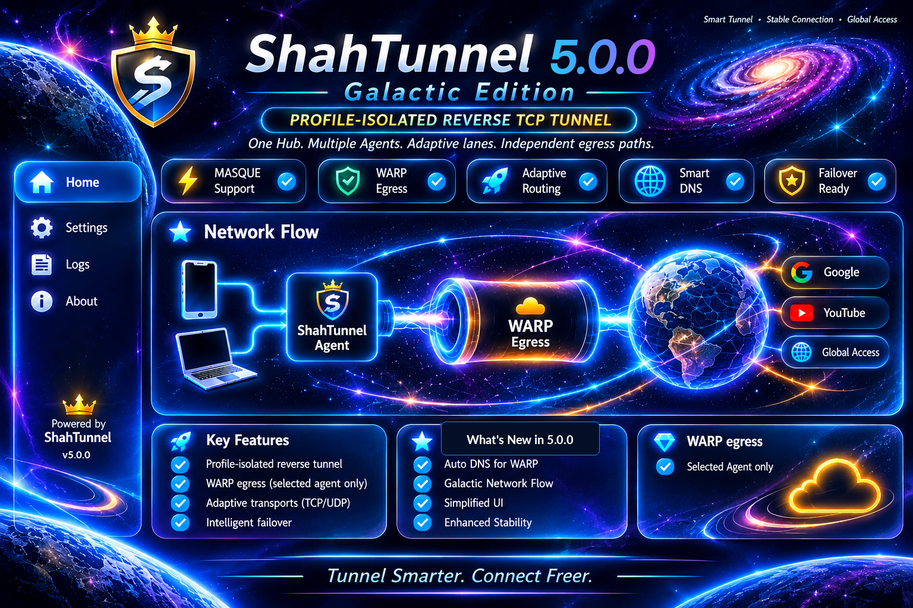

<p align="center">
  
</p>

<h1 align="center">SHAH TUNNEL</h1>
<p align="center"><strong>V2.2.1 · Secure Reverse TCP Relay · External Underlay Adapters</strong></p>
<p align="center">A reverse TCP relay that carries public client connections through a Hub to mapped target services via authenticated Agent lanes. The private Hub↔Agent channel uses TLS 1.3, SHA-256 certificate pinning and adaptive recovery across four native transports plus six optional external underlay adapters.</p>
<p align="center"><a href="README.md">🇬🇧 English</a> · <a href="README-fa.md">🇮🇷 فارسی</a></p>

## Network flow

<p align="center">
  
</p>

## Features

- **Four native transports:** TCP/TLS, WebSocket/TLS, HTTP/2 CONNECT and HTTP/1.1 CONNECT/TLS.
- **Six external underlay adapters:** MASQUE-compatible local SOCKS5, Cloudflare WARP system route, secondary WARP SOCKS5 route, Tor SOCKS5, Psiphon SOCKS5 and a Backhaul local TCP forward.
- **Full adaptive recovery:** option 8 tries four native transports plus the six configured underlays, remembers the last successful path per lane, and tries another candidate after a path closes.
- **Security:** TLS 1.3 for the private Hub↔Agent channel, token authentication and SHA-256 certificate pinning.
- **Concurrency:** twelve independent lanes by default, bounded queues and load-aware session selection.
- **Management:** interactive CLI, systemd integration, status and logs, installer and local verification script.

## Transport menu

Select the matching Hub policy and Agent strategy.

| Option | Transport / strategy | Behaviour |
|---|---|---|
| `1` | TCP/TLS | Native TLS-protected stream. |
| `2` | WebSocket/TLS | Tunnel stream carried in WebSocket binary frames over TLS. |
| `3` | HTTP/2 CONNECT | Bidirectional CONNECT stream over TLS on control port + 1. |
| `4` | HTTP/1.1 CONNECT/TLS | CONNECT stream over TLS on control port + 2. |
| `5` | HTTP CONNECT fallback | Tries HTTP/2 CONNECT, then HTTP/1.1 CONNECT if setup fails. |
| `6` | Automatic fallback | TCP/TLS, then WebSocket/TLS. |
| `7` | New tunnel methods | Hub accepts the TCP/TLS carrier; Agent selects one external underlay (MASQUE, WARP, WARP-on-WARP, Tor, Psiphon or Backhaul). |
| `8` | Full adaptive failover | Agent cycles through four native transports plus all six configured underlay adapters. Hub enables all four native transport listeners. |

### External underlay requirements

The six new entries are **network-path adapters**, not six new wire protocols implemented inside ShahTunnel. They use independently managed clients/services on the Agent:

- **MASQUE:** a MASQUE-compatible client exposing a local unauthenticated SOCKS5 endpoint.
- **Cloudflare WARP:** Cloudflare WARP must already be installed and connected (`warp-cli status` is checked before dialing). Its OS routing carries the native ShahTunnel connection.
  Note: WARP is a system-level route in this mode. When enabled, other direct connections may also use it; this adapter does not provide per-connection route isolation by itself.
- **WARP on WARP:** requires a separately managed secondary WARP path exposed as its own local SOCKS5 endpoint. ShahTunnel does not create a second WARP session or account.
- **Tor:** a running local SOCKS5 service (default `127.0.0.1:9050`). A Hub onion service and `.onion` Hub address are recommended for a Tor-only route.
- **Psiphon:** a running Psiphon client exposing a local unauthenticated SOCKS5 endpoint (default `127.0.0.1:1080`).
- **Backhaul:** a separately configured Backhaul client forwarding the Hub control port to a local TCP endpoint (default `127.0.0.1:12080`).

The setup wizard prompts for the local endpoints. Before saving an Agent profile, it preflights the local dependency: unauthenticated SOCKS5 negotiation, `warp-cli` connection status, or TCP reachability of the Backhaul forward. For option 7, an unavailable sole path stops setup by default, with an explicit override available. For option 8, unavailable optional paths are listed and the user can continue so working native/underlay candidates remain usable while unavailable paths are retried at runtime. This local preflight does not prove end-to-end reachability to the Hub; TLS and token authentication remain the real runtime check. ShahTunnel does not silently install third-party clients, create Cloudflare accounts, or invent a MASQUE/Tor/Psiphon/Backhaul server configuration. The local SOCKS5 adapters currently require no-auth SOCKS5.

### Adaptive failover behaviour and limits

Option 8 orders four native candidates first, then the six configured underlays. It connects using the first candidate that completes TLS and token authentication, remembers that candidate per lane, and tries the remaining candidates after that lane closes. A lane heartbeat detects dead sessions; the Agent reconnects with jittered backoff after all candidates fail. This is failover/reconnection, not packet duplication or seamless migration of an existing TCP session. Public TCP sessions carried by a failed lane may disconnect and need to reconnect; other healthy lanes continue independently.

### Hub firewall ports

If the Hub control port is `9443`:

- `9443/TCP`: native TCP/TLS, WebSocket/TLS and all external underlays carried using TCP/TLS.
- `9444/TCP`: HTTP/2 CONNECT (options 3, 5 and 8).
- `9445/TCP`: HTTP/1.1 CONNECT (options 4, 5 and 8).

Option 7 only needs the control port. Option 8 uses all three ports on the Hub. All four native transports use TCP as their network carrier.

## Multiple tunnel profiles and upload throughput

Each create operation asks for a unique tunnel name and stores its configuration separately. Existing profiles remain intact. Every named profile runs as its own systemd instance; Start, Stop, Restart, Status, and Delete act on the selected profile. In the main manager menu, option 7 deletes one profile and option 8 removes the entire installation; these manager options are separate from the transport choices in the setup wizard.

The per-stream in-flight window is increased to 64 frames of up to 64 KiB (about 4 MiB per stream), while each tunnel socket keeps a smaller bounded outbound queue to limit head-of-line delay. On Linux kernels that support BBR, the outer tunnel TCP socket attempts to use BBR per-socket; unsupported kernels retain their existing default. This reduces the throughput ceiling caused by a small flow-control window on high-RTT paths and can improve latency under load. Actual throughput still depends on link capacity, packet loss, congestion, kernel qdisc, and provider limits; application-level changes cannot prevent an uplink from being fully saturated without an appropriate network-level rate limit.

## Responsible use and privacy

ShahTunnel is a general-purpose TCP relay. Configure it only for servers and services you own or are explicitly authorized to administer. Do not use it to access third-party systems without permission, relay abusive traffic, or disrupt services. Operators are responsible for the endpoints and traffic they choose to forward.

The server information display may make outbound HTTPS requests to public IP and GeoIP providers (including ipify, icanhazip, checkip.amazonaws.com, ipinfo.io, ip.sb, ipapi.co and ipwho.is) to determine the server's public IPv4 address and country. These providers can observe the server's public IP and request metadata; the GeoIP lookups do not include the tunnel token or tunnel payload.

For upgrade compatibility, the installed systemd unit and configuration directory still use the legacy names `ravanreverse.service` and `/etc/ravanreverse`; the installer also provides the `shah-tunnel` command as a symlink. These are local compatibility names, not third-party download destinations. Do not rename them manually on an existing server; a future rename would need an explicit migration.

## Install

Run as root on Linux amd64 or arm64 with systemd and HTTPS access to the official Go download hosts. For a downloaded source ZIP, run the local installer from its extracted folder:

```bash
sudo bash S1T-START.sh
```

The local installer builds the exact source tree next to the script. To install directly from the repository's published `main` branch instead, use:

```bash
bash <(curl -fsSL https://raw.githubusercontent.com/ShahNetLab/ShahTunnel/main/S1T-START.sh)
```

The installer downloads the Go `1.26.1` toolchain, trying regional mirrors first and then official distribution hosts. If a transfer is interrupted, it retains a separate partial file per mirror and resumes only from that same mirror with HTTP Range where supported. This avoids mixing partial responses from different hosts. It verifies the pinned SHA-256 checksum before using the archive; unverified archives are never accepted. When a local source tree is present, the installer builds that exact tree; when invoked remotely with no local tree, it downloads the source archive from the `main` branch. In both cases it compiles `S1T-CAPSULE` locally for the server architecture with CGO disabled. It does not use GitHub Release assets or install the Go toolchain permanently. The built binary's application version and target architecture are checked before installation. An existing binary is backed up before replacement, and an already-active service is not restarted during installation to avoid dropping live tunnel sessions.

## Build and tests

The verification helper requires Go 1.26.1 to already be installed locally; it will not download a toolchain. From the repository root:

```bash
./VERIFY-ALL-TRANSPORTS.sh
```

Or run the main checks directly:

```bash
gofmt -w S1T-CAPSULE/main.go S1T-CAPSULE/main_test.go
go test -race -count=20 ./S1T-CAPSULE
go vet ./S1T-CAPSULE
mkdir -p dist
CGO_ENABLED=0 GOOS=linux GOARCH=amd64 go build -trimpath -ldflags='-s -w -buildid=' -o dist/shah-tunnel-linux-amd64 ./S1T-CAPSULE
CGO_ENABLED=0 GOOS=linux GOARCH=arm64 go build -trimpath -ldflags='-s -w -buildid=' -o dist/shah-tunnel-linux-arm64 ./S1T-CAPSULE
(cd dist && sha256sum shah-tunnel-linux-amd64 > shah-tunnel-linux-amd64.sha256)
(cd dist && sha256sum shah-tunnel-linux-arm64 > shah-tunnel-linux-arm64.sha256)
```
