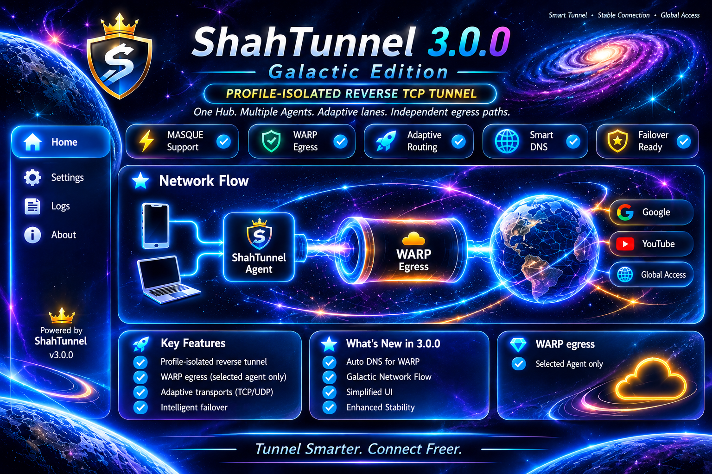

<div align="center">


# ShahTunnel 3.0.6

[](https://github.com/ShahNetLab/ShahTunnel)

[](S1T-START.sh)

<p align="center">
<a href="https://t.me/MediaZet"></a>
&nbsp;
<a href="https://t.me/cloudflare0_bot"></a>
</p>

<p align="center">Support ShahTunnel and get project updates by joining the channel. The bot is for Cloudflare operations.</p>

**English** · [فارسی](README-fa.md)

[⚡ Capabilities](#capabilities) · [🚀 Install](#install)

</div>

---

<a id="network-flow"></a>
## Network Flow

The Hub-to-Agent forwarding path and optional per-profile Internet egress are separate: the tunnel forwards mapped TCP services to Agent-side targets, while the optional Xray sidecar sends only the selected inbound through that Agent profile’s WARP SOCKS5 egress.

```text
Client → Hub public mapping → authenticated Agent lanes → Agent local target
Selected Xray inbound → loopback-only Xray sidecar → WARP SOCKS5 → Internet
```

<p align="center"></p>

## Capabilities

| | Capability | What it does |
|:--:|---|---|
|  | **Hub–Agent reverse relay** | The Hub exposes public TCP listeners; Agents connect outward and forward each mapping to its local target. |
|  | **Independent tunnel profiles** | Each named profile has its own configuration and systemd service. Start, stop and restart operations are profile-scoped. |
|  | **Adaptive transport lanes** | Four implemented transports can be selected individually or used by adaptive failover modes. |
|  | **Lane-level recovery** | Each Agent lane reconnects independently; one failed lane does not require dropping every healthy lane. New Agent profiles use 12 independent lanes by default (maximum 16). |
|  | **Multiple port mappings** | Mapping IDs pair Hub public listeners with Agent-side local targets. IDs must match on both ends. |
|  | **External Agent egress** | Agent traffic can use Direct, Cloudflare WARP/MASQUE, WARP/WireGuard or Psiphon/SOCKS5. |
|  | **Per-profile Xray WARP** | A selected Xray inbound is cloned to a loopback-only sidecar and routed through the local WARP SOCKS5 proxy. |
|  | **Automatic WARP DNS path** | The isolated sidecar handles client DNS and routes its DoH resolver traffic through the same WARP egress. |

## Hub↔Agent transport modes

Choose a mode during tunnel creation. The Hub and Agent must use compatible settings.

| Wizard option | Mode | Behaviour |
|:--:|---|---|
| `1` | TCP/TLS | TLS-protected stream between Hub and Agent. |
| `2` | WebSocket/TLS | Carries the tunnel stream in WebSocket binary frames over TLS. |
| `3` | HTTP/2 CONNECT | Uses HTTP/2 CONNECT over TLS on the control port + 1. |
| `4` | HTTP/1.1 CONNECT/TLS | Uses HTTP/1.1 CONNECT over TLS on the control port + 2. |
| `5` | HTTP CONNECT fallback | Tries HTTP/2 CONNECT, then HTTP/1.1 CONNECT. |
| `6` | Automatic fallback | Tries TCP/TLS, then WebSocket/TLS. |
| `7` | Full Adaptive Failover | Uses all four implemented transports; each lane remembers its last successful transport. |
| `8` | External egress | On an Agent, select Cloudflare MASQUE, WARP/WireGuard or Psiphon/SOCKS5. |
| `9` | All-protocol adaptive | On an Agent, combines all four transports with Direct/Psiphon egress failover. |

### Agent egress providers

| Provider | Requirement / path |
|---|---|
| `Direct` | Agent connects to the Hub through its normal network route. |
| `Cloudflare WARP / MASQUE` | Requires an already-connected WARP MASQUE path or the Cloudflare Local Proxy. |
| `Cloudflare WARP / WireGuard` | Requires an already-connected system WARP tunnel. |
| `Psiphon / SOCKS5` | ShahTunnel builds the official ConsoleClient on first use, creates a signed-server-list bootstrap config and an isolated loopback SOCKS5 endpoint. No manual binary or JSON is required. |
| `Adaptive` | Uses the supported Direct/Psiphon egress failover path. |

### Psiphon through the public TCP/443 Mapping

When Psiphon cannot reach the Hub control port (for example, a custom `9448`), the Agent uses the Hub public Mapping endpoint on `443` for Psiphon egress only; the Direct path continues to use the configured control port. The Step 06 default is independent of the control port and points to TCP/443. The Hub distinguishes ShahTunnel control traffic from ordinary TLS with the dedicated `shah-tunnel-control/1` ALPN and forwards normal ClientHello bytes unchanged. This does not take over the public port, move a Mapping, or modify X-UI.

The Hub must run version `3.0.3` or newer (with public-Mapping ALPN support); the Agent must run version `3.0.4` or newer for the separated Mapping/control endpoint handling. A public Mapping must already be enabled on the Hub and reachable through Psiphon. The Agent wizard lets you override the alternate endpoint. Existing profiles using `HubAddr` on `9443` automatically derive `PsiphonHubAddr` as the same host on port `443`.

### Automatic Psiphon setup

When an Agent selects `Psiphon / SOCKS5` (or the adaptive egress option), ShahTunnel automatically:

- builds the official Psiphon ConsoleClient from a pinned upstream source revision for the host architecture (`amd64` or `arm64`);
- verifies the resulting executable architecture and version before installation;
- creates a private per-Agent JSON configuration with the public client identity, authenticated server-list mirrors, server-entry signature key, and exchange-obfuscation key;
- assigns a unique `127.0.0.1` SOCKS5 port and private data directory;
- grants that Agent service write access only to its own Psiphon data directory;
- starts ConsoleClient in local-proxy mode. Local SOCKS5 readiness is distinguished from a real Psiphon tunnel and a connected Agent lane. If SOCKS5 becomes ready first, the service remains active and the wizard reports `PENDING` rather than claiming a successful connection. `ListenInterface` remains unset so the local SOCKS5 listener uses Psiphon's loopback binding. Psiphon's WebRTC ICE stack can still enumerate host interfaces through `AF_NETLINK`; the service allow-list explicitly includes that family while retaining `CapabilityBoundingSet=CAP_NET_BIND_SERVICE` (no `CAP_NET_ADMIN`). This enables interface discovery without permitting route changes. Diagnostic notices are written to the local journal; they may contain sensitive session/network details and should not be published.

For an existing Agent profile whose earlier Psiphon bootstrap did not connect, run `sudo bash repair-psiphon-profile.sh PROFILE` from the extracted project directory. The helper backs up and repairs only that profile's Psiphon JSON and restarts only its matching `ravanreverse@PROFILE.service` unit.

No TUN device, default route, SSH service, or X-UI service is changed. The first Psiphon setup downloads and builds the official client; it requires access to GitHub source hosting and the Go toolchain distribution. Psiphon egress applies to the Agent's outer TCP lanes to the Hub, not to end-user Xray traffic.

> **Two different option 9 entries:** option `9` in the *creation wizard* means All-protocol adaptive. Option `9` in the *main manager menu* enables per-profile Xray WARP egress for a selected Agent.

## Per-tunnel WARP egress for Xray

- **New Agent profiles:** when an Agent is created with MASQUE and the Cloudflare Local Proxy is detected, ShahTunnel prepares the dedicated Xray sidecar and WARP-routed DNS before starting that Agent.
- **Existing Agent profiles:** select the Agent in the manager and use **`[9] WARP egress`**.
- **Isolation:** only the selected profile's cloned Xray inbound uses the local WARP SOCKS5 proxy. Other profiles and inbounds remain Direct.
- **Host safety:** the X-UI-managed Xray config/service, SSH and the server default route are not modified or restarted by this per-profile integration.

The per-tunnel Xray route requires the Cloudflare **WarpProxy / Local Proxy** SOCKS5 listener. It is not system-wide WARP routing. If the Local Proxy is unavailable, the isolated route is not silently replaced with a host-wide route; the Agent remains on its configured egress until the requirement is met.

## Day to day

`sudo shah-tunnel menu` opens the manager. Its operations are scoped to the selected profile:

| Menu option | Action |
|:--:|---|
| `1` | Create a new tunnel profile (Hub, Agent or Relay). |
| `2` | Start a selected tunnel. |
| `3` | Stop a selected tunnel. |
| `4` | Restart a selected tunnel. |
| `5` | Show status and recent logs. |
| `6` | Configure scheduled restarts for active tunnels. |
| `7` | Delete one selected tunnel profile. |
| `8` | Complete uninstall. |
| `9` | Enable isolated WARP egress for a selected Agent. |

Useful commands:

```bash
sudo shah-tunnel version
sudo shah-tunnel menu
sudo systemctl status 'ravanreverse@PROFILE.service' --no-pager -l
sudo journalctl -u 'ravanreverse@PROFILE.service' -n 80 --no-pager
```

Replace `PROFILE` with the selected profile's systemd instance name. The manager's **Status & Logs** entry is the simplest way to inspect the selected tunnel.

## Security

- Keep the Hub token and certificate fingerprint private. The Agent must use the exact values generated by its Hub.
- Restrict the Hub firewall to the selected control/CONNECT ports and the public mapping ports you actually use.
- Do not publish tokens, private keys, full tunnel configs or unredacted logs in issues or screenshots.
- The optional Xray WARP sidecar listens on loopback for its cloned inbound; it does not replace the X-UI-managed Xray service.
- Use ShahTunnel only on servers and services you own or are authorized to administer. See [SECURITY.md](SECURITY.md).

<a id="install"></a>
## Install

ShahTunnel uses a **Hub / Agent** layout. Install it on the Hub and on every Agent that should connect to it. A third server can optionally run as a Relay.

**Requirements:** Linux `amd64` or `arm64`, `systemd`, root access, and outbound connectivity from each Agent to the Hub. The installer downloads and verifies the pinned Go 1.26.1 toolchain, then builds the Linux binary on the server.

**1. Run the installer** on each server:

```bash
bash <(curl -fsSL https://raw.githubusercontent.com/ShahNetLab/ShahTunnel/main/S1T-START.sh)
```

The manager opens after installation. You can reopen it with:

```bash
sudo shah-tunnel menu
```

**2. Configure the Hub**

1. Choose **Create a new tunnel** and select **HUB**.
2. Set the control listener (default `0.0.0.0:9443`) and the accepted Hub↔Agent transport.
3. Add each public port mapping. Give every mapping an ID such as `main` or `web`.
4. Save the generated **Agent token** and **certificate SHA-256 fingerprint**. The Agent must use both values exactly.

**3. Configure each Agent**

1. Create a tunnel and select **AGENT**.
2. Enter the Hub address and control port, then choose a transport accepted by the Hub.
3. Enter the token and certificate fingerprint from the Hub.
4. Add the same mapping IDs and set each local target, for example `127.0.0.1:443`.
5. Save the profile. ShahTunnel enables its dedicated service and reconnects dropped lanes automatically.

**4. Open only the required firewall ports.** The Hub needs its selected control listener, any selected CONNECT port (`control + 1` for HTTP/2 or `control + 2` for HTTP/1.1), and the public mapping ports. Agents initiate the connection to the Hub; local targets stay on the Agent side.

## Troubleshooting

| Symptom | First check |
|---|---|
| Agent does not connect | Confirm Hub address, token, certificate fingerprint, matching transport mode and firewall ports. |
| HTTP/2 or HTTP/1.1 CONNECT fails | Check the additional Hub TCP port (`control + 1` or `control + 2`) selected for that mode. |
| A mapping does not forward | Confirm the mapping ID matches on Hub and Agent and the Agent-side target is reachable locally. |
| WARP egress does not activate | Confirm the selected Agent uses MASQUE and Cloudflare Local Proxy is active before enabling manager option `9`. |
| Google/YouTube DNS fails through per-profile WARP | Check the dedicated `shah-tunnel-xray-warp-<profile>.service` status and its recent logs; do not change host routes. |

---

> **Psiphon startup in 3.0.6:** a ready local SOCKS5 listener is not the same as an established Psiphon tunnel. If SOCKS5 is ready but the external tunnel is not yet established, the Agent service remains active and ConsoleClient keeps retrying; the wizard reports a pending connection, not a successful tunnel. Psiphon diagnostic notices are written to the local journal and may include network/server details; do not publish them publicly.

> **Psiphon endpoint routing in 3.0.6:** TCP/TLS and WebSocket/TLS use the configured public Mapping endpoint through the local SOCKS5 proxy. HTTP/2 CONNECT and HTTP/1.1 CONNECT continue to use the control listener +1 and +2 respectively; the Mapping port is never used as the base for deriving CONNECT ports.


> **Psiphon systemd sandbox in 3.0.6:** both the source-generated service template and installer-managed drop-ins allow `AF_NETLINK` for Psiphon's WebRTC ICE interface discovery. The capability set remains unchanged; `CAP_NET_ADMIN` is not granted. This is applied automatically by the installer and is not a manual VPS repair step.

> **Upgrade restart in 3.0.6:** after updating the systemd drop-ins, the installer now restarts only already-active Agent instances whose saved configuration selects Psiphon or Adaptive external egress. This is necessary because systemd applies address-family sandbox changes when a service starts; changing a unit file alone does not change the sandbox of an already-running process. Hub, Direct, WARP, and unrelated profile services are not restarted. The affected Agent lanes reconnect automatically.
