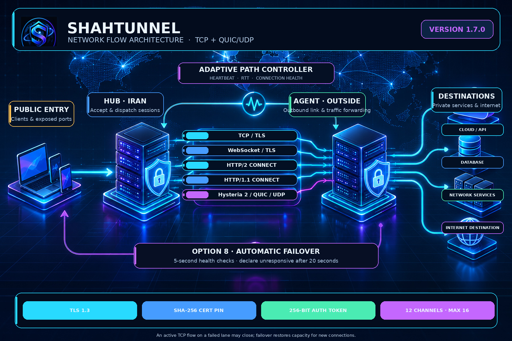

<p align="center">
  
</p>

<h1 align="center">SHAH TUNNEL</h1>
<p align="center"><strong>v1.7.0 · Authenticated reverse TCP tunnel · TCP + QUIC/UDP adaptive transport</strong></p>
<p align="center">An authenticated Hub↔Agent reverse tunnel with four TCP transport choices and an independent Hysteria 2 / QUIC / UDP path.</p>
<p align="center"><a href="README.md">🇬🇧 English</a> · <a href="README-fa.md">🇮🇷 فارسی</a></p>

## Quick install

Run this command as `root` on both servers. The installer downloads the matching source bundle and checks that its installer and application versions agree before building:

```bash
bash <(curl -fsSL https://raw.githubusercontent.com/ShahNetLab/ShahTunnel/main/S1T-START.sh)
```

Select `Hub` on the Iran server and `Agent` on the outside server.

## Network flow

<p align="center">
  
</p>

## Tunnel operation

1. **Hub** accepts public TCP connections and maps each public listener to a configured mapping ID.
2. **Agent** initiates authenticated outbound tunnel lanes to the Hub and forwards each matching mapping ID to its configured local target.
3. Each lane carries framed, multiplexed TCP streams. The default is **12 independent lanes** (configurable up to 16); streams are bounded by per-lane and queue limits.
4. The inner ShahTunnel channel remains protected by TLS 1.3, the setup token and SHA-256 certificate pinning, regardless of the selected outer transport.
5. In option **8**, first-time lanes are spread over five candidates. Every lane remembers its last successfully authenticated transport and tries it first after reconnecting.

## Transport menu

Choose the same policy on the Hub and Agent:

| Option | Transport | Path |
|---|---|---|
| `1` | TCP/TLS | Native TLS-protected stream on the control port. |
| `2` | WebSocket/TLS | Binary WebSocket frames over TLS on the control port. |
| `3` | HTTP/2 CONNECT | Full-duplex CONNECT on control port + 1. |
| `4` | HTTP/1.1 CONNECT/TLS | CONNECT on control port + 2. |
| `5` | HTTP CONNECT fallback | HTTP/2 CONNECT, then HTTP/1.1 CONNECT. |
| `6` | Automatic TCP fallback | TCP/TLS, then WebSocket/TLS. |
| `7` | Hysteria 2 / QUIC / UDP | Independent UDP transport with Salamander packet obfuscation. No TCP fallback in this single-transport mode. |
| `8` | Full adaptive failover | All four TCP paths plus Hysteria 2 / QUIC / UDP. This is the default recommended configuration when both networks allow the required ports. |

### Option 8 health and recovery

- Each active ShahTunnel lane sends an authenticated heartbeat every 5 seconds.
- A lane is closed after 20 seconds without a PONG. Its worker then reconnects and tries the next path. A single lost heartbeat does not trigger failover.
- Hysteria 2 runs as a managed child process of ShahTunnel. If it exits, ShahTunnel restarts it with jittered backoff.
- In adaptive mode, a Hysteria start/configuration failure is non-fatal: the four TCP alternatives continue to run. In option 7 (Hysteria-only), failure to start the UDP sidecar is fatal by design.
- **Failover is per lane, not seamless migration of an in-flight TCP stream.** If its lane dies, an existing public TCP stream on that lane closes; the lane reconnects for new streams. Silent blackholes can take about 20–25 seconds to be detected, plus the next dial/handshake time.

## Hub firewall ports

For a Hub control port of `9443`:

| Port | Protocol | Purpose |
|---|---|---|
| `9443` | TCP | Native TCP/TLS, WebSocket/TLS and inner loopback control. |
| `9444` | TCP | HTTP/2 CONNECT. |
| `9445` | TCP | HTTP/1.1 CONNECT. |
| `9446` | UDP | Hysteria 2 / QUIC. |

- **Option 7:** expose `9446/UDP` only for the tunnel control path. The inner control listener is bound to `127.0.0.1`; it is not exposed publicly. Keep the configured public service-mapping ports open separately.
- **Option 8:** expose `9443/TCP`, `9444/TCP`, `9445/TCP` and `9446/UDP`. Open only what your chosen mode actually uses, plus the public service-mapping ports.
- The UDP tunnel port is always the control port + 3. Ensure it does not overlap with another UDP listener on the Hub.

## UDP path security

- Hysteria 2 v2.13.0 carries the inner ShahTunnel TLS 1.3 control stream over QUIC/UDP.
- Salamander obfuscation uses a separate random 256-bit password that must match on Hub and Agent. Hysteria authentication has its own random 256-bit password.
- The Agent uses Hysteria's `pinSHA256` against the Hub certificate. The inner ShahTunnel TLS session independently validates the same certificate fingerprint and authenticates the ShahTunnel token.
- The Hub's Hysteria ACL is default-deny: it permits only `127.0.0.1:<control-port>` over TCP and rejects every other destination. The local SOCKS5 endpoint listens only on `127.0.0.1` on the Agent.
- The Hysteria binary and Go toolchain are downloaded as pinned versions and checksum-verified by the installer. Keep `/etc/ravanreverse` restricted to root; it contains credentials and private keys.

## Limits you should plan for

QUIC/UDP provides a genuinely separate transport family from TCP. Salamander can help when a network filters QUIC/HTTP/3 patterns but still carries UDP. It **cannot** make UDP work when UDP is blocked or unusable. If all Hub IP addresses are blocked, the Hub has no reachable uplink, or international connectivity is completely cut, no protocol on that same server can guarantee a working path. A second independently routed server/uplink is required for that failure domain. IP source spoofing is not included: it does not create a usable return path for a TCP/UDP session.

Hysteria's optional Linux “Mimic / Fake TCP” mode is not enabled. It requires a separate executable and kernel XDP/eBPF support; it is not equivalent to changing UDP packet source addresses and should not be presented as a software-only fallback.

## Compatibility and verification

Legacy v1.6.x configuration files remain readable. Options `1`–`6` retain their earlier behavior. The old `adaptive` setting still means the four legacy TCP paths; the new option 8 uses `adaptive_all` and requires matching Hysteria credentials on both ends. Run Hub setup first, then copy the token, certificate fingerprint, Hysteria password and Salamander password into Agent setup.

Run local checks with Go 1.27.3 already installed:

```bash
./VERIFY-ALL-TRANSPORTS.sh
```

The verification script tests the ShahTunnel code and builds Linux `amd64` / `arm64` binaries. It does not simulate filtering on a real ISP; test the selected UDP/TCP ports from both actual server networks before relying on the tunnel.
