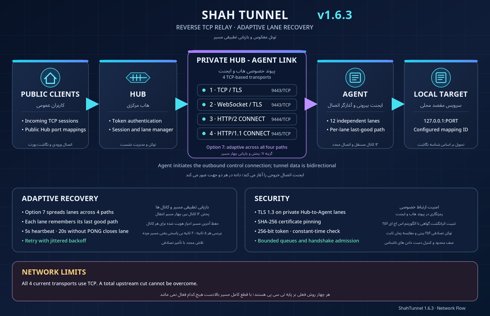

<p align="center">
  
</p>

<h1 align="center">SHAH TUNNEL | شاه تونل</h1>
<p align="center"><strong>v1.6.3 · Reverse TCP Tunnel · Adaptive Lane Recovery</strong></p>
<p align="center">An authenticated reverse TCP relay from public Hub listeners to services reachable by the remote Agent.</p>
<p align="center"><a href="README.md">🇬🇧 English</a> · <a href="README-fa.md">🇮🇷 فارسی</a></p>

## Network flow

<p align="center">
  
</p>

## Tunnel operation

1. **Hub** listens for incoming public TCP sessions and maintains the configured public-port-to-mapping-ID table.
2. **Agent** initiates outbound authenticated connections to the Hub. It opens connections to the configured local targets and forwards streams for matching mapping IDs.
3. The Hub and Agent exchange framed tunnel messages over independent lanes. Each lane carries multiple multiplexed streams, subject to bounded stream and queue limits.
4. The default is **12 independent lanes** (configurable up to 16). In option 7, first-time lanes are distributed across the four implemented transports. Each lane remembers its own last successfully authenticated transport and tries it first after reconnecting.

## Transport menu

Select the same policy on both Hub and Agent:

| Option | Transport | Tunnel path |
|---|---|---|
| `1` | TCP/TLS | TLS-protected stream on the control port. |
| `2` | WebSocket/TLS | Binary WebSocket frames over TLS on the control port. |
| `3` | HTTP/2 CONNECT | Full-duplex CONNECT stream on control port + 1. |
| `4` | HTTP/1.1 CONNECT/TLS | CONNECT stream on control port + 2. |
| `5` | HTTP CONNECT fallback | HTTP/2 CONNECT, then HTTP/1.1 CONNECT if setup fails. |
| `6` | Automatic fallback | TCP/TLS, then WebSocket/TLS. |
| `7` | Full adaptive failover | Uses all four transports, distributes first-time lanes, and remembers each lane's last good path. |

**Option 7 health and recovery:** an authenticated heartbeat is sent every 5 seconds. A lane is closed after 20 seconds without a PONG, allowing its worker to reconnect and try the next transport. A single missed heartbeat does not trigger failover. Reconnect attempts use jittered backoff. The Hub and Agent must use matching policies and have all required transport ports reachable.

## Hub ports

With control port `9443`:

- `9443/TCP`: TCP/TLS and WebSocket/TLS.
- `9444/TCP`: HTTP/2 CONNECT.
- `9445/TCP`: HTTP/1.1 CONNECT.

Open the control port and the additional ports required by the selected policy. **All four transports in v1.6.3 use TCP.** This release does not include QUIC/UDP, Hysteria2, REALITY, IP spoofing, or an alternate Internet uplink. It therefore cannot bypass a complete TCP block, a block of every Hub address, or a total international upstream outage. A separate reachable UDP path and an independently routed upstream would be required for those failure cases.

## Security

- TLS 1.3 protects the private Hub-Agent control and data lanes.
- The Agent verifies the Hub certificate using its configured SHA-256 certificate fingerprint.
- The Hub verifies the 256-bit random setup token using constant-time comparison.
- Authentication failures are rate-limited in logs; stream queues, pending public connections and concurrent streams are bounded.
- Keep the token, private key and certificate fingerprint configuration confidential. Restrict file permissions and expose only the Hub ports required by the selected transport policy.

## Compatibility and verification

The v1.6.3 configuration remains compatible with existing v1.6.x configurations; missing lane-count values continue to use the 12-lane default. No new config key is required. An in-flight public TCP stream is not migrated transparently if its specific lane dies; that stream closes, while the lane reconnects for new streams.

Build and test from the repository root with the Go version pinned by the installer (Go 1.26.1):

```bash
./VERIFY-ALL-TRANSPORTS.sh
```

The installer builds locally for Linux amd64 or arm64. Existing service configuration and public-port mappings should be backed up before replacing a running deployment.
