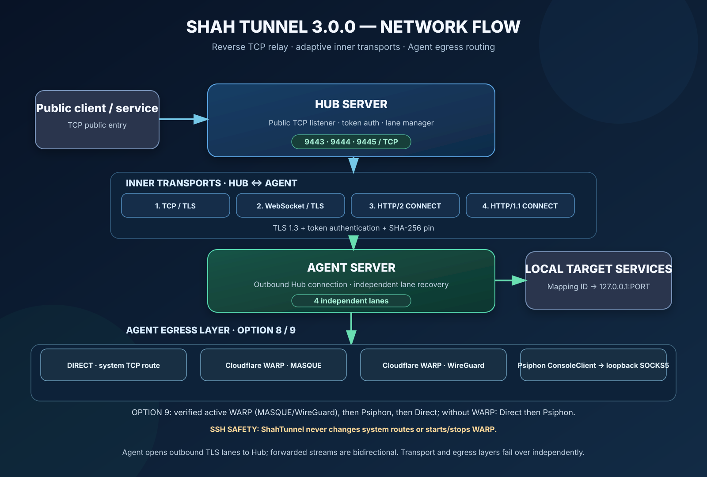

<p align="center">
  
</p>

<h1 align="center">SHAH TUNNEL 3.0.0</h1>
<p align="center"><strong>GALACTIC EDITION · PROFILE-ISOLATED REVERSE TCP TUNNEL</strong></p>
<p align="center">One Hub. Multiple Agents. Adaptive lanes. Independent egress paths.</p>

<p align="center">
  <a href="README-fa.md">🇮🇷 فارسی</a> · <a href="#network-flow">🌌 Network Flow</a> · <a href="#tunnel-capabilities">⚡ Capabilities</a> · <a href="#install">🚀 Install</a>
</p>

## 🌌 Network Flow

<table>
<tr><td align="center"><strong>GALACTIC NETWORK ARCHITECTURE</strong><br/><sub>Secure reverse TCP relay · Four inner transports · Profile-scoped routing</sub></td></tr>
<tr><td align="center"></td></tr>
</table>

## Tunnel capabilities

<table>
<tr>
<td width="50%" valign="top">
<h3>🔵 ☑️ Hub–Agent relay</h3>
<p>The Hub exposes the public TCP entry. Each Agent establishes authenticated outbound lanes to the Hub and forwards accepted streams to its mapped local services.</p>
</td>
<td width="50%" valign="top">
<h3>🔵 ☑️ Adaptive inner transports</h3>
<p>Each lane can use TCP/TLS, WebSocket/TLS, HTTP/2 CONNECT, or HTTP/1.1 CONNECT/TLS. Recovery is lane-scoped so a failed lane does not require dropping healthy lanes.</p>
</td>
</tr>
<tr>
<td width="50%" valign="top">
<h3>🔵 ☑️ Independent Agent egress</h3>
<p>Agent transport can use Direct, Cloudflare WARP over MASQUE or WireGuard, or Psiphon through a local SOCKS5 endpoint, according to the selected egress mode.</p>
</td>
<td width="50%" valign="top">
<h3>🔵 ☑️ Multi-profile isolation</h3>
<p>Each ShahTunnel profile has its own configuration and systemd service. Starting, stopping, or recovering one profile is scoped to that profile.</p>
</td>
</tr>
<tr>
<td width="50%" valign="top">
<h3>🔵 ☑️ Per-tunnel Xray WARP</h3>
<p>A dedicated sidecar clones only the selected Xray inbound to a loopback port and sends that inbound through the local WARP SOCKS5 proxy. Other Xray inbounds remain on their original route.</p>
</td>
<td width="50%" valign="top">
<h3>🔵 ☑️ Automatic DNS inside WARP</h3>
<p>The sidecar intercepts client DNS on port 53, resolves through Cloudflare/Google DNS-over-HTTPS, and routes resolver traffic through the same WARP egress.</p>
</td>
</tr>
</table>

## Tunnel transport matrix

| Option | Transport / strategy | Tunnel behaviour |
|:--:|---|---|
| `1` | TCP/TLS | Native TLS-protected stream between Hub and Agent. |
| `2` | WebSocket/TLS | Tunnel stream carried in WebSocket binary frames over TLS. |
| `3` | HTTP/2 CONNECT | CONNECT stream over TLS on control port + 1. |
| `4` | HTTP/1.1 CONNECT/TLS | CONNECT stream over TLS on control port + 2. |
| `5` | HTTP CONNECT fallback | HTTP/2 first, then HTTP/1.1. |
| `6` | Automatic fallback | TCP/TLS first, then WebSocket/TLS. |
| `7` | Full Adaptive Failover | All four inner transports; each lane prefers its last successful transport. |
| `8` | External egress | Select Agent egress: WARP/MASQUE, WARP/WireGuard, or Psiphon/SOCKS5. |
| `9` | All-Protocol Adaptive | All four inner transports over the available egress candidates, with lane-level recovery. |

## 🌐 Per-tunnel WARP egress for Xray

<table>
<tr><td>
<h3>🔵 ☑️ Automatic setup for new Agents</h3>
<p>When an Agent is created with MASQUE and Cloudflare Local Proxy (<code>WarpProxy</code>) is already active, ShahTunnel automatically prepares the dedicated Xray sidecar and its DNS path before starting the Agent. No manual JSON edit or follow-up shell command is required.</p>
</td></tr>
<tr><td>
<h3>🔵 ☑️ Existing Agent profiles</h3>
<p>For an existing Agent, use <strong>Manager → [9] WARP egress</strong>. ShahTunnel discovers the Xray inbound associated with the selected profile mapping, creates a loopback-only clone, and changes only that Agent profile's local target.</p>
</td></tr>
<tr><td>
<h3>🔵 ☑️ Isolation and rollback boundaries</h3>
<p>The X-UI-managed Xray configuration and original service are not edited or restarted. Other inbounds and profiles—including a profile using option 7—remain Direct. SSH and the host default route are not changed. The dedicated sidecar is removed with its ShahTunnel profile.</p>
</td></tr>
</table>

**WARP Local Proxy requirement:** per-tunnel Xray egress uses Cloudflare `WarpProxy` / MASQUE with a reachable local SOCKS5 listener. It is not the same as routing the whole server through system WARP. ShahTunnel does not connect or disconnect WARP, change the WARP protocol, or modify system routes. If the local proxy is not available, the isolated route is not silently replaced with a host-wide route.

## Security and reliability

<table>
<tr>
<td width="50%" valign="top">🔵 ☑️ **TLS 1.3 and token authentication**<br/><sub>Authenticated Hub–Agent transport with SHA-256 certificate pinning.</sub></td>
<td width="50%" valign="top">🔵 ☑️ **Lane-level recovery**<br/><sub>A failed lane can recover independently from healthy lanes.</sub></td>
</tr>
<tr>
<td width="50%" valign="top">🔵 ☑️ **Profile-scoped services**<br/><sub>Separate settings and systemd units per tunnel profile.</sub></td>
<td width="50%" valign="top">🔵 ☑️ **Host-route safety**<br/><sub>Per-tunnel WARP does not change the server default route or restart SSH.</sub></td>
</tr>
</table>

## Install

On a supported Linux server (amd64 or arm64) with systemd, run as root:

```bash
bash <(curl -fsSL https://raw.githubusercontent.com/ShahNetLab/ShahTunnel/main/S1T-START.sh)
```

The installer downloads the source and builds the ShahTunnel binary on the target server.

## Verify transports

```bash
./VERIFY-ALL-TRANSPORTS.sh
```

---

<p align="center"><strong>SHAH TUNNEL 3.0.0 · GALACTIC EDITION</strong><br/><sub>One Hub. Many Agents. Independent paths. A network that keeps moving.</sub></p>
