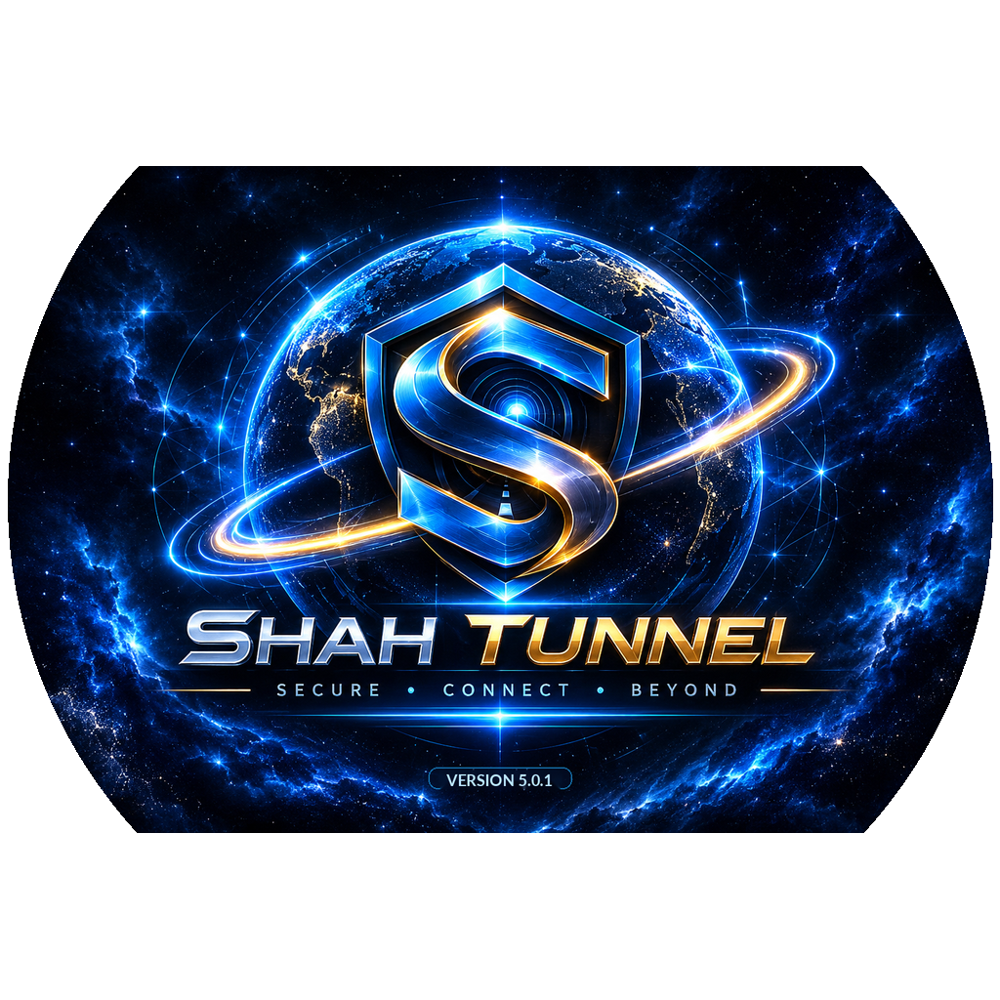
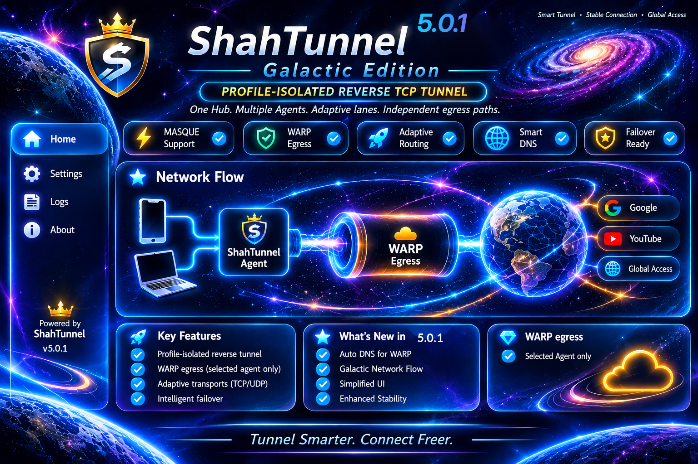

<div align="center">
# ShahTunnel 5.1.2

<p align="center"></p>

[](https://github.com/ShahNetLab/ShahTunnel)

[](S1T-START.sh)

<p align="center">
<a href="https://t.me/MediaZet"></a>
&nbsp;
<a href="https://t.me/cloudflare0_bot"></a>
</p>

<p align="center">Support ShahTunnel and get project updates by joining the channel. The bot is for Cloudflare operations.</p>

**English** · [فارسی](README-fa.md)

[⚡ Capabilities](#capabilities) · [🚀 Install](#install)

</div>

---

<a id="network-flow"></a>
## Network Flow

<p align="center"><a href="docs/img/ShahTunnel-Network-Flow-v5.png"></a></p>

The Hub-to-Agent forwarding path and optional per-profile Internet egress are separate: the tunnel forwards mapped TCP services to Agent-side targets, while the optional Xray sidecar sends only the selected inbound through that Agent profile’s WARP, Psiphon or Tor SOCKS5 egress.

```text
Client → Hub public mapping → authenticated Agent lanes → Agent local target
Selected Xray inbound → loopback-only Xray sidecar → WARP / Psiphon / Tor SOCKS5 → Internet
```
## Version 5.1.2 — TUIC/REALITY runtime and Agent endpoint fixes

This full-source revision fixes two confirmed defects in the 5.1.0 TUIC setup path:

- **sing-box helper discovery:** the Agent now checks the same canonical helper path used by `S1T-START.sh` (`/usr/local/lib/shah-tunnel/install-sing-box.sh`), while retaining the legacy path as a compatibility fallback.
- **sing-box release URL validation:** the installer uses the official `v1.14.4` release tag and exact asset name to construct the canonical GitHub download URL. It still requires the GitHub Release API SHA-256 digest and verifies the downloaded archive before installing it. The previous code accidentally prepended `v` to a tag that already began with `v`, rejecting the valid release URL.
- **Hub control endpoint validation:** the Agent wizard validates and canonicalizes `IP:PORT` at STEP 03, displays the exact accepted endpoint, and stops immediately on a missing/invalid port. The custom control port is preserved; it is not inferred from a public Mapping port.
- **Exit-node clarity:** TUIC / REALITY details must come from `S1T-EXIT-NODE.sh` running on a third VPS independent of both the Iran Hub and the Agent. Copy the generated UUID, password/key, server address, port and TLS/REALITY parameters exactly; do not invent or reuse values.

- **Netlink service fix:** the sing-box systemd unit now allows `AF_NETLINK`, required by `route.auto_detect_interface` for interface discovery. Without it, startup failed with `create netlink socket: address family not supported by protocol`. The unit still does not receive `CAP_NET_ADMIN`, and host default routes are not changed. A regression test covers this policy.

Existing profile files, host default routes, SSH settings, unrelated systemd services and original Xray/X-UI configuration are not intentionally changed by these fixes.

## Independent TUIC v5 and VLESS + REALITY + Vision egress
### Feature introduced in 5.1.0 and retained in 5.1.2

Two independent Agent egress options are available: **TUIC v5** and **VLESS + REALITY + Vision**. Each profile owns a separate sing-box sidecar and isolated Xray inbound clone on loopback; the original Xray/X-UI configuration and other tunnel profiles are not rewritten. Agent↔Hub lanes and the selected Xray user mappings use the selected egress. A genuinely different public IP requires a separate exit VPS: extract the archive there and run `bash S1T-EXIT-NODE.sh`, then enter the generated client settings in the Agent wizard.

- **Exit node setup:** the helper creates only `shah-tunnel-exit.service`. It does not alter firewall rules, default routes, SSH, or unrelated services. TUIC requires a valid TLS certificate and an open UDP port; REALITY requires an open TCP port and a reachable TLS handshake destination.
- **Agent runtime:** the installer pins the official stable sing-box release and verifies its SHA-256 digest from the GitHub Release API. Generated sing-box configuration is checked with `sing-box check`; generated Xray configuration is tested by the actual Xray binary before the profile is switched.
- **Fail-closed IP verification:** before activation, ShahTunnel checks the public IP through the selected proxy and the Agent's direct public IP independently. If it cannot verify that the egress differs, or the isolated Xray sidecar fails to start, the new profile is not enabled. The check is repeated when the Agent starts. These modes never fall back to Direct.
- **Scope:** only mappings whose local targets are Xray inbounds and can be safely cloned into an isolated runtime are covered. Non-Xray services and ambiguous/shared runtimes are not automatically modified.
- **Removal:** deleting a profile stops and removes only that profile's TUIC/REALITY and Xray sidecars, then restores the original mapping targets.

Go unit tests cover the generated protocol configurations and validation. Live end-to-end confirmation still requires both VPSs, an open exit-node port, and a real public-IP check after deployment.

**Transport distinction:** TUIC uses native QUIC/UDP and is the preferred option for UDP/QUIC traffic. VLESS + REALITY + Vision uses a TCP-based VLESS path; its XUDP packet encoding carries UDP through that stream and does not provide native QUIC transport characteristics. REALITY is therefore the TCP fallback, not a speed-equivalent substitute for TUIC.


The release also refines Psiphon exit selection and verification. The application version, installer, terminal banner, service ownership marker, tests and documentation are aligned on **5.1.2**. Existing profiles are revalidated against the current exit policy.

## Capabilities

| | Capability | What it does |
|:--:|---|---|
|  | **Hub–Agent reverse relay** | The Hub exposes public TCP listeners; Agents connect outward and forward each mapping to its local target. |
|  | **Independent tunnel profiles** | Each named profile has its own configuration and systemd service. Start, stop and restart operations are profile-scoped. |
|  | **Adaptive transport lanes** | Four implemented transports can be selected individually or used by adaptive failover modes. |
|  | **Lane-level recovery** | Each Agent lane reconnects independently; one failed lane does not require dropping every healthy lane. New Agent profiles use 12 independent lanes by default (maximum 16). |
|  | **Multiple port mappings** | Mapping IDs pair Hub public listeners with Agent-side local targets. IDs must match on both ends. |
|  | **External Agent egress** | Agent tunnel lanes can use Direct, WARP/MASQUE, Psiphon, Tor, TUIC v5, or VLESS + REALITY + Vision. |
|  | **Independent TUIC and REALITY exits** | A separate exit VPS can provide a distinct public IP; each Agent profile uses isolated loopback sidecars and fails closed if the exit cannot be verified. |
|  | **Per-profile Xray WARP** | A selected Xray inbound is cloned to a loopback-only sidecar and routed through the local WARP SOCKS5 proxy. |
|  | **Automatic WARP DNS path** | The isolated sidecar handles client DNS and routes its DoH resolver traffic through the same WARP egress. |
|  | **Per-profile Psiphon and Tor user egress** | Selected Agent Xray inbounds are cloned into an isolated sidecar; TCP and DNS use the selected SOCKS5 path, while UDP is blocked to prevent direct leakage. |


### Psiphon exit policy

Psiphon accepts one `EgressRegion` value per ConsoleClient, so ShahTunnel tests eligible exit candidates sequentially instead of relying on provider-side rotation. A candidate is accepted only when the observed SOCKS5 public IP differs from the VPS's independently detected direct IP. If no candidate can be verified, or the SOCKS5 exit matches the direct IP, user egress fails closed. After activation, a profile-scoped systemd timer periodically revalidates and rotates the selected exit. If alternatives fail, ShahTunnel attempts to restore the last verified exit. Availability depends on Psiphon's active relays and is not guaranteed.

### Automatic Psiphon egress for user traffic

When a new Agent profile is created with Psiphon egress, ShahTunnel first installs and starts a dedicated per-profile `shah-tunnel-psiphon-*.service` with `Restart=always`; the Agent unit pulls it in with `Wants`/`After` ordering. A Psiphon restart therefore does not stop the Agent; its lanes keep retrying and can fail over independently. ShahTunnel tests eligible Psiphon exit candidates in order and verifies that the observed public IP differs from the VPS's independently detected direct-IP baseline; a match is rejected. Only then does ShahTunnel prepare the dedicated loopback-only Xray sidecar and update the selected mappings. The Agent restart does not cold-restart the independent Psiphon unit. TCP and DNS traffic use that profile's Psiphon SOCKS5 proxy. Psiphon's local port-forward SOCKS proxy carries TCP streams, not UDP; UDP and unknown network types are routed to a Blackhole outbound so they cannot silently fall back to the Agent's direct Internet connection. Consequently UDP/QUIC apps and ICMP ping are not supported on this Psiphon-only user path. No separate Psiphon action is added to the manager menu. The all-protocol adaptive option 9 also prepares the isolated Psiphon Xray sidecar for mapped user TCP/DNS traffic, while Agent-to-Hub lanes independently retain adaptive Direct/Psiphon/active-MASQUE failover. Option 9 therefore does not send mapped user traffic through the VPS's ordinary direct route: its TCP/DNS path uses the per-profile Psiphon SOCKS5 proxy. After user egress is enabled, a profile-scoped systemd timer periodically rotates and revalidates the Psiphon exit. A route change may briefly interrupt active connections; traffic remains fail-closed and is never redirected to the VPS direct IP. The X-UI source config, unrelated inbounds, other profiles, SSH and host routes are left unchanged.

If a previous setup was interrupted after systemd installed the profile's `shah-tunnel-xray-psiphon-*.service`, retrying the same Agent profile now safely recognizes and updates that exact ShahTunnel-owned unit and its profile-local config. Unknown units, symlinks, and services pointing at another config path are rejected rather than overwritten; users do not need to delete systemd files manually.

### Automatic Tor egress for Xray users

For a newly created Tor Agent profile, ShahTunnel clones only the mapped Xray inbounds into a dedicated sidecar. User TCP and DNS traffic use that profile's isolated Tor SOCKS5 endpoint. UDP and unknown network types are blackholed instead of falling back to the server's direct route; UDP/QUIC applications and ICMP ping are therefore unsupported. The sidecar listens only on `127.0.0.1`, is stopped with its Agent service, and does not edit the original X-UI/Xray config or unrelated inbounds. Existing profiles are not modified automatically.

**5.0.1 Psiphon performance tuning:** Tunnel-lane PING/PONG sampling runs every 5 seconds, uses a quicker 1/4 EWMA, and ranks only RTT samples fresher than 15 seconds; stale measurements cannot keep a degraded lane selected. Active-stream load remains part of the score. The isolated Xray sidecar keeps DNS caching enabled. Psiphon buffer limits are selected from actual host resources: below 3 GiB RAM, conservative Meek/relay limits and the documented SSH channel window default of 4 (128 KiB) are retained; at or above 3 GiB, Meek/relay caps are lifted and the SSH channel window is set to 16 (512 KiB) to improve TCP throughput on high-RTT paths. CPU-thread limiting is lifted only on hosts with at least 2 CPUs, and Psiphon's tunnel-pool size scales with detected RAM/CPU from 2 to 16 independent tunnels. These are throughput and path-selection optimisations, not a promise that the physical Psiphon route or a client app's end-to-end connection time will have a lower RTT. The SOCKS5 user path carries TCP/DNS only; UDP/QUIC and ICMP ping are not supported and are blocked rather than sent Direct.

## Hub↔Agent transport modes

Choose a mode during tunnel creation. The Hub and Agent must use compatible settings.

| Wizard option | Mode | Behaviour |
|:--:|---|---|
| `1` | TCP/TLS | TLS-protected stream between Hub and Agent. |
| `2` | WebSocket/TLS | Carries the tunnel stream in WebSocket binary frames over TLS. |
| `3` | HTTP/2 CONNECT | Uses HTTP/2 CONNECT over TLS on the control port + 1. |
| `4` | HTTP/1.1 CONNECT/TLS | Uses HTTP/1.1 CONNECT over TLS on the control port + 2. |
| `5` | HTTP CONNECT fallback | Tries HTTP/2 CONNECT, then HTTP/1.1 CONNECT. |
| `6` | Automatic fallback | Tries TCP/TLS, then WebSocket/TLS. |
| `7` | Full Adaptive Failover | Uses all four implemented transports; each lane remembers its last successful transport. |
| `8` | External egress | On an Agent, select Cloudflare MASQUE, Psiphon/SOCKS5 or Tor Snowflake/WebTunnel. |
| `9` | All-protocol adaptive | On an Agent, combines all four transports, isolated Psiphon TCP/DNS egress for mapped Xray users, and independent Direct/Psiphon/active-MASQUE Agent-to-Hub lane failover. |

### Agent egress providers

| Provider | Requirement / path |
|---|---|
| `Direct` | Agent connects to the Hub through its normal network route. |
| `Cloudflare WARP / MASQUE` | Requires WARP Connected over MASQUE and a reachable loopback WarpProxy / Local Proxy. System Tunnel mode is rejected for per-profile user egress. |
| `Psiphon / SOCKS5` | ShahTunnel builds the official ConsoleClient on first use and prepares an isolated loopback SOCKS5 endpoint. |
| `Tor / Snowflake` | Installs the official Tor Expert Bundle and Lyrebird with pinned SHA-256; exposes loopback SOCKS5 for Agent TCP lanes and the same profile’s isolated Xray user egress. |
| `Tor / WebTunnel` | Uses the same Tor path with a user-supplied Tor WebTunnel bridge line. |
| `Adaptive` | Uses an already-active MASQUE path, configured Psiphon, and Direct failover; unsupported WARP protocols are not selected. |

### Tor transport underlay: Snowflake and WebTunnel

The Agent's `EXTERNAL EGRESS` menu can use Tor. On profile creation, ShahTunnel downloads the official Tor Expert Bundle 16.0 for amd64 or arm64, verifies its SHA-256 against the Tor Project's signed build manifest, and uses Tor with Lyrebird for Snowflake and WebTunnel. Installation occurs only when Tor is selected, so create and prepare the profile while the server still has download access.

- **Snowflake** uses the documented default Tor bridge.
- **WebTunnel** requires a valid bridge line obtained from Tor Bridges and entered in the wizard.
- Each profile gets a private Tor data directory and a SOCKS5 listener bound only to `127.0.0.1`. Tor is supervised as a child process and restarted if it exits.
- Tor routes both Agent-to-Hub TCP lanes and TCP/DNS from that Agent's selected Xray inbounds through its local SOCKS5 endpoint. The user sidecar sends UDP and unknown network types to a Blackhole outbound, preventing direct-IP fallback; UDP/QUIC and ICMP are unsupported. The Xray sidecar listens only on loopback and is stopped with its Agent service. The original X-UI/Xray config, unrelated inbounds, TUN devices, default routes, SSH and firewall rules are not changed.
- Tor cannot create a network path when all IP/DNS connectivity between Agent and Hub is unavailable.

**DNSTT and Slipstream are not included in this release.** Both require a delegated DNS domain, keys and a matching server on the opposite side. They cannot work as a standalone SOCKS underlay in the current Agent-to-Hub topology. A real integration needs a coordinated inside/outside endpoint and connection-flow design; adding menu entries without that server would be non-functional. Psiphon was already present in the previous source and remains available.

### Psiphon through the public TCP/443 Mapping

When Psiphon cannot reach the Hub control port (for example, a custom `9448`), the Agent uses the Hub public Mapping endpoint on `443` for Psiphon egress only; the Direct path continues to use the configured control port. The Step 06 default is independent of the control port and points to TCP/443. The Hub distinguishes ShahTunnel control traffic from ordinary TLS with the dedicated `shah-tunnel-control/1` ALPN and forwards normal ClientHello bytes unchanged. This does not take over the public port, move a Mapping, or modify X-UI.

For the complete ShahTunnel 5.1.2 feature set, run **5.1.2 on both Hub and Agent**. A public Mapping must already be enabled on the Hub and reachable through Psiphon. The Agent wizard lets you override the alternate endpoint. Existing profiles using `HubAddr` on `9443` automatically derive `PsiphonHubAddr` as the same host on port `443`.

### Automatic Psiphon setup

When an Agent selects the dedicated `Psiphon / SOCKS5` egress option, ShahTunnel automatically:

- builds the official Psiphon ConsoleClient from a pinned upstream source revision for the host architecture (`amd64` or `arm64`);
- verifies the resulting executable architecture and version before installation;
- creates a private per-Agent JSON configuration with the public client identity, authenticated server-list mirrors, server-entry signature key, and exchange-obfuscation key;
- assigns a unique `127.0.0.1` SOCKS5 port and private data directory;
- grants that Agent service write access only to its own Psiphon data directory;
- installs a separate systemd service for each profile with `Restart=always`. The ConsoleClient unit is deliberately **not** linked with `PartOf` to the Agent unit: restarting an Agent leaves the Psiphon process and its warm tunnel pool alive instead of causing a second cold bootstrap. The Agent unit uses `Wants` and `After` ordering for the Psiphon service, so Psiphon is started with the Agent but a Psiphon restart cannot stop the Agent; startup preparation separately waits for the local SOCKS5 listener; ConsoleClient is not supervised as an Agent child. The wizard prepares the isolated Xray sidecar and verifies a real HTTPS exit through Psiphon **before** starting a new Agent, avoiding a second Agent restart after the user mappings change. On a later Start, ShahTunnel checks the actual Psiphon exit and starts the profile's Xray sidecar before exposing the Agent. An explicit Stop stops that profile's Xray sidecar and Psiphon service; a later Start brings them back. `ListenInterface` remains unset so the local SOCKS5 listener uses Psiphon's loopback binding. Psiphon's WebRTC ICE stack can still enumerate host interfaces through `AF_NETLINK`; the service allow-list explicitly includes that family while retaining `CapabilityBoundingSet=CAP_NET_BIND_SERVICE` (no `CAP_NET_ADMIN`). Diagnostic notices are written to the local journal; they may contain sensitive session/network details and should not be published.

For an existing Agent profile whose earlier Psiphon bootstrap did not connect, run `sudo bash scripts/repair-psiphon-profile.sh PROFILE` from the extracted project directory at `scripts/repair-psiphon-profile.sh`. The helper backs up and repairs only that profile's Psiphon JSON and restarts only its matching `ravanreverse@PROFILE.service` unit.

No TUN device, default route, SSH service, or X-UI service is changed. The first Psiphon setup downloads and builds the official client; it requires access to GitHub source hosting and the Go toolchain distribution. For Agent profiles created with either the dedicated Psiphon option or all-protocol adaptive option 9, mapped end-user Xray TCP/DNS traffic uses the profile's Psiphon SOCKS5 sidecar; UDP is blocked on the user sidecar to prevent direct leakage. Option 9 additionally keeps its independent adaptive Agent-to-Hub lane failover.

> The creation wizard's option `9` means **All-protocol adaptive**. Mapped subscriber Xray TCP/DNS traffic is sent through the profile-local Psiphon SOCKS5 sidecar, while Agent-to-Hub tunnel lanes independently use all four inner transports and adaptive Direct/Psiphon/active-MASQUE failover. UDP/QUIC and ICMP are not carried by the Psiphon user path; UDP is blocked rather than falling back to the VPS's direct route. There is no WARP egress action in the main manager menu: WARP is applied automatically while creating an Agent profile when selected as its external egress.

## Automatic per-tunnel WARP egress for Xray

- **New Agent profiles:** choose Cloudflare WARP over MASQUE in the Agent creation wizard. ShahTunnel verifies that WARP is connected over MASQUE and that its loopback **WarpProxy / Local Proxy** is available, then prepares the dedicated Xray sidecar and WARP-routed DNS before starting the Agent.
- **Isolation:** only the selected profile's cloned Xray inbounds use that profile's local WARP SOCKS5 proxy. Other profiles and inbounds remain unchanged.
- **Host safety:** the X-UI-managed Xray config/service, SSH and server routes are not modified or restarted by this per-profile integration.
- **Existing Agent profiles:** the automatic integration is performed at creation time. Recreate an Agent profile to add this behavior; there is no separate manager-menu action.

Per-tunnel WARP requires Cloudflare **WarpProxy / Local Proxy** in MASQUE mode. **System Tunnel mode is deliberately rejected** for this per-profile feature because its routing is host-wide and cannot guarantee isolation to one Agent. If Local Proxy is unavailable, profile creation stops with an explanatory error; ShahTunnel does not silently fall back to Direct or modify host routes.

## Day to day

`sudo shah-tunnel menu` opens the manager. Its operations are scoped to the selected profile:

| Menu option | Action |
|:--:|---|
| `1` | Create a new tunnel profile (Hub, Agent or Relay). |
| `2` | Start a selected tunnel. |
| `3` | Stop a selected tunnel. |
| `4` | Restart a selected tunnel. |
| `5` | Show status and recent logs. |
| `6` | Configure scheduled restarts for active tunnels. |
| `7` | Delete one selected tunnel profile. |
| `8` | Complete uninstall. |

Useful commands:

```bash
sudo shah-tunnel version
sudo shah-tunnel menu
sudo systemctl status 'ravanreverse@PROFILE.service' --no-pager -l
sudo journalctl -u 'ravanreverse@PROFILE.service' -n 80 --no-pager
```

Replace `PROFILE` with the selected profile's systemd instance name. The manager's **Status & Logs** entry is the simplest way to inspect the selected tunnel.

## Security

- Keep the Hub token and certificate fingerprint private. The Agent must use the exact values generated by its Hub.
- Restrict the Hub firewall to the selected control/CONNECT ports and the public mapping ports you actually use.
- Do not publish tokens, private keys, full tunnel configs or unredacted logs in issues or screenshots.
- The optional Xray WARP sidecar listens on loopback for its cloned inbound; it does not replace the X-UI-managed Xray service.
- Use ShahTunnel only on servers and services you own or are authorized to administer. See [SECURITY.md](SECURITY.md).

<a id="install"></a>
## Install

ShahTunnel uses a **Hub / Agent** layout. Install it on the Hub and on every Agent that should connect to it. A third server can optionally run as a Relay.

**Requirements:** Linux `amd64` or `arm64`, `systemd`, root access, and outbound connectivity from each Agent to the Hub. The installer downloads and verifies the pinned Go 1.26.1 toolchain, then builds the Linux binary on the server.

**1. Run the installer** on each server:

```bash
bash <(curl -fsSL https://raw.githubusercontent.com/ShahNetLab/ShahTunnel/main/S1T-START.sh)
```

If `raw.githubusercontent.com` is unreachable on your VPS, use the GitHub API fallback below:

```bash
set -o pipefail
curl -fsSL --connect-timeout 10 --max-time 30 \
  -H 'Accept: application/vnd.github+json' \
  -H 'User-Agent: ShahTunnel-bootstrap' \
  'https://api.github.com/repos/ShahNetLab/ShahTunnel/contents/S1T-START.sh?ref=main' \
| python3 -c 'import sys,json,base64; d=json.load(sys.stdin); sys.stdout.buffer.write(base64.b64decode(d["content"]))' \
| bash
```

The manager opens after installation. You can reopen it with:

```bash
sudo shah-tunnel menu
```

**2. Configure the Hub**

1. Choose **Create a new tunnel** and select **HUB**.
2. Set the control listener (default `0.0.0.0:9443`) and the accepted Hub↔Agent transport.
3. Add each public port mapping. Give every mapping an ID such as `main` or `web`.
4. Save the generated **Agent token** and **certificate SHA-256 fingerprint**. The Agent must use both values exactly.

**3. Configure each Agent**

1. Create a tunnel and select **AGENT**.
2. Enter the Hub address and control port, then choose a transport accepted by the Hub.
3. Enter the token and certificate fingerprint from the Hub.
4. Add the same mapping IDs and set each local target, for example `127.0.0.1:443`.
5. Save the profile. ShahTunnel enables its dedicated service and reconnects dropped lanes automatically.

**4. Open only the required firewall ports.** The Hub needs its selected control listener, any selected CONNECT port (`control + 1` for HTTP/2 or `control + 2` for HTTP/1.1), and the public mapping ports. Agents initiate the connection to the Hub; local targets stay on the Agent side.

## Troubleshooting

| Symptom | First check |
|---|---|
| Agent does not connect | Confirm Hub address, token, certificate fingerprint, matching transport mode and firewall ports. |
| HTTP/2 or HTTP/1.1 CONNECT fails | Check the additional Hub TCP port (`control + 1` or `control + 2`) selected for that mode. |
| A mapping does not forward | Confirm the mapping ID matches on Hub and Agent and the Agent-side target is reachable locally. |
| WARP egress does not activate | Before creating the Agent, confirm WARP is Connected over MASQUE and `warp-cli settings` shows a reachable `WarpProxy` Local Proxy listener. System Tunnel mode is not accepted for per-profile isolation. |
| Google/YouTube DNS fails through per-profile WARP | Check the dedicated `shah-tunnel-xray-warp-<profile>.service` status and its recent logs; do not change host routes. |

---

## Psiphon behavior and performance in 5.0.1

- A local SOCKS5 listener is not treated as proof that Psiphon has established an external tunnel. The Agent remains active while ConsoleClient retries, and the wizard reports a pending state until a real tunnel and Agent lanes are ready.
- For the selected Agent profile, TCP and DNS from its cloned Xray inbounds use that profile's loopback Psiphon SOCKS5 proxy. UDP, QUIC and unknown network types are blocked in the isolated sidecar rather than falling back to the server's direct route. ICMP ping is not carried by this SOCKS5 path.
- Psiphon remains in local SOCKS mode. ShahTunnel does not configure a TUN device, alter the host default route, grant `CAP_NET_ADMIN`, or change the X-UI-managed Xray service.
- Hub↔Agent lane RTT is measured with authenticated PING/PONG every five seconds. The Hub ranks lanes using fresh RTT samples and active-stream load; a sample older than 15 seconds is excluded. This internal lane RTT is **not** the same as the end-to-end latency shown by a client app.
- Psiphon buffer limits remain enabled on hosts with less than 3 GiB RAM. On hosts with at least 3 GiB RAM, the Meek and relay buffer caps are removed and the SSH channel window is set to 16 (512 KiB); low-memory hosts retain the documented default window of 4 (128 KiB). CPU thread limiting remains enabled on single-core hosts. The Psiphon tunnel-pool default is retained.
- These settings target TCP throughput and more responsive lane selection. They cannot remove the physical latency of the client's route to the Hub, the Psiphon relay, or the selected destination. A client-reported value such as 635 ms must be measured end-to-end before and after deployment; no fixed reduction is guaranteed.

Full-feature deployments should keep Hub and Agent on the same ShahTunnel 5.1.2 release. Historical version numbers are retained only in migration/repair code where they are needed to recognize existing installations; they are not separate current releases.


## Multi-user performance notes (5.0.1)

The Hub lane scheduler considers authenticated RTT, active stream count, pending payload bytes, and recent data-write wait. Active streams now have a meaningful load weight even when RTT samples are fresh, so a small RTT advantage cannot keep pinning new connections to one busy lane. The per-stream in-flight window is 512 × 64 KiB (32 MiB), while the process-wide queued-payload ceiling remains 64 MiB; this adds bandwidth-delay-product headroom without allowing unbounded aggregate buffering. Queue-pressure and write-wait telemetry continue to steer new flows away from congested lanes. Important: the current protocol distributes independent TCP connections across lanes; one long-lived TCP connection remains pinned to one lane and its bandwidth is not the sum of all 12 lanes. Psiphon `TunnelPoolSize` is selected from RAM/CPU (2–16); exit candidates outside the configured policy are rejected and live egress-IP verification remains mandatory. In option 9, each Agent profile gets one isolated Xray sidecar that sends mapped TCP/DNS flows through its own Psiphon SOCKS5 endpoint; the Agent-to-Hub lanes retain independent Direct/Psiphon/active-MASQUE failover. This is not a host-wide route and does not change SSH or unrelated Xray inbounds. Psiphon capacity is still shared by users of that profile and can be the throughput bottleneck under concurrency. WARP per-tunnel proxy integration currently supports Cloudflare MASQUE Local Proxy only; WireGuard is not advertised as a compatible Xray Local Proxy underlay. Tor/Snowflake/WebTunnel remain fallback transports, not a high-throughput primary for large user populations.

These changes improve scheduling and queue discipline but cannot guarantee 100 simultaneous users on every VPS. Actual capacity depends on CPU, RAM, NIC throughput, the Hub's bandwidth, and the available WARP/Psiphon relay capacity. Validate with a staged load test before serving production users.
